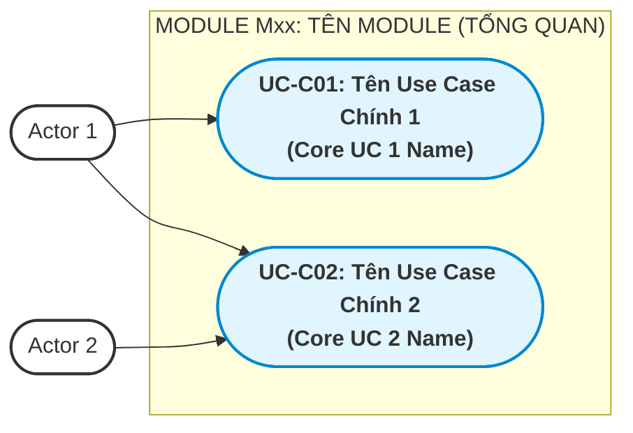
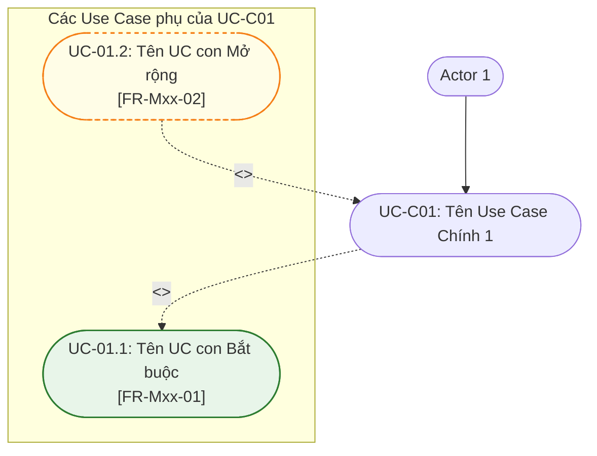
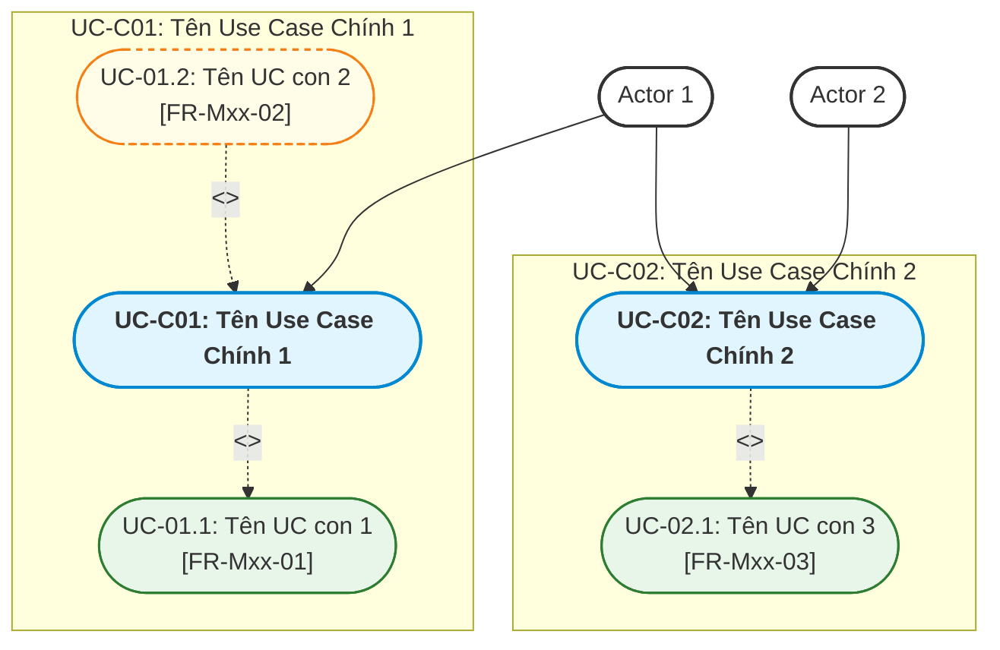

# Tài liệu Đặc tả Use Case — {{MODULE_CODE}}: {{MODULE_NAME}} (US-{{MODULE_CODE}})

| Thuộc tính | Nội dung |
|---|---|
| **Mã tài liệu** | `US-{{MODULE_CODE}}` |
| **Dự án** | iShare — Nền tảng chia sẻ tri thức và hỏi đáp học sinh THPT |
| **Module** | {{MODULE_CODE}} — {{MODULE_NAME}} |
| **Tài liệu căn cứ (Nguồn)** | [`FR-{{MODULE_CODE}}.md`](file:///g:/documents/season9/iShare/docs/specs/fr/FR-{{MODULE_CODE}}.md) (Phiên bản {{FR_VERSION}} — Ngày {{FR_DATE}}) |
| **Mốc register căn cứ** | {{REGISTER_REFS}} |
| **Người thực hiện** | Antigravity Engine (Tổng hợp & Phân rã theo yêu cầu BA) |
| **Ngày lập** | {{DATE}} |
| **Trạng thái** | Đang thực hiện |

---

## 1. Bảng Tổng hợp các Chức năng con trong {{MODULE_CODE}}

Căn cứ theo mục 4.4 và mục 5 trong tài liệu [`FR-{{MODULE_CODE}}.md`](file:///g:/documents/season9/iShare/docs/specs/fr/FR-{{MODULE_CODE}}.md), module bao gồm {{N}} chức năng con với mô tả ngắn gọn như sau:

| STT | Mã chức năng | Tên chức năng con | Mô tả ngắn gọn phạm vi & nghiệp vụ |
|:---:|:---:|---|---|
| 1 | **FR-{{MODULE_CODE}}-01** | {{FUNCTION_NAME_1}} | {{SHORT_DESCRIPTION_1}} |
| 2 | **FR-{{MODULE_CODE}}-02** | {{FUNCTION_NAME_2}} | {{SHORT_DESCRIPTION_2}} |
| ... | ... | ... | ... |

---

## 2. Phân rã thành các Use Case Chính & Quy trình Nghiệp vụ Hoàn chỉnh

### 2.1 Tiêu chí phân rã Use Case Chính
- **Đủ lớn & Độc lập:** Đại diện cho một mục tiêu nghiệp vụ trọn vẹn của người dùng (User Goal) hoặc của hệ thống.
- **Có tương tác giao diện trực tiếp:** Bắt đầu bằng một hành động chủ động của Actor trên giao diện (UI) và kết thúc khi đạt được kết quả mong đợi.
- **Bao hàm các chức năng con:** Chứa đựng các bước thực hiện mang tính nghiệp vụ bắt buộc hoặc tùy chọn mở rộng.

Từ {{N}} chức năng con, module được phân rã thành **{{M}} Use Case Chính** sau:
1. **UC-C01: {{UC1_NAME_VI}} ({{UC1_NAME_EN}})**
2. **UC-C02: {{UC2_NAME_VI}} ({{UC2_NAME_EN}})**
<!-- Thêm các UC Chính khác nếu có -->

---

### 2.2 Sơ đồ Use Case Tổng quan của Module {{MODULE_CODE}} (Macro Use Case Diagram)

---

### 2.3 Mô tả Quy trình Nghiệp vụ Hoàn chỉnh của từng Use Case Chính

#### 1. UC-C01: {{UC1_NAME_VI}} ({{UC1_NAME_EN}})
- **Actor chính:** `{{ACTOR_1}}`.
- **Mục tiêu:** {{GOAL_DESCRIPTION_1}}.
- **Quy trình nghiệp vụ hoàn chỉnh:**
  1. *Khởi đầu:* {{STEP_1_START}}
  2. *Thực hiện & Kiểm tra:* {{STEP_1_EXECUTION}}
  3. *Kết thúc:* {{STEP_1_END}}

#### 2. UC-C02: {{UC2_NAME_VI}} ({{UC2_NAME_EN}})
- **Actor chính:** `{{ACTOR_2}}`.
- **Mục tiêu:** {{GOAL_DESCRIPTION_2}}.
- **Quy trình nghiệp vụ hoàn chỉnh:**
  1. *Khởi đầu:* {{STEP_2_START}}
  2. *Thực hiện & Kiểm tra:* {{STEP_2_EXECUTION}}
  3. *Kết thúc:* {{STEP_2_END}}

<!-- Tiếp tục mô tả cho các UC Chính tiếp theo -->

---

## 3. Xác định Use Case con Chi tiết và Mối quan hệ với Use Case Chính

Phần này phân tích chi tiết quan hệ giữa các Use Case Chính và các Use Case con theo đúng 2 loại quan hệ chuẩn UML:
- **`<<include>>` (Bắt buộc):** Bước nghiệp vụ tiên quyết, bắt buộc phải có để Use Case chính thành công.
- **`<<extend>>` (Tùy chọn / Rẽ nhánh):** Bước mở rộng, phương thức thay thế hoặc nhánh ngoại lệ có thể có hoặc không.

---

### 3.1 Phân rã UC-C01: {{UC1_NAME_VI}}

#### Bảng chi tiết quan hệ, điều kiện & lý do nghiệp vụ (UC-C01):
| Mã Use Case con | Tên Use Case con | Căn cứ FR/BR | Quan hệ | Điều kiện kích hoạt & Lý do nghiệp vụ |
|---|---|:---:|:---:|---|
| **UC-01.1** | {{INC_SUB_UC_NAME}} | FR-{{MODULE_CODE}}-01 | `<<include>>` | **Bắt buộc:** {{REASON_MANDATORY}} |
| **UC-01.2** | {{EXT_SUB_UC_NAME}} | FR-{{MODULE_CODE}}-02 | `<<extend>>` | **{{EXTENSION_TYPE}}:** {{REASON_CONDITIONAL}} |

---

### 3.2 Phân rã UC-C02: {{UC2_NAME_VI}}

<!-- Lặp lại cấu trúc sơ đồ và bảng quan hệ chi tiết cho UC-C02 và các UC Chính tiếp theo -->

---

## 4. Bảng Tổng kết Ánh xạ & Sơ đồ Use Case Chi tiết Toàn Module

### 4.1 Ma trận Truy vết Toàn bộ Chức năng (FR → UC)

| Mã FR | Tên chức năng con | UC Chính liên quan | UC con tương ứng | Vai trò quan hệ |
|:---:|---|:---:|:---:|:---:|
| **FR-{{MODULE_CODE}}-01** | {{FUNCTION_NAME_1}} | UC-C01 | UC-01.1 | `<<include>>` (Bắt buộc) |
| **FR-{{MODULE_CODE}}-02** | {{FUNCTION_NAME_2}} | UC-C01 | UC-01.2 | `<<extend>>` (Tùy chọn) |
| ... | ... | ... | ... | ... |

---

### 4.2 Sơ đồ Use Case Chi tiết Toàn Module

