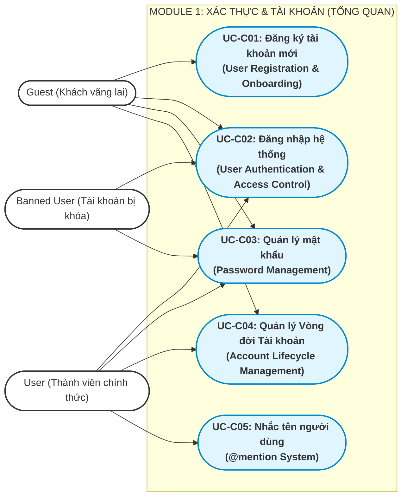
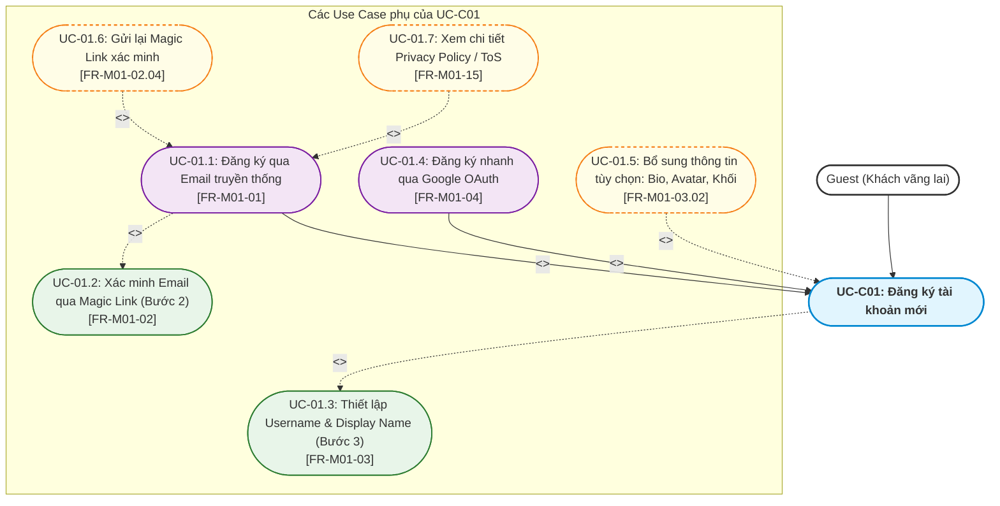
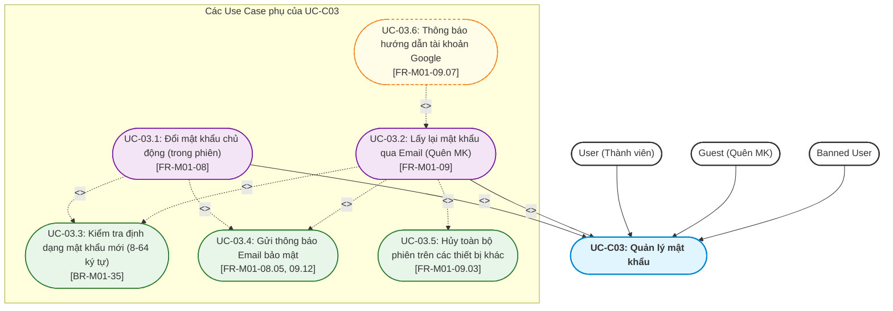
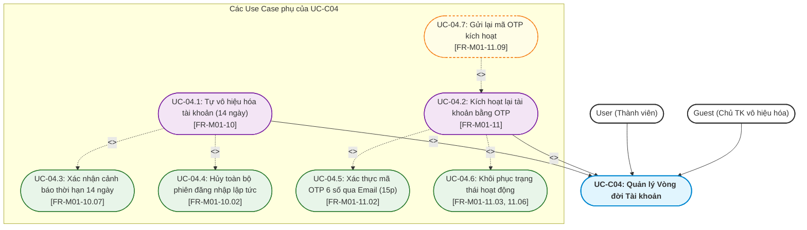
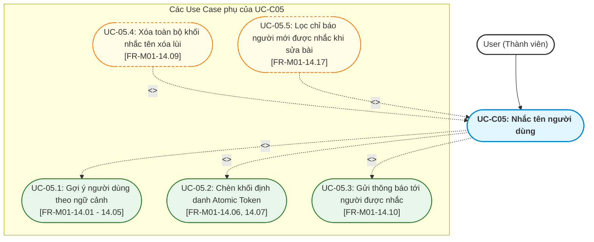

# Tài liệu Đặc tả Use Case — M01: Authentication & Account (US-M01)

| Thuộc tính | Nội dung |
|---|---|
| **Mã tài liệu** | `US-M01` |
| **Dự án** | iShare — Nền tảng chia sẻ tri thức và hỏi đáp học sinh THPT |
| **Module** | M01 — Authentication & Account (Xác thực và Tài khoản) |
| **Tài liệu căn cứ (Nguồn)** | [`FR-M01.md`](file:///g:/documents/season9/iShare/docs/specs/fr/FR-M01.md) (Phiên bản 1.10 — Ngày 2026-10-24) |
| **Mốc register căn cứ** | DEC-271, QA-477, ISS-415, OPEN-012 |
| **Người thực hiện** | Antigravity Engine (Tổng hợp & Phân rã theo chuẩn BA iShare) |
| **Ngày lập** | 2026-10-27 |
| **Trạng thái** | Hoàn thành |

---

## 1. Bảng Tổng hợp các Chức năng con trong Module 1

Căn cứ theo mục 4.4 và mục 5 trong tài liệu [`FR-M01.md`](file:///g:/documents/season9/iShare/docs/specs/fr/FR-M01.md), Module 1 bao gồm 16 chức năng con với mô tả ngắn gọn như sau:

| STT | Mã chức năng | Tên chức năng con | Mô tả ngắn gọn phạm vi & nghiệp vụ |
|:---:|:---:|---|---|
| 1 | **FR-M01-01** | Đăng ký tài khoản bằng email | Cho phép Guest tạo tài khoản qua Bước 1 (nhập email, mật khẩu 8–64 ký tự, tích cam kết ToS/độ tuổi dưới 16); khởi tạo tài khoản ở trạng thái `ACTIVE`, mức xác minh `NONE`, vai trò `USER`. |
| 2 | **FR-M01-02** | Xác minh email | Gửi Magic Link xác minh có thời hạn 1 giờ tới email đăng ký; mở link thành công nâng mức xác minh lên `EMAIL_VERIFIED`; cho phép gửi lại link (cách nhau tối thiểu 60s). |
| 3 | **FR-M01-03** | Thiết lập tài khoản (Bước 3) | Cho phép chủ tài khoản đã xác minh email thiết lập `username` (duy nhất, 3–20 ký tự), `display_name` (1–50 ký tự), tùy chọn nhập hoặc bỏ qua Bio, Khối lớp, Avatar; nâng mức lên `SETUP_COMPLETED`. |
| 4 | **FR-M01-04** | Đăng ký, đăng nhập bằng Google | Đăng nhập Google OAuth lần đầu tạo tài khoản `EMAIL_VERIFIED` (bỏ qua bước 1 và 2); nếu trùng email tài khoản sẵn có thì tự động liên kết tài khoản và gửi thông báo. |
| 5 | **FR-M01-05** | Đăng nhập bằng email và mật khẩu | Xác thực tài khoản; điều hướng qua Cổng đăng nhập (Login Gate) theo trạng thái (`account_state`) và mức xác minh (`verify_level`); xử lý cô lập tài khoản `BANNED` tại Màn hình khóa. |
| 6 | **FR-M01-06** | Duy trì phiên đăng nhập | Cơ chế Token kép JWT: Phiên truy cập (Access Token 1h), Phiên làm mới (Refresh Token 30d); xoay vòng Refresh Token sau mỗi lần dùng; hỗ trợ đa thiết bị độc lập. |
| 7 | **FR-M01-07** | Đăng xuất | Chấm dứt phiên đăng nhập trên thiết bị hiện tại, giữ nguyên phiên làm việc trên các thiết bị khác của người dùng. |
| 8 | **FR-M01-08** | Đổi mật khẩu | Cho phép người dùng đang đăng nhập đổi mật khẩu (yêu cầu mật khẩu cũ đúng, mật khẩu mới khác mật khẩu cũ); giữ nguyên phiên các thiết bị khác; gửi mail/thông báo bảo mật. |
| 9 | **FR-M01-09** | Lấy lại mật khẩu | Cho phép người quên mật khẩu nhận Magic Link qua email (hạn 15 phút); đặt lại thành công sẽ tự động hủy toàn bộ phiên trên các thiết bị khác; hiển thị thông báo chung chống dò email. |
| 10 | **FR-M01-10** | Vô hiệu hóa tài khoản | Chủ tài khoản tự đưa tài khoản sang `DEACTIVATED`; là con đường duy nhất để xóa tài khoản; hủy toàn bộ phiên ngay lập tức; bắt đầu kích hoạt đồng hồ đếm ngược 14 ngày. |
| 11 | **FR-M01-11** | Kích hoạt lại tài khoản | Chủ tài khoản `DEACTIVATED` vào trang kích hoạt riêng nhập email $\to$ nhận mã OTP 6 số qua email (hạn 15 phút, sai tối đa 5 lần) để khôi phục tài khoản về `ACTIVE` và tự đăng nhập. |
| 12 | **FR-M01-12** | Tự xóa tài khoản hết hạn vô hiệu hóa | Tiến trình ngầm tự động chuyển tài khoản sang `DELETED` sau 14 ngày (gửi mail cảnh báo trước 24h); xóa toàn bộ PII, giải phóng email đăng ký, **khóa vĩnh viễn username**. |
| 13 | **FR-M01-13** | Hiển thị nội dung của tài khoản vô hiệu hóa / đã xóa | Ẩn bài viết; bình luận giữ nguyên nội dung với tên tác giả thay thế: *"Tài khoản tạm thời vô hiệu hoá"* (`DEACTIVATED`) hoặc *"[Người dùng đã xóa]"* (`DELETED`). |
| 14 | **FR-M01-14** | Nhắc tên người dùng (`@mention`) | Gõ `@` + 1 ký tự (debounce 300ms) $\to$ Tìm kiếm mờ không dấu trên cả `display_name` và `username`, xếp hạng ưu tiên 3 tầng $\to$ Chèn Atomic Token $\to$ Bắn thông báo khi nội dung công khai. |
| 15 | **FR-M01-15** | Xem trang Privacy Policy/ToS | Cung cấp trang tĩnh công khai trình bày 4 nhóm dữ liệu thu thập, minh bạch việc xử lý dữ liệu của dịch vụ AI bên thứ ba, cam kết không bán dữ liệu cá nhân. |
| 16 | **FR-M01-16** | Đồng ý lại khi chính sách đổi | Bắt buộc người dùng mở ứng dụng phải xác nhận đồng ý lại khi hệ thống cập nhật phiên bản chính sách mới (`policy_version`); nếu từ chối chỉ được Đăng xuất hoặc Vô hiệu hóa. |

---

## 2. Phân rã thành các Use Case Chính & Quy trình Nghiệp vụ Hoàn chỉnh

### 2.1 Tiêu chí phân rã Use Case Chính
- **Đủ lớn & Độc lập:** Đại diện cho một mục tiêu nghiệp vụ trọn vẹn của người dùng (User Goal) hoặc của hệ thống.
- **Có tương tác giao diện trực tiếp:** Bắt đầu bằng một hành động chủ động của Actor trên giao diện (UI) và kết thúc khi đạt được kết quả mong đợi.
- **Bao hàm các chức năng con:** Chứa đựng các bước thực hiện mang tính nghiệp vụ bắt buộc hoặc tùy chọn mở rộng.

Từ 16 chức năng con, Module 1 được phân rã thành **5 Use Case Chính** sau:
1. **UC-C01: Đăng ký tài khoản mới (User Registration & Onboarding)**
2. **UC-C02: Đăng nhập hệ thống (User Authentication & Access Control)**
3. **UC-C03: Quản lý mật khẩu (Password Management)**
4. **UC-C04: Quản lý Vòng đời Tài khoản (Account Lifecycle Management)**
5. **UC-C05: Nhắc tên người dùng trong nội dung (`@mention` System)**

---

### 2.2 Sơ đồ Use Case Tổng quan của Module 1 (Macro Use Case Diagram)

---

### 2.3 Mô tả Quy trình Nghiệp vụ Hoàn chỉnh của từng Use Case Chính

#### 1. UC-C01: Đăng ký tài khoản mới (User Registration & Onboarding) — [Kiểu A: Quy trình tuần tự kết hợp chuyên biệt hóa]
- **Actor chính:** `Guest` (Khách vãng lai).
- **Mục tiêu:** Chuyển đổi một người dùng chưa có tài khoản thành thành viên chính thức (`ACTIVE`, `SETUP_COMPLETED`) sẵn sàng tham gia cộng đồng.
- **Quy trình nghiệp vụ hoàn chỉnh:**
  1. *Khởi đầu:* Guest truy cập trang Đăng ký, lựa chọn 1 trong 2 phương thức đăng ký chuyên biệt:
     - **Dạng 1 (Đăng ký bằng Email truyền thống):** Nhập email, mật khẩu (8–64 ký tự) và tích chọn ô cam kết Điều khoản & Quyền riêng tư (chứa cam kết người dưới 16 tuổi). Hệ thống xác thực $\to$ Tạo tài khoản ở trạng thái `ACTIVE`, mức `NONE` và gửi Magic Link xác thực có hạn 1 giờ tới hòm thư.
     - **Dạng 2 (Đăng ký nhanh qua Google OAuth):** Xác thực tài khoản qua Google $\to$ Hệ thống tạo tài khoản `ACTIVE`, mức `EMAIL_VERIFIED` (bỏ qua bước 1 và 2).
  2. *Xác minh Email (Chỉ áp dụng luồng Email):* Guest mở hòm thư, nhấn Magic Link (hạn 1 giờ) $\to$ Hệ thống nâng mức xác minh lên `EMAIL_VERIFIED` và chuyển hướng tới Bước 3. Cho phép gửi lại link xác minh nếu link cũ hết hạn (cách nhau tối thiểu 60s).
  3. *Định danh & Hoàn tất thiết lập (Bước 3 - Bắt buộc cho cả 2 luồng):* Người dùng bắt buộc đặt `username` (duy nhất, không đổi, 3–20 ký tự) và `display_name` (1–50 ký tự); có thể tùy chọn nhập hoặc bấm "Bỏ qua" các trường Bio, Khối lớp, Avatar.
  4. *Kết thúc:* Hệ thống lưu hồ sơ, nâng mức xác minh lên `SETUP_COMPLETED`, tự động cấp phiên làm việc JWT kép và đưa người dùng vào trang chủ iShare.

---

#### 2. UC-C02: Đăng nhập hệ thống (User Authentication & Access Control) — [Kiểu A: Quy trình tuần tự điều phối Cổng kiểm soát]
- **Actor chính:** `Guest` (Đăng nhập thông thường), `User` (Đăng xuất hoặc chuyển tài khoản), `Banned User` (Đăng nhập vào màn hình khóa vi phạm).
- **Mục tiêu:** Xác thực danh tính người dùng và điều phối quyền truy cập an toàn qua Cổng kiểm soát (Login Gate).
- **Quy trình nghiệp vụ hoàn chỉnh:**
  1. *Khởi đầu:* Người dùng chọn 1 trong 2 phương thức xác thực chuyên biệt: nhập Email + Mật khẩu hoặc nhấn nút Đăng nhập bằng Google.
  2. *Kiểm tra thông tin:* Hệ thống xác thực danh tính. Nếu email Google trùng với tài khoản email sẵn có, tự động liên kết tài khoản và gửi email thông báo.
  3. *Kiểm tra qua Cổng đăng nhập (Login Gate):*
     - Nếu tài khoản `DELETED`: Từ chối đăng nhập (Báo tài khoản không tồn tại).
     - Nếu tài khoản `DEACTIVATED`: Từ chối đăng nhập (Không tự kích hoạt lại; hiển thị hướng dẫn sang trang kích hoạt bằng OTP).
     - Nếu tài khoản `BANNED`: Cấp phiên đăng nhập hạn chế và **chỉ hiển thị duy nhất Màn hình tài khoản bị khóa** (thấy lý do ban, nút Đăng xuất, và nút nộp đơn Khiếu nại sang M09 nếu còn trong hạn 14 ngày).
     - Nếu tài khoản `ACTIVE`: Kiểm tra mức xác minh (`verify_level`). Nếu chưa xong Bước 2 hoặc Bước 3 $\to$ Tự động điều hướng về đúng bước còn dở; nếu đã là `SETUP_COMPLETED` $\to$ Cấp phiên đăng nhập hoàn chỉnh.
  4. *Kiểm tra phiên bản chính sách:* Nếu hệ thống vừa cập nhật `policy_version` mới, chặn bằng màn hình yêu cầu đồng ý lại (Re-consent) trước khi vào trang chủ (từ chối chỉ được Đăng xuất hoặc Vô hiệu hóa).
  5. *Kết thúc:* Người dùng vào phiên làm việc hợp lệ hoặc bị cô lập tại màn hình xử phạt đúng quy định. Khi hoàn tất phiên làm việc, người dùng có thể chủ động Đăng xuất để chấm dứt phiên trên thiết bị hiện tại.

---

#### 3. UC-C03: Quản lý mật khẩu (Password Management) — [Kiểu B: Quy trình phân nhánh song song]
- **Actor chính:** `User` (Đổi mật khẩu chủ động), `Guest` / `Banned User` (Quên mật khẩu ngoài màn hình đăng nhập).
- **Mục tiêu:** Giúp người dùng chủ động bảo vệ an toàn tài khoản hoặc khôi phục quyền truy cập khi không thể đăng nhập.
- **Quy trình nghiệp vụ hoàn chỉnh:**
  - *Nhánh 1 — Đổi mật khẩu chủ động (User trong phiên):*
    1. User truy cập Cài đặt tài khoản $\to$ Nhập mật khẩu cũ, mật khẩu mới (8–64 ký tự) và xác nhận lại mật khẩu mới.
    2. Hệ thống kiểm tra: Mật khẩu cũ phải chính xác, mật khẩu mới phải khác mật khẩu cũ.
    3. Cập nhật mật khẩu trong CSDL, giữ nguyên phiên làm việc trên các thiết bị khác và gửi email cảnh báo bảo mật tới hòm thư người dùng.
  - *Nhánh 2 — Lấy lại mật khẩu qua Email (Quên mật khẩu):*
    1. Người dùng tại màn hình Đăng nhập bấm liên kết "Quên mật khẩu" $\to$ Nhập địa chỉ email.
    2. Hệ thống kiểm tra: Nếu email thuộc tài khoản tạo bằng Google (không có mật khẩu), hiển thị thông báo hướng dẫn dùng nút Google, không gửi link. Với email thông thường, hệ thống luôn hiển thị thông báo chung (chống dò email) và gửi Magic Link đặt lại mật khẩu (hạn ngắn 15 phút) về hòm thư.
    3. Người dùng mở Magic Link $\to$ Nhập mật khẩu mới hợp lệ (8–64 ký tự).
    4. Hệ thống cập nhật mật khẩu, **hủy ngay lập tức toàn bộ phiên làm việc trên các thiết bị khác** (bảo vệ tài khoản khẩn cấp), cấp phiên mới cho thiết bị hiện tại và gửi email thông báo.

---

#### 4. UC-C04: Quản lý Vòng đời Tài khoản (Account Lifecycle Management) — [Kiểu B: Quy trình phân nhánh song song]
- **Actor chính:** `User` (Chủ động vô hiệu hóa), `Guest` (Chủ tài khoản kích hoạt lại trong thời hạn ân hạn).
- **Mục tiêu:** Thực thi quyền riêng tư và quyền được lãng quên (Right to be Forgotten) thông qua cơ chế ân hạn 14 ngày trước khi xóa vĩnh viễn dữ liệu cá nhân.
- **Quy trình nghiệp vụ hoàn chỉnh:**
  - *Nhánh 1 — Tự vô hiệu hóa tài khoản (User):*
    1. User vào Cài đặt chọn "Vô hiệu hóa tài khoản" $\to$ Đọc kỹ thông điệp cảnh báo thời hạn 14 ngày.
    2. Người dùng nhập mật khẩu xác nhận (hoặc xác thực qua Google nếu là tài khoản Google).
    3. Hệ thống chuyển trạng thái sang `DEACTIVATED`, lập tức thu hồi toàn bộ phiên đăng nhập trên mọi thiết bị, kích hoạt đồng hồ đếm ngược $14 \times 24$ giờ, ẩn toàn bộ bài viết và thay thế tên tác giả trên các bình luận công khai.
  - *Nhánh 2 — Kích hoạt lại tài khoản bằng OTP (Chủ tài khoản):*
    1. Trong thời hạn 14 ngày, chủ tài khoản truy cập Trang kích hoạt riêng biệt $\to$ Nhập địa chỉ email.
    2. Hệ thống gửi mã OTP 6 số qua email (thời hạn 15 phút, cho phép nhập sai tối đa 5 lần).
    3. Người dùng nhập đúng mã OTP (có nút gửi lại mã sau tối thiểu 60 giây).
    4. Hệ thống khôi phục trạng thái tài khoản về `ACTIVE`, hiển thị lại bài viết và bình luận dưới tên thật, tự động đăng nhập và đưa người dùng vào trang chủ.

---

#### 5. UC-C05: Nhắc tên người dùng trong nội dung (`@mention` System) — [Kiểu A: Quy trình tuần tự trong trình soạn thảo]
- **Actor chính:** `User` (Thành viên đang soạn thảo nội dung).
- **Mục tiêu:** Cho phép người dùng gắn thẻ định danh thành viên khác vào bài viết hoặc bình luận, tạo liên kết hồ sơ và bắn thông báo tương tác.
- **Quy trình nghiệp vụ hoàn chỉnh:**
  1. *Kích hoạt:* Trong trình soạn thảo (M03/M04), User gõ ký tự `@` kèm tối thiểu 1 ký tự và dừng gõ (debounce 300ms).
  2. *Truy vấn & Xếp hạng:* Hệ thống tự động tìm kiếm mờ không dấu trên cả `display_name` và `username`, tự động loại trừ các tài khoản bị ban/xóa/chưa hoàn tất hồ sơ, áp dụng bộ lọc ưu tiên 3 tầng ngữ cảnh (Đang Follow $\to$ Cùng Group $\to$ Khác), trả về tối đa 5 gợi ý phù hợp nhất.
  3. *Chèn định danh:* User nhấp chọn 1 thành viên $\to$ Hệ thống chèn vào văn bản một **khối liền (Atomic Token)** hiển thị theo `display_name` hiện tại, không chứa chữ `@`, không thể chỉnh sửa từng ký tự lẻ (chỉ có thể xóa toàn bộ khối bằng phím Backspace).
  4. *Kích hoạt thông báo:* Khi nội dung được xuất bản công khai, hệ thống tự động gửi thông báo In-app (M07) cho người được nhắc tên (khi sửa bài chỉ bắn thông báo cho những người mới được thêm vào).

---

## 3. Xác định Use Case con Chi tiết và Mối quan hệ với Use Case Chính

Phần này phân tích chi tiết quan hệ giữa 5 Use Case Chính và các Use Case con theo đúng 3 loại quan hệ chuẩn UML:
- **`<<include>>` (Bao hàm Bắt buộc):** Bước nghiệp vụ tiên quyết, bắt buộc phải có để Use Case chính hoàn thành. Thiếu nó quy trình không thể kết thúc. (Mũi tên nét đứt từ Chính sang Con: `UC_Chính -.->|"<<include>>"| UC_Con`).
- **`<<extend>>` (Mở rộng Tùy chọn / Rẽ nhánh / Ngoại lệ):** Bước mở rộng, phương thức tùy chọn bổ sung, nhánh ngoại lệ hoặc nhánh nghiệp vụ song song. Use Case chính vẫn có thể hoàn tất độc lập mà không cần Use Case con này. (Mũi tên nét đứt từ Con sang Chính: `UC_Con -.->|"<<extend>>"| UC_Chính`).
- **`Generalization` (Kế thừa / Khái quát hóa / Quan hệ Cha - Con):** Use Case con là một dạng chuyên biệt hóa cụ thể của Use Case cha tổng quát (*is-a-kind-of*). Use Case con kế thừa toàn bộ mục tiêu và quy tắc cơ bản của cha, đồng thời chuyên biệt hóa cơ chế thực hiện hoặc nguồn dữ liệu xác thực. (Mũi tên nét liền từ Con chuyên biệt về Cha tổng quát: `UC_Con -->|"<<generalization>>"| UC_Cha`).

---

### 3.1 Phân rã UC-C01: Đăng ký tài khoản mới

#### Bảng chi tiết quan hệ, điều kiện & lý do nghiệp vụ (UC-C01):
| Mã Use Case con | Tên Use Case con | Căn cứ FR/BR | Quan hệ | Điều kiện kích hoạt & Lý do nghiệp vụ |
|---|---|:---:|:---:|---|
| **UC-01.1** | Đăng ký qua Email truyền thống | FR-M01-01 BR-M01-02 | Generalization | **Kế thừa (Chuyên biệt hóa):** Là phương thức đăng ký tài khoản truyền thống bằng email và mật khẩu (8–64 ký tự), tích cam kết ToS/độ tuổi; khởi tạo bản ghi `ACTIVE` với `verify_level = NONE`. |
| **UC-01.4** | Đăng ký nhanh qua Google OAuth | FR-M01-04 BR-M01-08 | Generalization | **Kế thừa (Chuyên biệt hóa):** Là phương thức đăng ký tài khoản nhanh qua Google OAuth; tự động bỏ qua Bước 1 và 2 (do email đã được Google xác thực), tạo ngay tài khoản `ACTIVE` mức `EMAIL_VERIFIED` và chuyển thẳng vào Bước 3 đặt `username`. |
| **UC-01.2** | Xác minh Email qua Magic Link (Bước 2) | FR-M01-02 BR-M01-10 | `<<include>>` *(trong luồng Email)* | **Bắt buộc riêng cho luồng Email:** Luồng đăng ký bằng email bắt buộc phải xác thực quyền sở hữu hòm thư qua Magic Link để nâng mức xác minh từ `NONE` lên `EMAIL_VERIFIED` trước khi sang Bước 3 (FR-M01-02.01). Luồng Google OAuth được hệ thống tự động hoàn tất và bỏ qua bước này (FR-M01-04.01). |
| **UC-01.3** | Thiết lập Username & Display Name (Bước 3) | FR-M01-03 BR-M01-05 | `<<include>>` *(chung cả 2 luồng)* | **Bắt buộc chung:** Cả hai phương thức đăng ký đều bắt buộc người dùng phải đặt định danh `username` duy nhất và `display_name` để hoàn tất đăng ký và nâng lên `SETUP_COMPLETED` (FR-M01-03.01). |
| **UC-01.5** | Bổ sung thông tin tùy chọn (Bio, Avatar, Lớp) | FR-M01-03.02 FR-M01-03.03 | `<<extend>>` | **Tùy chọn:** Tại Bước 3 (áp dụng cho cả 2 luồng), người dùng có thể nhập các trường này hoặc bấm "Bỏ qua" mà không ảnh hưởng tới tiến trình hoàn tất đăng ký. |
| **UC-01.6** | Gửi lại Magic Link xác minh | FR-M01-02.04 BR-M01-11 | `<<extend>>` *(trong luồng Email)* | **Rẽ nhánh ngoại lệ của luồng Email:** Kích hoạt khi Magic Link cũ quá 1 giờ bị hết hạn hoặc thất lạc; phải cách lần gửi trước tối thiểu 60 giây (FR-M01-02.05). |
| **UC-01.7** | Xem chi tiết Privacy Policy / ToS | FR-M01-15 BR-M01-03 | `<<extend>>` *(trong luồng Email)* | **Tùy chọn:** Người dùng có thể nhấp vào liên kết để đọc toàn văn chính sách bảo mật trước khi tích ô cam kết tại Bước 1 của luồng đăng ký bằng email (FR-M01-01.04). |

---

### 3.2 Phân rã UC-C02: Đăng nhập hệ thống

```mermaid
flowchart TB
    Guest(["Guest (Khách vãng lai)"]) --> UC_C02(["UC-C02: Đăng nhập hệ thống"])
    User(["User (Thành viên)"]) --> UC_C02
    BannedUser(["Banned User"]) --> UC_C02

    subgraph Sub_UCC02 ["Các Use Case phụ của UC-C02"]
        direction TB
        %% Kế thừa / Cha - Con (Generalization)
        GEN_CRED_LOGIN(["UC-02.1: Đăng nhập bằng Email & Mật khẩu<br/>[FR-M01-05.01]"])
        GEN_GOOGLE_LOGIN(["UC-02.3: Đăng nhập bằng Google OAuth<br/>[FR-M01-04.06]"])

        %% Bắt buộc (Include)
        INC_GATE(["UC-02.2: Kiểm tra qua Cổng đăng nhập (Login Gate)<br/>[BR-M01-18]"])

        %% Tùy chọn / Mở rộng (Extend)
        EXT_AUTOLINK(["UC-02.4: Tự động liên kết tài khoản Google<br/>[FR-M01-04.04]"])
        EXT_RESUME(["UC-02.5: Điều hướng hoàn tất đăng ký còn dở<br/>[FR-M01-05.10, 05.11]"])
        EXT_BANSCREEN(["UC-02.6: Hiển thị Màn hình tài khoản bị khóa<br/>[FR-M01-05.05, 05.07]"])
        EXT_RECONSENT(["UC-02.7: Chấp thuận lại điều khoản chính sách<br/>[FR-M01-16]"])
        EXT_LOGOUT(["UC-02.8: Đăng xuất khỏi thiết bị hiện tại<br/>[FR-M01-07]"])
    end

    %% Quan hệ Generalization
    GEN_CRED_LOGIN -->|"<<generalization>>"| UC_C02
    GEN_GOOGLE_LOGIN -->|"<<generalization>>"| UC_C02

    %% Quan hệ Include
    UC_C02 -.->|"<<include>>"| INC_GATE

    %% Quan hệ Extend
    EXT_AUTOLINK -.->|"<<extend>>"| UC_C02
    EXT_RESUME -.->|"<<extend>>"| UC_C02
    EXT_BANSCREEN -.->|"<<extend>>"| UC_C02
    EXT_RECONSENT -.->|"<<extend>>"| UC_C02
    EXT_LOGOUT -.->|"<<extend>>"| UC_C02

    classDef actorStyle fill:#ffffff,stroke:#333333,stroke-width:2px;
    classDef coreUC fill:#e1f5fe,stroke:#0288d1,stroke-width:2px,font-weight:bold;
    classDef incStyle fill:#e8f5e9,stroke:#2e7d32,stroke-width:1.5px;
    classDef extStyle fill:#fffde7,stroke:#f57f17,stroke-width:1.5px,stroke-dasharray: 4 4;
    classDef genStyle fill:#f3e5f5,stroke:#7b1fa2,stroke-width:1.5px;

    class Guest,User,BannedUser actorStyle;
    class UC_C02 coreUC;
    class GEN_CRED_LOGIN,GEN_GOOGLE_LOGIN genStyle;
    class INC_GATE incStyle;
    class EXT_AUTOLINK,EXT_RESUME,EXT_BANSCREEN,EXT_RECONSENT,EXT_LOGOUT extStyle;
```

#### Bảng chi tiết quan hệ, điều kiện & lý do nghiệp vụ (UC-C02):
| Mã Use Case con | Tên Use Case con | Căn cứ FR/BR | Quan hệ | Điều kiện kích hoạt & Lý do nghiệp vụ |
|---|---|:---:|:---:|---|
| **UC-02.1** | Đăng nhập bằng Email & Mật khẩu | FR-M01-05.01 | Generalization | **Kế thừa (Chuyên biệt hóa):** Phương thức xác thực người dùng truyền thống thông qua cặp thông tin nhận dạng email và mật khẩu trong cơ sở dữ liệu. |
| **UC-02.3** | Đăng nhập bằng Google OAuth | FR-M01-04.06 | Generalization | **Kế thừa (Chuyên biệt hóa):** Phương thức xác thực ủy quyền trực tiếp thông qua Google Identity Services, không yêu cầu người dùng nhớ mật khẩu trên iShare. |
| **UC-02.2** | Kiểm tra qua Cổng đăng nhập (Login Gate) | FR-M01-05.01 BR-M01-18 | `<<include>>` | **Bắt buộc:** Mọi phương thức đăng nhập bắt buộc phải chạy qua cổng điều phối kiểm tra thứ tự: xét `account_state` trước $\to$ xét `verify_level` sau để quyết định cho vào, từ chối hay cô lập. |
| **UC-02.4** | Tự động liên kết tài khoản Google | FR-M01-04.04 BR-M01-09 | `<<extend>>` | **Rẽ nhánh điều kiện:** Tự động kích hoạt khi email Google đăng nhập trùng khớp với email của tài khoản sẵn có (tự động gắn kết nối và gửi thông báo). |
| **UC-02.5** | Điều hướng hoàn tất đăng ký còn dở | FR-M01-05.10 FR-M01-05.11 | `<<extend>>` | **Rẽ nhánh điều kiện:** Kích hoạt nếu tài khoản `ACTIVE` nhưng chưa xong bước 2 (đưa về Bước 2) hoặc chưa xong bước 3 (đưa về Bước 3). |
| **UC-02.6** | Hiển thị Màn hình tài khoản bị khóa | FR-M01-05.05 BR-M01-19 | `<<extend>>` | **Rẽ nhánh ngoại lệ:** Kích hoạt khi tài khoản ở trạng thái `BANNED`. Vẫn cấp phiên đăng nhập nhưng cô lập tuyệt đối tại màn hình khóa để xem lý do và gửi khiếu nại (M09). |
| **UC-02.7** | Bắt buộc Đồng ý lại Chính sách mới | FR-M01-16.01 BR-M01-44 | `<<extend>>` | **Rẽ nhánh điều kiện:** Kích hoạt tại thời điểm mở app nếu hệ thống đã cập nhật `policy_version` mới. Bắt buộc đồng ý mới được tiếp tục sử dụng. |
| **UC-02.8** | Đăng xuất khỏi thiết bị hiện tại | FR-M01-07.01 BR-M01-16 | `<<extend>>` | **Mở rộng tương tác:** Cho phép User chủ động chấm dứt phiên làm việc trên thiết bị hiện tại (thu hồi Token), giữ nguyên các phiên trên thiết bị khác. |

---

### 3.3 Phân rã UC-C03: Quản lý mật khẩu

#### Bảng chi tiết quan hệ, điều kiện & lý do nghiệp vụ (UC-C03):
| Mã Use Case con | Tên Use Case con | Căn cứ FR/BR | Quan hệ | Điều kiện kích hoạt & Lý do nghiệp vụ |
|---|---|:---:|:---:|---|
| **UC-03.1** | Đổi mật khẩu chủ động | FR-M01-08 BR-M01-14 | Generalization | **Kế thừa (Chuyên biệt hóa):** Hành trình thay đổi mật khẩu định kỳ của `User` đang trong phiên làm việc hợp lệ; yêu cầu xác nhận mật khẩu cũ trước khi thiết lập mật khẩu mới. |
| **UC-03.2** | Lấy lại mật khẩu qua Email (Quên MK) | FR-M01-09 BR-M01-12 | Generalization | **Kế thừa (Chuyên biệt hóa):** Hành trình khôi phục quyền truy cập khẩn cấp của `Guest` hoặc `Banned User` ngoài màn hình đăng nhập thông qua Magic Link gửi về hòm thư (hạn 15 phút). |
| **UC-03.3** | Nhập & Validate Mật khẩu mới | BR-M01-35 | `<<include>>` | **Bắt buộc:** Cả hai nhánh đổi mật khẩu hay đặt lại mật khẩu đều bắt buộc phải nhập mật khẩu mới dài 8–64 ký tự và khác mật khẩu hiện tại. |
| **UC-03.4** | Gửi thông báo Email bảo mật | FR-M01-08.05 FR-M01-09.12 | `<<include>>` | **Bắt buộc:** Bất kỳ thao tác thay đổi mật khẩu thành công nào cũng bắt buộc kích hoạt gửi email cảnh báo bảo mật cho chủ tài khoản. |
| **UC-03.5** | Hủy toàn bộ phiên trên các thiết bị khác | FR-M01-09.03 BR-M01-13 | `<<include>>` *(trong Quên MK)* | **Bắt buộc khi Quên MK:** Quên mật khẩu là sự kiện có nguy cơ lộ lọt tài khoản, hệ thống bắt buộc chấm dứt phiên trên mọi thiết bị khác để cô lập an toàn. |
| **UC-03.6** | Thông báo hướng dẫn tài khoản Google | FR-M01-09.07 BR-M01-15 | `<<extend>>` | **Rẽ nhánh ngoại lệ:** Nếu tài khoản tạo bằng Google nhấn "Quên mật khẩu", hệ thống thông báo dùng nút Google, không gửi link đặt lại. |

---

### 3.4 Phân rã UC-C04: Quản lý Vòng đời Tài khoản

#### Bảng chi tiết quan hệ, điều kiện & lý do nghiệp vụ (UC-C04):
| Mã Use Case con | Tên Use Case con | Căn cứ FR/BR | Quan hệ | Điều kiện kích hoạt & Lý do nghiệp vụ |
|---|---|:---:|:---:|---|
| **UC-04.1** | Tự vô hiệu hóa tài khoản | FR-M01-10 BR-M01-20 | Generalization | **Kế thừa (Chuyên biệt hóa):** Hành trình `User` chủ động đưa tài khoản vào thời gian ân hạn $14 \times 24$ giờ; là con đường duy nhất để xóa tài khoản vĩnh viễn (hệ thống không có nút xóa trực tiếp). |
| **UC-04.2** | Kích hoạt lại tài khoản bằng OTP | FR-M01-11 BR-M01-22 | Generalization | **Kế thừa (Chuyên biệt hóa):** Hành trình `Guest` (chủ tài khoản `DEACTIVATED`) thực hiện tại Trang kích hoạt riêng để đưa tài khoản trở lại `ACTIVE` trong vòng 14 ngày. |
| **UC-04.3** | Xác nhận cảnh báo thời hạn 14 ngày | FR-M01-10.07 BR-M01-21 | `<<include>>` *(trong Vô hiệu hóa)* | **Bắt buộc:** Người dùng bắt buộc phải xác nhận hiểu rõ quy định: bài viết sẽ bị ẩn và tài khoản sẽ tự động xóa sau 14 ngày đếm ngược. |
| **UC-04.4** | Hủy toàn bộ phiên đăng nhập lập tức | FR-M01-10.02 | `<<include>>` *(trong Vô hiệu hóa)* | **Bắt buộc:** Ngay khi chuyển sang `DEACTIVATED`, hệ thống lập tức chấm dứt mọi phiên đăng nhập trên toàn bộ thiết bị. |
| **UC-04.5** | Xác thực mã OTP 6 số qua Email | FR-M01-11.02 BR-M01-22 | `<<include>>` *(trong Kích hoạt lại)* | **Bắt buộc:** Người dùng bắt buộc phải nhập đúng mã OTP 6 chữ số gửi về email (hạn 15 phút, sai tối đa 5 lần) để chứng minh quyền sở hữu hòm thư. |
| **UC-04.6** | Khôi phục ACTIVE & Tự động đăng nhập | FR-M01-11.03 FR-M01-11.06 | `<<include>>` *(trong Kích hoạt lại)* | **Bắt buộc:** Nhập đúng OTP $\to$ Hệ thống bắt buộc đưa tài khoản về `ACTIVE`, hiện lại bài viết/bình luận tên thật và cấp phiên đăng nhập ngay. |
| **UC-04.7** | Gửi lại mã OTP kích hoạt | FR-M01-11.09 | `<<extend>>` | **Tùy chọn:** Kích hoạt khi mã OTP cũ bị hết hạn hoặc thất lạc (phải cách lần trước tối thiểu 60 giây). |

---

### 3.5 Phân rã UC-C05: Nhắc tên người dùng trong nội dung (`@mention`)

#### Bảng chi tiết quan hệ, điều kiện & lý do nghiệp vụ (UC-C05):
| Mã Use Case con | Tên Use Case con | Căn cứ FR/BR | Quan hệ | Điều kiện kích hoạt & Lý do nghiệp vụ |
|---|---|:---:|:---:|---|
| **UC-05.1** | Tìm kiếm mờ & Gợi ý theo ngữ cảnh | FR-M01-14.01 - 05 BR-M01-26, 27 | `<<include>>` | **Bắt buộc:** Tự động kích hoạt khi gõ `@` kèm $\ge 1$ ký tự (debounce 300ms). Tìm kiếm mờ không dấu trên cả username và display_name, ưu tiên 3 tầng (Following $\to$ Cùng Group $\to$ Khác), tối đa 5 người. |
| **UC-05.2** | Chèn khối định danh Atomic Token | FR-M01-14.06 FR-M01-14.07 | `<<include>>` | **Bắt buộc:** Khi người dùng chọn 1 người từ danh sách, hệ thống bắt buộc chèn dưới dạng khối liền hiển thị `display_name` hiện tại, không chứa ký tự `@` và không cho sửa từng chữ. |
| **UC-05.3** | Gửi thông báo tới người được nhắc | FR-M01-14.10 BR-M01-30 | `<<include>>` | **Bắt buộc:** Khi nội dung được xuất bản công khai, hệ thống bắt buộc kích hoạt gửi thông báo In-app cho người được nhắc (kể cả khi họ đã tắt chuông bài viết). |
| **UC-05.4** | Xóa toàn bộ khối nhắc tên (xóa lùi) | FR-M01-14.09 BR-M01-29 | `<<extend>>` | **Mở rộng tương tác:** Nếu người dùng nhấn phím Backspace ở cuối khối token, hệ thống tự động xóa toàn bộ khối, không để lại chuỗi ký tự dở dang. |
| **UC-05.5** | Lọc chỉ báo người mới khi sửa bài | FR-M01-14.17 | `<<extend>>` | **Rẽ nhánh điều kiện:** Khi chỉnh sửa nội dung đã công khai từ trước, hệ thống chỉ kích hoạt gửi thông báo cho những người mới được nhắc thêm vào. |

---

## 4. Bảng Tổng kết Ánh xạ Toàn bộ Chức năng & Sơ đồ Use Case Chi tiết

### 4.1 Bảng Ma trận Ánh xạ Toàn bộ 16 Chức năng Con vào Hệ thống Use Case

| Mã FR | Tên chức năng con trong `FR-M01.md` | Thuộc Use Case Chính | Thuộc Use Case Phụ cụ thể | Vai trò quan hệ trong UC Chính |
|:---:|---|:---:|---|:---:|
| **FR-M01-01** | Đăng ký tài khoản bằng email | **UC-C01** | UC-01.1: Đăng ký qua Email truyền thống (Bước 1) | Generalization (Chuyên biệt hóa) |
| **FR-M01-02** | Xác minh email | **UC-C01** | UC-01.2: Xác minh Email qua Magic Link (Bước 2) UC-01.6: Gửi lại Magic Link xác minh | `<<include>>` (Bắt buộc luồng Email) `<<extend>>` (Rẽ nhánh ngoại lệ) |
| **FR-M01-03** | Thiết lập tài khoản | **UC-C01** | UC-01.3: Thiết lập Username & Display Name (Bước 3) UC-01.5: Bổ sung thông tin tùy chọn (Bio, Khối, Avatar) | `<<include>>` (Bắt buộc chung cả 2 luồng) `<<extend>>` (Tùy chọn) |
| **FR-M01-04** | Đăng ký, đăng nhập bằng Google | **UC-C01** **UC-C02** | UC-01.4: Đăng ký nhanh qua Google OAuth UC-02.3: Đăng nhập bằng Google OAuth UC-02.4: Tự động liên kết tài khoản Google | Generalization (Chuyên biệt hóa) Generalization (Chuyên biệt hóa) `<<extend>>` (Rẽ nhánh điều kiện) |
| **FR-M01-05** | Đăng nhập bằng email và mật khẩu | **UC-C02** | UC-02.1: Đăng nhập bằng Email & Mật khẩu UC-02.2: Kiểm tra qua Cổng đăng nhập (Login Gate) UC-02.5: Điều hướng hoàn tất đăng ký còn dở UC-02.6: Hiển thị Màn hình tài khoản bị khóa | Generalization (Chuyên biệt hóa) `<<include>>` (Bắt buộc) `<<extend>>` (Rẽ nhánh điều kiện) `<<extend>>` (Ngoại lệ) |
| **FR-M01-06** | Duy trì phiên đăng nhập | *(Tiến trình ngầm)* | Quản lý Token kép JWT (Access 1h / Refresh 30d xoay vòng) | Nền tảng hạ tầng kỹ thuật |
| **FR-M01-07** | Đăng xuất | **UC-C02** | UC-02.8: Đăng xuất khỏi thiết bị hiện tại | `<<extend>>` (Mở rộng tương tác) |
| **FR-M01-08** | Đổi mật khẩu | **UC-C03** | UC-03.1: Đổi mật khẩu chủ động | Generalization (Chuyên biệt hóa) |
| **FR-M01-09** | Lấy lại mật khẩu | **UC-C03** | UC-03.2: Lấy lại mật khẩu qua Email (Quên MK) UC-03.6: Thông báo hướng dẫn tài khoản Google | Generalization (Chuyên biệt hóa) `<<extend>>` (Ngoại lệ) |
| **FR-M01-10** | Vô hiệu hóa tài khoản | **UC-C04** | UC-04.1: Tự vô hiệu hóa tài khoản (bắt đầu 14 ngày) | Generalization (Chuyên biệt hóa) |
| **FR-M01-11** | Kích hoạt lại tài khoản | **UC-C04** | UC-04.2: Kích hoạt lại tài khoản bằng OTP UC-04.7: Gửi lại mã OTP kích hoạt | Generalization (Chuyên biệt hóa) `<<extend>>` (Tùy chọn) |
| **FR-M01-12** | Tự xóa tài khoản hết hạn vô hiệu hóa | *(Tiến trình ngầm)* | Cron Job tự động chuyển `DELETED` sau 14 ngày & Xóa sạch PII | Daemon chạy tự động |
| **FR-M01-13** | Hiển thị nội dung của tài khoản vô hiệu hóa / đã xóa | *(Tầng hiển thị)* | Bộ lọc ẩn bài viết & Đổi tên bình luận thành tên thay thế | Logic kiểm soát hiển thị |
| **FR-M01-14** | Nhắc tên người dùng (`@mention`) | **UC-C05** | UC-05.1: Gợi ý người dùng theo ngữ cảnh UC-05.2: Chèn khối định danh Atomic Token UC-05.3: Gửi thông báo tới người được nhắc UC-05.4: Xóa toàn bộ khối nhắc tên (xóa lùi) UC-05.5: Lọc chỉ báo người mới khi sửa bài | `<<include>>` (Bắt buộc) `<<include>>` (Bắt buộc) `<<include>>` (Bắt buộc) `<<extend>>` (Mở rộng tương tác) `<<extend>>` (Rẽ nhánh điều kiện) |
| **FR-M01-15** | Xem trang Privacy Policy/ToS | **UC-C01** | UC-01.7: Xem chi tiết Privacy Policy / ToS | `<<extend>>` (Tùy chọn luồng Email) |
| **FR-M01-16** | Đồng ý lại khi chính sách đổi | **UC-C02** | UC-02.7: Chấp thuận lại điều khoản chính sách (Re-consent) | `<<extend>>` (Rẽ nhánh điều kiện) |

---

### 4.2 Sơ đồ Use Case Chi tiết Toàn bộ Module 1 (Comprehensive Detailed Use Case Diagram)

```mermaid
flowchart TB
    %% ACTORS
    Guest(["Guest (Khách vãng lai)"])
    User(["User (Thành viên chính thức)"])
    BannedUser(["Banned User (TK bị khóa)"])

    %% ==========================================
    %% SUBGRAPH 1: ĐĂNG KÝ TÀI KHOẢN MỚI
    %% ==========================================
    subgraph UCC01 ["UC-C01: Đăng ký tài khoản mới"]
        direction TB
        UC_C01(["UC-C01: Đăng ký tài khoản mới"])

        GEN_C01_EMAIL(["UC-01.1: Đăng ký qua Email truyền thống<br/>[FR-M01-01]"])
        GEN_C01_GOOGLE(["UC-01.4: Đăng ký nhanh qua Google OAuth<br/>[FR-M01-04]"])

        INC_C01_STEP3(["UC-01.3: Thiết lập Username & Display Name<br/>[FR-M01-03]"])
        INC_C01_STEP2(["UC-01.2: Xác minh Email qua Magic Link<br/>[FR-M01-02]"])

        EXT_C01_PROF(["UC-01.5: Bổ sung Bio, Avatar, Khối lớp<br/>[FR-M01-03.02]"])
        EXT_C01_RSND(["UC-01.6: Gửi lại Magic Link xác minh<br/>[FR-M01-02.04]"])
        EXT_C01_TOS(["UC-01.7: Xem Privacy Policy / ToS<br/>[FR-M01-15]"])

        GEN_C01_EMAIL -->|"<<generalization>>"| UC_C01
        GEN_C01_GOOGLE -->|"<<generalization>>"| UC_C01

        UC_C01 -.->|"<<include>>"| INC_C01_STEP3
        GEN_C01_EMAIL -.->|"<<include>>"| INC_C01_STEP2

        EXT_C01_PROF -.->|"<<extend>>"| UC_C01
        EXT_C01_RSND -.->|"<<extend>>"| GEN_C01_EMAIL
        EXT_C01_TOS -.->|"<<extend>>"| GEN_C01_EMAIL
    end

    %% ==========================================
    %% SUBGRAPH 2: ĐĂNG NHẬP HỆ THỐNG
    %% ==========================================
    subgraph UCC02 ["UC-C02: Đăng nhập hệ thống"]
        direction TB
        UC_C02(["UC-C02: Đăng nhập hệ thống"])

        GEN_C02_CRED(["UC-02.1: Đăng nhập bằng Email & Mật khẩu<br/>[FR-M01-05.01]"])
        GEN_C02_GOOGLE(["UC-02.3: Đăng nhập bằng Google OAuth<br/>[FR-M01-04.06]"])

        INC_C02_GATE(["UC-02.2: Kiểm tra qua Cổng Login Gate<br/>[BR-M01-18]"])

        EXT_C02_LINK(["UC-02.4: Tự động liên kết tài khoản Google<br/>[FR-M01-04.04]"])
        EXT_C02_RESUME(["UC-02.5: Điều hướng hoàn tất đăng ký dở<br/>[FR-M01-05.10]"])
        EXT_C02_BAN(["UC-02.6: Hiển thị Màn hình tài khoản bị khóa<br/>[FR-M01-05.05]"])
        EXT_C02_RECON(["UC-02.7: Chấp thuận lại điều khoản chính sách<br/>[FR-M01-16]"])
        EXT_C02_LOGOUT(["UC-02.8: Đăng xuất khỏi thiết bị hiện tại<br/>[FR-M01-07]"])

        GEN_C02_CRED -->|"<<generalization>>"| UC_C02
        GEN_C02_GOOGLE -->|"<<generalization>>"| UC_C02

        UC_C02 -.->|"<<include>>"| INC_C02_GATE

        EXT_C02_LINK -.->|"<<extend>>"| UC_C02
        EXT_C02_RESUME -.->|"<<extend>>"| UC_C02
        EXT_C02_BAN -.->|"<<extend>>"| UC_C02
        EXT_C02_RECON -.->|"<<extend>>"| UC_C02
        EXT_C02_LOGOUT -.->|"<<extend>>"| UC_C02
    end

    %% ==========================================
    %% SUBGRAPH 3: QUẢN LÝ & KHÔI PHỤC MẬT KHẨU
    %% ==========================================
    subgraph UCC03 ["UC-C03: Quản lý mật khẩu"]
        direction TB
        UC_C03(["UC-C03: Quản lý mật khẩu"])

        GEN_C03_CHG(["UC-03.1: Đổi mật khẩu chủ động<br/>[FR-M01-08]"])
        GEN_C03_RST(["UC-03.2: Lấy lại mật khẩu qua Email<br/>[FR-M01-09]"])

        INC_C03_VAL(["UC-03.3: Kiểm tra định dạng mật khẩu mới 8-64 ký tự<br/>[BR-M01-35]"])
        INC_C03_NOTI(["UC-03.4: Gửi thông báo Email bảo mật<br/>[FR-M01-08.05, 09.12]"])
        INC_C03_REVOK(["UC-03.5: Hủy toàn bộ phiên trên thiết bị khác<br/>[FR-M01-09.03]"])

        EXT_C03_GWARN(["UC-03.6: Thông báo hướng dẫn tài khoản Google<br/>[FR-M01-09.07]"])

        GEN_C03_CHG -->|"<<generalization>>"| UC_C03
        GEN_C03_RST -->|"<<generalization>>"| UC_C03

        GEN_C03_CHG -.->|"<<include>>"| INC_C03_VAL
        GEN_C03_CHG -.->|"<<include>>"| INC_C03_NOTI

        GEN_C03_RST -.->|"<<include>>"| INC_C03_VAL
        GEN_C03_RST -.->|"<<include>>"| INC_C03_NOTI
        GEN_C03_RST -.->|"<<include>>"| INC_C03_REVOK

        EXT_C03_GWARN -.->|"<<extend>>"| GEN_C03_RST
    end

    %% ==========================================
    %% SUBGRAPH 4: QUẢN LÝ VÒNG ĐỜI TÀI KHOẢN
    %% ==========================================
    subgraph UCC04 ["UC-C04: Quản lý Vòng đời Tài khoản"]
        direction TB
        UC_C04(["UC-C04: Quản lý Vòng đời Tài khoản"])

        GEN_C04_DEACT(["UC-04.1: Tự vô hiệu hóa tài khoản 14 ngày<br/>[FR-M01-10]"])
        GEN_C04_REACT(["UC-04.2: Kích hoạt lại tài khoản bằng OTP<br/>[FR-M01-11]"])

        INC_C04_CONF(["UC-04.3: Xác nhận cảnh báo thời hạn 14 ngày<br/>[FR-M01-10.07]"])
        INC_C04_KILL(["UC-04.4: Hủy toàn bộ phiên đăng nhập lập tức<br/>[FR-M01-10.02]"])
        INC_C04_OTP(["UC-04.5: Xác thực mã OTP 6 số qua Email<br/>[FR-M01-11.02]"])
        INC_C04_RSTR(["UC-04.6: Khôi phục trạng thái hoạt động<br/>[FR-M01-11.03]"])

        EXT_C04_RSND(["UC-04.7: Gửi lại mã OTP kích hoạt<br/>[FR-M01-11.09]"])

        GEN_C04_DEACT -->|"<<generalization>>"| UC_C04
        GEN_C04_REACT -->|"<<generalization>>"| UC_C04

        GEN_C04_DEACT -.->|"<<include>>"| INC_C04_CONF
        GEN_C04_DEACT -.->|"<<include>>"| INC_C04_KILL

        GEN_C04_REACT -.->|"<<include>>"| INC_C04_OTP
        GEN_C04_REACT -.->|"<<include>>"| INC_C04_RSTR
        EXT_C04_RSND -.->|"<<extend>>"| GEN_C04_REACT
    end

    %% ==========================================
    %% SUBGRAPH 5: ĐỊNH DANH & NHẮC TÊN @MENTION
    %% ==========================================
    subgraph UCC05 ["UC-C05: Nhắc tên người dùng (@mention)"]
        direction TB
        UC_C05(["UC-C05: Nhắc tên người dùng"])

        INC_C05_SRCH(["UC-05.1: Gợi ý người dùng theo ngữ cảnh<br/>[FR-M01-14.01]"])
        INC_C05_TOKN(["UC-05.2: Chèn khối định danh Atomic Token<br/>[FR-M01-14.06]"])
        INC_C05_NOTI(["UC-05.3: Gửi thông báo tới người được nhắc<br/>[FR-M01-14.10]"])

        EXT_C05_DEL(["UC-05.4: Xóa toàn bộ khối nhắc tên xóa lùi<br/>[FR-M01-14.09]"])
        EXT_C05_EDIT(["UC-05.5: Lọc chỉ báo người mới khi sửa bài<br/>[FR-M01-14.17]"])

        UC_C05 -.->|"<<include>>"| INC_C05_SRCH
        UC_C05 -.->|"<<include>>"| INC_C05_TOKN
        UC_C05 -.->|"<<include>>"| INC_C05_NOTI

        EXT_C05_DEL -.->|"<<extend>>"| UC_C05
        EXT_C05_EDIT -.->|"<<extend>>"| UC_C05
    end

    %% ==========================================
    %% LIÊN KẾT ACTOR ĐẾN CÁC UC CHÍNH
    %% ==========================================
    Guest --> UC_C01
    Guest --> UC_C02
    Guest --> UC_C03
    Guest --> UC_C04

    User --> UC_C02
    User --> UC_C03
    User --> UC_C04
    User --> UC_C05

    BannedUser --> UC_C02
    BannedUser --> UC_C03

    %% Styling
    classDef actorStyle fill:#ffffff,stroke:#333333,stroke-width:2px;
    classDef coreUC fill:#e1f5fe,stroke:#0288d1,stroke-width:2px,font-weight:bold;
    classDef incStyle fill:#e8f5e9,stroke:#2e7d32,stroke-width:1.5px;
    classDef extStyle fill:#fffde7,stroke:#f57f17,stroke-width:1.5px,stroke-dasharray: 4 4;
    classDef genStyle fill:#f3e5f5,stroke:#7b1fa2,stroke-width:1.5px;

    class Guest,User,BannedUser actorStyle;
    class UC_C01,UC_C02,UC_C03,UC_C04,UC_C05 coreUC;
    class GEN_C01_EMAIL,GEN_C01_GOOGLE,GEN_C02_CRED,GEN_C02_GOOGLE,GEN_C03_CHG,GEN_C03_RST,GEN_C04_DEACT,GEN_C04_REACT genStyle;
    class INC_C01_STEP2,INC_C01_STEP3,INC_C02_GATE,INC_C03_VAL,INC_C03_NOTI,INC_C03_REVOK,INC_C04_CONF,INC_C04_KILL,INC_C04_OTP,INC_C04_RSTR,INC_C05_SRCH,INC_C05_TOKN,INC_C05_NOTI incStyle;
    class EXT_C01_PROF,EXT_C01_RSND,EXT_C01_TOS,EXT_C02_LINK,EXT_C02_RESUME,EXT_C02_BAN,EXT_C02_RECON,EXT_C02_LOGOUT,EXT_C03_GWARN,EXT_C04_RSND,EXT_C05_DEL,EXT_C05_EDIT extStyle;
```

