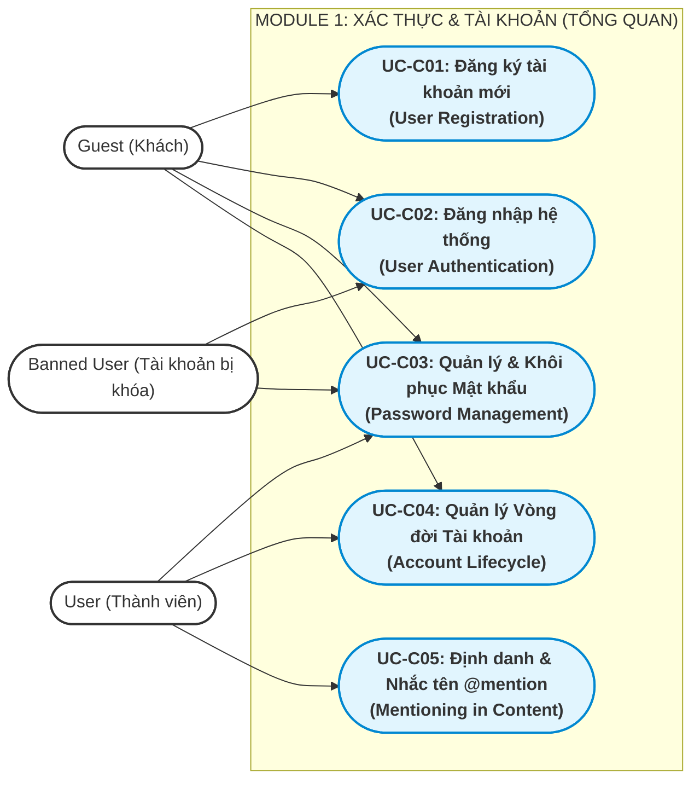
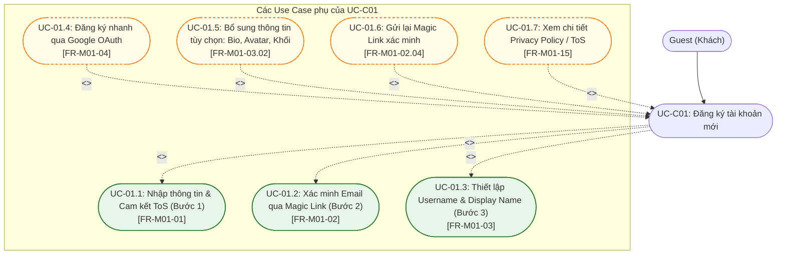
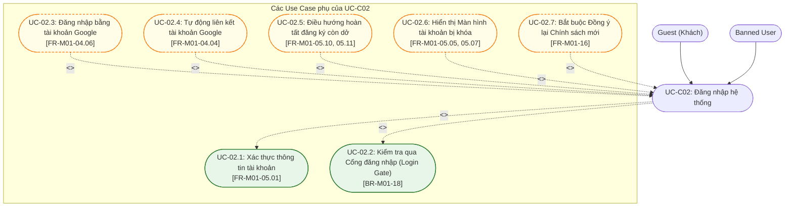
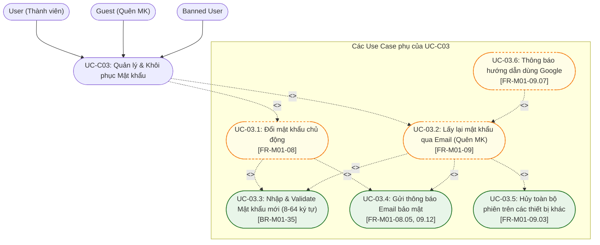
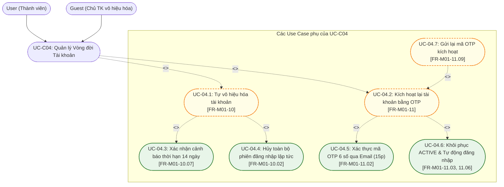
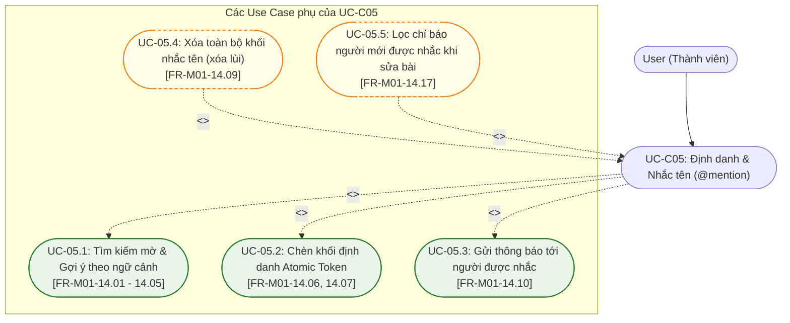

# Tài liệu Đặc tả Use Case — M01: Authentication & Account (US-M01)

| Thuộc tính | Nội dung |
|---|---|
| **Mã tài liệu** | `US-M01` |
| **Dự án** | iShare — Nền tảng chia sẻ tri thức và hỏi đáp học sinh THPT |
| **Module** | M01 — Authentication & Account (Xác thực và Tài khoản) |
| **Tài liệu căn cứ (Nguồn)** | [`FR-M01.md`](file:///g:/documents/season9/iShare/docs/specs/fr/FR-M01.md) (Phiên bản 1.10 — Ngày 2026-10-24) |
| **Mốc register căn cứ** | DEC-271, QA-477, ISS-415, OPEN-012 |
| **Người thực hiện** | Antigravity Engine (Tổng hợp & Phân rã theo yêu cầu BA) |
| **Ngày lập** | 2026-10-27 |
| **Trạng thái** | Hoàn thành |

---

## 1. Bảng Tổng hợp các Chức năng con trong Module 1

Căn cứ theo mục 4.4 và mục 5 trong tài liệu [`FR-M01.md`](file:///g:/documents/season9/iShare/docs/specs/fr/FR-M01.md), Module 1 bao gồm 16 chức năng con với mô tả ngắn gọn như sau:

| STT | Mã chức năng | Tên chức năng con | Mô tả ngắn gọn phạm vi & nghiệp vụ |
|:---:|:---:|---|---|
| 1 | **FR-M01-01** | Đăng ký tài khoản bằng email | Cho phép Guest tạo tài khoản qua Bước 1 (nhập email, mật khẩu 8–64 ký tự, tích cam kết ToS/độ tuổi dưới 16); khởi tạo tài khoản ở trạng thái `ACTIVE`, mức xác minh `NONE`, vai trò `USER`. |
| 2 | **FR-M01-02** | Xác minh email | Gửi Magic Link xác minh có thời hạn 1 giờ tới email đăng ký; mở link thành công nâng mức xác minh lên `EMAIL_VERIFIED`; cho phép gửi lại link (cách nhau tối thiểu 60s). |
| 3 | **FR-M01-03** | Thiết lập tài khoản (Bước 3) | Cho phép chủ tài khoản đã xác minh email thiết lập `username` (duy nhất, 3–20 ký tự), `display_name` (1–50 ký tự), tùy chọn nhập hoặc bỏ qua Bio, Khối lớp, Avatar; nâng mức lên `SETUP_COMPLETED`. |
| 4 | **FR-M01-04** | Đăng ký, đăng nhập bằng Google | Đăng nhập Google OAuth lần đầu tạo tài khoản `EMAIL_VERIFIED` (bỏ qua bước 1 và 2); nếu trùng email tài khoản sẵn có thì tự động liên kết tài khoản và gửi thông báo. |
| 5 | **FR-M01-05** | Đăng nhập bằng email và mật khẩu | Xác thực tài khoản; điều hướng qua Cổng đăng nhập (Login Gate) theo trạng thái (`account_state`) và mức xác minh (`verify_level`); xử lý cô lập tài khoản `BANNED` tại Màn hình khóa. |
| 6 | **FR-M01-06** | Duy trì phiên đăng nhập | Cơ chế Token kép JWT: Phiên truy cập (Access Token 1h), Phiên làm mới (Refresh Token 30d); xoay vòng Refresh Token sau mỗi lần dùng; hỗ trợ đa thiết bị độc lập. |
| 7 | **FR-M01-07** | Đăng xuất | Chấm dứt phiên đăng nhập trên thiết bị hiện tại, giữ nguyên phiên làm việc trên các thiết bị khác của người dùng. |
| 8 | **FR-M01-08** | Đổi mật khẩu | Cho phép người dùng đang đăng nhập đổi mật khẩu (yêu cầu mật khẩu cũ đúng, mật khẩu mới khác mật khẩu cũ); giữ nguyên phiên các thiết bị khác; gửi mail/thông báo bảo mật. |
| 9 | **FR-M01-09** | Lấy lại mật khẩu | Cho phép người quên mật khẩu nhận Magic Link qua email (hạn 15 phút); đặt lại thành công sẽ tự động hủy toàn bộ phiên trên các thiết bị khác; hiển thị thông báo chung chống dò email. |
| 10 | **FR-M01-10** | Vô hiệu hóa tài khoản | Chủ tài khoản tự đưa tài khoản sang `DEACTIVATED`; là con đường duy nhất để xóa tài khoản; hủy toàn bộ phiên ngay lập tức; bắt đầu kích hoạt đồng hồ đếm ngược 14 ngày. |
| 11 | **FR-M01-11** | Kích hoạt lại tài khoản | Chủ tài khoản `DEACTIVATED` vào trang kích hoạt riêng nhập email $\to$ nhận mã OTP 6 số qua email (hạn 15 phút, sai tối đa 5 lần) để khôi phục tài khoản về `ACTIVE` và tự đăng nhập. |
| 12 | **FR-M01-12** | Tự xóa tài khoản hết hạn vô hiệu hóa | Tiến trình ngầm tự động chuyển tài khoản sang `DELETED` sau 14 ngày (gửi mail cảnh báo trước 24h); xóa toàn bộ PII, giải phóng email đăng ký, **khóa vĩnh viễn username**. |
| 13 | **FR-M01-13** | Hiển thị nội dung của tài khoản vô hiệu hóa / đã xóa | Ẩn bài viết; bình luận giữ nguyên nội dung với tên tác giả thay thế: *"Tài khoản tạm thời vô hiệu hoá"* (`DEACTIVATED`) hoặc *"[Người dùng đã xóa]"* (`DELETED`). |
| 14 | **FR-M01-14** | Nhắc tên người dùng (`@mention`) | Gõ `@` + 1 ký tự (debounce 300ms) $\to$ Tìm kiếm mờ không dấu trên cả `display_name` và `username`, xếp hạng ưu tiên 3 tầng $\to$ Chèn Atomic Token $\to$ Bắn thông báo khi nội dung công khai. |
| 15 | **FR-M01-15** | Xem trang Privacy Policy/ToS | Cung cấp trang tĩnh công khai trình bày 4 nhóm dữ liệu thu thập, minh bạch việc xử lý dữ liệu của dịch vụ AI bên thứ ba, cam kết không bán dữ liệu cá nhân. |
| 16 | **FR-M01-16** | Đồng ý lại khi chính sách đổi | Bắt buộc người dùng mở ứng dụng phải xác nhận đồng ý lại khi hệ thống cập nhật phiên bản chính sách mới (`policy_version`); nếu từ chối chỉ được Đăng xuất hoặc Vô hiệu hóa. |

---

## 2. Phân rã thành các Use Case Chính & Quy trình Nghiệp vụ Hoàn chỉnh

### 2.1 Tiêu chí phân rã Use Case Chính
- **Đủ lớn & Độc lập:** Đại diện cho một mục tiêu nghiệp vụ trọn vẹn của người dùng (User Goal) hoặc của hệ thống.
- **Có tương tác giao diện trực tiếp:** Bắt đầu bằng một hành động chủ động của Actor trên giao diện (UI) và kết thúc khi đạt được kết quả mong đợi.
- **Bao hàm các chức năng con:** Chứa đựng các bước thực hiện mang tính nghiệp vụ bắt buộc hoặc tùy chọn mở rộng.

Từ 16 chức năng con, Module 1 được phân rã thành **5 Use Case Chính** sau:
1. **UC-C01: Đăng ký tài khoản mới (User Registration & Onboarding)**
2. **UC-C02: Đăng nhập hệ thống (User Authentication & Access Control)**
3. **UC-C03: Quản lý & Khôi phục Mật khẩu (Password Management & Recovery)**
4. **UC-C04: Quản lý Vòng đời Tài khoản (Account Lifecycle Management)**
5. **UC-C05: Định danh & Nhắc tên trong nội dung (`@mention` System)**

---

### 2.2 Sơ đồ Use Case Tổng quan của Module 1 (Macro Use Case Diagram)

---

### 2.3 Mô tả Quy trình Nghiệp vụ Hoàn chỉnh của từng Use Case Chính

#### 1. UC-C01: Đăng ký tài khoản mới (User Registration & Onboarding)
- **Actor chính:** `Guest` (Khách vãng lai).
- **Mục tiêu:** Chuyển đổi một người dùng chưa có tài khoản thành thành viên chính thức (`ACTIVE`, `SETUP_COMPLETED`) sẵn sàng tham gia cộng đồng.
- **Quy trình nghiệp vụ hoàn chỉnh:**
  1. *Khởi đầu:* Guest truy cập trang Đăng ký, chọn phương thức (Email truyền thống hoặc Google OAuth).
  2. *Thực hiện bước đầu:*
     - Nếu dùng Email: Điền email, mật khẩu và tích chọn ô cam kết Điều khoản & Quyền riêng tư (chứa cam kết người dưới 16 tuổi). Hệ thống kiểm tra hợp lệ $\to$ Tạo tài khoản ở trạng thái `ACTIVE`, mức `NONE` và gửi Magic Link xác thực về hòm thư.
     - Nếu dùng Google: Xác thực qua Google OAuth $\to$ Tạo tài khoản `ACTIVE`, mức `EMAIL_VERIFIED` (bỏ qua bước 1 và 2).
  3. *Xác thực:* Với email, Guest mở hòm thư, nhấn vào Magic Link (hạn 1 giờ) $\to$ Hệ thống nâng mức xác minh lên `EMAIL_VERIFIED` và chuyển hướng tới Bước 3.
  4. *Định danh & Hoàn tất (Bước 3):* Người dùng bắt buộc đặt `username` (duy nhất, không đổi) và `display_name` (tên hiển thị chính); có thể tùy chọn nhập hoặc bỏ qua Bio, Khối lớp, Avatar.
  5. *Kết thúc:* Hệ thống lưu hồ sơ, nâng mức xác minh lên `SETUP_COMPLETED`, tự động cấp phiên làm việc (JWT) và đưa người dùng vào trang chủ iShare.

#### 2. UC-C02: Đăng nhập hệ thống (User Authentication & Access Control)
- **Actor chính:** `Guest`, `Banned User`.
- **Mục tiêu:** Xác thực thông tin đăng nhập và điều phối quyền truy cập qua Cổng kiểm soát (Login Gate).
- **Quy trình nghiệp vụ hoàn chỉnh:**
  1. *Khởi đầu:* Người dùng nhập Email + Mật khẩu (hoặc bấm Đăng nhập Google) trên giao diện Đăng nhập.
  2. *Kiểm tra thông tin:* Hệ thống xác thực danh tính. Nếu email Google trùng với tài khoản email sẵn có, tự động liên kết tài khoản.
  3. *Kiểm tra qua Cổng đăng nhập (Login Gate):*
     - Nếu tài khoản `DELETED`: Từ chối đăng nhập (Báo tài khoản không tồn tại).
     - Nếu tài khoản `DEACTIVATED`: Từ chối đăng nhập (Không tự kích hoạt lại; hướng dẫn sang trang kích hoạt bằng OTP).
     - Nếu tài khoản `BANNED`: Cấp phiên đăng nhập hạn chế và **chỉ hiển thị duy nhất Màn hình tài khoản bị khóa** (thấy lý do ban, nút Đăng xuất OK, và nút nộp đơn Khiếu nại sang M09 nếu còn hạn).
     - Nếu tài khoản `ACTIVE`: Kiểm tra tiếp mức độ hồ sơ (`verify_level`). Nếu chưa xong Bước 2 hoặc Bước 3 $\to$ Tự động điều hướng về đúng bước còn dở; nếu đã là `SETUP_COMPLETED` $\to$ Cấp phiên đăng nhập hoàn chỉnh.
  4. *Kiểm tra phiên bản chính sách:* Nếu hệ thống vừa cập nhật `policy_version` mới, chặn màn hình yêu cầu đồng ý lại (Re-consent) trước khi vào trang chủ.
  5. *Kết thúc:* Người dùng vào phiên làm việc hợp lệ hoặc bị cô lập tại màn hình xử phạt đúng quy định.

#### 3. UC-C03: Quản lý & Khôi phục Mật khẩu (Password Management & Recovery)
- **Actor chính:** `User` (Đổi mật khẩu), `Guest` / `Banned User` (Quên mật khẩu).
- **Mục tiêu:** Giúp người dùng chủ động bảo vệ tài khoản hoặc lấy lại quyền truy cập khi không thể đăng nhập.
- **Quy trình nghiệp vụ hoàn chỉnh:**
  - *Nhánh 1 — Đổi mật khẩu chủ động:* User đang đăng nhập vào Cài đặt $\to$ Nhập mật khẩu cũ, mật khẩu mới (8–64 ký tự) $\to$ Hệ thống kiểm tra hợp lệ, cập nhật mật khẩu, giữ nguyên phiên đăng nhập trên các thiết bị khác và gửi email/thông báo bảo mật.
  - *Nhánh 2 — Quên mật khẩu:* Người dùng tại trang đăng nhập bấm "Quên mật khẩu" $\to$ Nhập email $\to$ Hệ thống hiển thị thông báo chung (chống dò quét email) và gửi Magic Link (hạn ngắn 15 phút) $\to$ Người dùng mở link, nhập mật khẩu mới $\to$ Hệ thống cập nhật mật khẩu, **hủy ngay lập tức toàn bộ phiên trên các thiết bị khác** (sự kiện bảo mật), cấp phiên mới cho thiết bị hiện tại và gửi email thông báo.

#### 4. UC-C04: Quản lý Vòng đời Tài khoản (Account Lifecycle Management)
- **Actor chính:** `User` (Vô hiệu hóa), `Guest` (Chủ tài khoản kích hoạt lại).
- **Mục tiêu:** Thực thi quyền riêng tư (Quyền được lãng quên - Right to be Forgotten) theo Luật Bảo vệ dữ liệu cá nhân 2025 thông qua cơ chế ân hạn 14 ngày.
- **Quy trình nghiệp vụ hoàn chỉnh:**
  - *Nhánh 1 — Tự vô hiệu hóa:* User vào Cài đặt chọn "Vô hiệu hóa tài khoản" $\to$ Đọc cảnh báo 14 ngày $\to$ Xác nhận $\to$ Chuyển sang `DEACTIVATED`, hủy ngay lập tức mọi phiên đăng nhập trên toàn bộ thiết bị, ẩn toàn bộ bài viết, đổi tên tác giả bình luận thành *"Tài khoản tạm thời vô hiệu hoá"*.
  - *Nhánh 2 — Kích hoạt lại (Trong 14 ngày):* Chủ tài khoản vào Trang kích hoạt riêng $\to$ Nhập email $\to$ Nhận mã OTP 6 số qua email (hạn 15 phút, sai tối đa 5 lần) $\to$ Nhập đúng OTP $\to$ Hệ thống khôi phục trạng thái `ACTIVE`, hiện lại bài viết/bình luận với tên thật và tự động đăng nhập.

#### 5. UC-C05: Định danh & Nhắc tên trong nội dung (`@mention` System)
- **Actor chính:** `User`.
- **Mục tiêu:** Cho phép người dùng gắn thẻ định danh thành viên khác vào văn bản khi đang soạn bài viết hoặc bình luận.
- **Quy trình nghiệp vụ hoàn chỉnh:**
  1. *Kích hoạt:* Trong trình soạn thảo (M03/M04), User gõ ký tự `@` kèm tối thiểu 1 ký tự và dừng gõ 300ms.
  2. *Truy vấn & Xếp hạng:* Hệ thống tự động tìm kiếm mờ không dấu trên cả `display_name` và `username`, loại trừ tài khoản bị ban/xóa/chưa hoàn tất hồ sơ, áp dụng bộ lọc ưu tiên 3 tầng ngữ cảnh (Đang Follow $\to$ Cùng Group $\to$ Khác), trả về tối đa 5 gợi ý.
  3. *Chèn định danh:* User nhấp chọn một người $\to$ Hệ thống chèn vào văn bản một **khối liền (Atomic Token)** hiển thị theo `display_name` hiện tại, không có chữ `@`, không thể sửa từng ký tự.
  4. *Kích hoạt thông báo:* Khi nội dung được xuất bản công khai, hệ thống tự động gửi thông báo (M07) cho người được nhắc tên.

---

## 3. Xác định Use Case con Chi tiết và Mối quan hệ với Use Case Chính

Phần này phân tích chi tiết quan hệ giữa 5 Use Case Chính và các Use Case con theo đúng 2 loại quan hệ chuẩn UML:
- **`<<include>>` (Bắt buộc):** Bước nghiệp vụ tiên quyết, bắt buộc phải có để Use Case chính thành công.
- **`<<extend>>` (Tùy chọn / Rẽ nhánh):** Bước mở rộng, phương thức thay thế hoặc nhánh ngoại lệ có thể có hoặc không.

---

### 3.1 Phân rã UC-C01: Đăng ký tài khoản mới

#### Bảng chi tiết quan hệ, điều kiện & lý do nghiệp vụ (UC-C01):
| Mã Use Case con | Tên Use Case con | Căn cứ FR/BR | Quan hệ | Điều kiện kích hoạt & Lý do nghiệp vụ |
|---|---|:---:|:---:|---|
| **UC-01.1** | Nhập thông tin & Cam kết ToS (Bước 1) | FR-M01-01 BR-M01-02 | `<<include>>` | **Bắt buộc:** Khởi tạo bản ghi tài khoản `ACTIVE` với `verify_level = NONE`. Bắt buộc phải có email, mật khẩu hợp lệ (8–64 ký tự) và tích cam kết ToS/độ tuổi (FR-M01-01.05). |
| **UC-01.2** | Xác minh Email qua Magic Link (Bước 2) | FR-M01-02 BR-M01-10 | `<<include>>` | **Bắt buộc:** Luồng email bắt buộc phải xác thực quyền sở hữu hòm thư để nâng lên `EMAIL_VERIFIED` trước khi sang Bước 3 (FR-M01-02.01). |
| **UC-01.3** | Thiết lập Username & Display Name (Bước 3) | FR-M01-03 BR-M01-05 | `<<include>>` | **Bắt buộc:** Bắt buộc người dùng phải đặt định danh `username` duy nhất và tên hiển thị `display_name` để chuyển sang `SETUP_COMPLETED` (FR-M01-03.01). |
| **UC-01.4** | Đăng ký nhanh qua Google OAuth | FR-M01-04 BR-M01-08 | `<<extend>>` | **Phương thức thay thế:** Người dùng có thể chọn đăng ký qua Google. Hệ thống tự động bỏ qua Bước 1 và Bước 2, đi thẳng vào Bước 3 đặt `username` (FR-M01-04.01). |
| **UC-01.5** | Bổ sung thông tin tùy chọn (Bio, Avatar, Lớp) | FR-M01-03.02 FR-M01-03.03 | `<<extend>>` | **Tùy chọn:** Tại Bước 3, người dùng có thể nhập các trường này hoặc bấm "Bỏ qua" mà không ảnh hưởng tới tiến trình hoàn tất đăng ký. |
| **UC-01.6** | Gửi lại Magic Link xác minh | FR-M01-02.04 BR-M01-11 | `<<extend>>` | **Rẽ nhánh ngoại lệ:** Kích hoạt khi Magic Link cũ quá 1 giờ bị hết hạn hoặc thất lạc; phải cách lần gửi trước tối thiểu 60 giây (FR-M01-02.05). |
| **UC-01.7** | Xem chi tiết Privacy Policy / ToS | FR-M01-15 BR-M01-03 | `<<extend>>` | **Tùy chọn:** Người dùng có thể nhấp vào liên kết để đọc toàn văn chính sách bảo mật trước khi tích ô đồng ý tại Bước 1 (FR-M01-01.04). |

---

### 3.2 Phân rã UC-C02: Đăng nhập hệ thống

#### Bảng chi tiết quan hệ, điều kiện & lý do nghiệp vụ (UC-C02):
| Mã Use Case con | Tên Use Case con | Căn cứ FR/BR | Quan hệ | Điều kiện kích hoạt & Lý do nghiệp vụ |
|---|---|:---:|:---:|---|
| **UC-02.1** | Xác thực thông tin tài khoản | FR-M01-05.01 | `<<include>>` | **Bắt buộc:** Kiểm tra tính chính xác của email và mật khẩu trong cơ sở dữ liệu. |
| **UC-02.2** | Kiểm tra qua Cổng đăng nhập (Login Gate) | FR-M01-05.01 BR-M01-18 | `<<include>>` | **Bắt buộc:** Bắt buộc phải chạy logic kiểm tra thứ tự: xét `account_state` trước $\to$ xét `verify_level` sau để quyết định cho vào hay từ chối. |
| **UC-02.3** | Đăng nhập bằng tài khoản Google | FR-M01-04.06 | `<<extend>>` | **Phương thức thay thế:** Người dùng có thể bỏ qua nhập mật khẩu để đăng nhập trực tiếp qua OAuth của Google. |
| **UC-02.4** | Tự động liên kết tài khoản Google | FR-M01-04.04 BR-M01-09 | `<<extend>>` | **Rẽ nhánh điều kiện:** Tự động kích hoạt khi email Google đăng nhập trùng khớp với email của tài khoản sẵn có (tự động gắn kết nối và gửi thông báo). |
| **UC-02.5** | Điều hướng hoàn tất đăng ký còn dở | FR-M01-05.10 FR-M01-05.11 | `<<extend>>` | **Rẽ nhánh điều kiện:** Kích hoạt nếu tài khoản `ACTIVE` nhưng chưa xong bước 2 (đưa về Bước 2) hoặc chưa xong bước 3 (đưa về Bước 3). |
| **UC-02.6** | Hiển thị Màn hình tài khoản bị khóa | FR-M01-05.05 BR-M01-19 | `<<extend>>` | **Rẽ nhánh ngoại lệ:** Kích hoạt khi tài khoản ở trạng thái `BANNED`. Vẫn cấp phiên đăng nhập nhưng cô lập tuyệt đối tại màn hình khóa để xem lý do và gửi khiếu nại. |
| **UC-02.7** | Xác nhận Đồng ý lại Chính sách mới | FR-M01-16.01 BR-M01-44 | `<<extend>>` | **Rẽ nhánh điều kiện:** Kích hoạt tại thời điểm mở app nếu hệ thống đã cập nhật `policy_version` mới. Bắt buộc đồng ý mới được tiếp tục sử dụng. |

---

### 3.3 Phân rã UC-C03: Quản lý & Khôi phục Mật khẩu

#### Bảng chi tiết quan hệ, điều kiện & lý do nghiệp vụ (UC-C03):
| Mã Use Case con | Tên Use Case con | Căn cứ FR/BR | Quan hệ | Điều kiện kích hoạt & Lý do nghiệp vụ |
|---|---|:---:|:---:|---|
| **UC-03.1** | Đổi mật khẩu chủ động | FR-M01-08 BR-M01-14 | `<<extend>>` | **Nhánh nghiệp vụ:** Dành cho `User` đang đăng nhập hợp lệ (`ACTIVE`) muốn cập nhật mật khẩu định kỳ (yêu cầu mật khẩu cũ). |
| **UC-03.2** | Lấy lại mật khẩu qua Email (Quên MK) | FR-M01-09 BR-M01-12 | `<<extend>>` | **Nhánh nghiệp vụ:** Dành cho `Guest` hoặc `Banned User` bị quên mật khẩu $\to$ Gửi Magic Link (hạn 15 phút) về hòm thư. |
| **UC-03.3** | Nhập & Validate Mật khẩu mới | BR-M01-35 | `<<include>>` | **Bắt buộc:** Cả hai nhánh đổi mật khẩu hay đặt lại mật khẩu đều bắt buộc phải nhập mật khẩu mới dài 8–64 ký tự và khác mật khẩu hiện tại. |
| **UC-03.4** | Gửi thông báo Email bảo mật | FR-M01-08.05 FR-M01-09.12 | `<<include>>` | **Bắt buộc:** Bất kỳ thao tác thay đổi mật khẩu thành công nào cũng bắt buộc kích hoạt gửi email cảnh báo bảo mật cho chủ tài khoản. |
| **UC-03.5** | Hủy toàn bộ phiên trên các thiết bị khác | FR-M01-09.03 BR-M01-13 | `<<include>>` *(trong luồng Quên MK)* | **Bắt buộc khi Quên MK:** Quên mật khẩu là sự kiện có nguy cơ lộ lọt tài khoản, hệ thống bắt buộc chấm dứt phiên trên mọi thiết bị khác để cô lập an toàn. |
| **UC-03.6** | Thông báo hướng dẫn dùng Google | FR-M01-09.07 BR-M01-15 | `<<extend>>` | **Rẽ nhánh ngoại lệ:** Nếu tài khoản tạo bằng Google nhấn "Quên mật khẩu", hệ thống thông báo dùng nút Google, không gửi link đặt lại. |

---

### 3.4 Phân rã UC-C04: Quản lý Vòng đời Tài khoản

#### Bảng chi tiết quan hệ, điều kiện & lý do nghiệp vụ (UC-C04):
| Mã Use Case con | Tên Use Case con | Căn cứ FR/BR | Quan hệ | Điều kiện kích hoạt & Lý do nghiệp vụ |
|---|---|:---:|:---:|---|
| **UC-04.1** | Tự vô hiệu hóa tài khoản | FR-M01-10 BR-M01-20 | `<<extend>>` | **Nhánh nghiệp vụ:** `User` chủ động thao tác trong Cài đặt; là bước đệm duy nhất để xóa tài khoản vĩnh viễn (hệ thống không có nút xóa trực tiếp). |
| **UC-04.2** | Kích hoạt lại tài khoản bằng OTP | FR-M01-11 BR-M01-22 | `<<extend>>` | **Nhánh nghiệp vụ:** `Guest` (chủ tài khoản cũ) thực hiện tại Trang kích hoạt trong thời hạn ân hạn 14 ngày. |
| **UC-04.3** | Xác nhận cảnh báo thời hạn 14 ngày | FR-M01-10.07 BR-M01-21 | `<<include>>` *(trong Vô hiệu hóa)* | **Bắt buộc:** Người dùng bắt buộc phải xác nhận hiểu rõ quy định: bài viết sẽ bị ẩn và tài khoản sẽ tự động xóa sau $14 \times 24$ giờ. |
| **UC-04.4** | Hủy toàn bộ phiên đăng nhập lập tức | FR-M01-10.02 | `<<include>>` *(trong Vô hiệu hóa)* | **Bắt buộc:** Ngay khi chuyển sang `DEACTIVATED`, hệ thống lập tức chấm dứt mọi phiên đăng nhập trên toàn bộ thiết bị. |
| **UC-04.5** | Xác thực mã OTP 6 số qua Email | FR-M01-11.02 BR-M01-22 | `<<include>>` *(trong Kích hoạt lại)* | **Bắt buộc:** Người dùng bắt buộc phải nhập đúng mã OTP 6 chữ số gửi về email (hạn 15 phút, sai tối đa 5 lần) để chứng minh quyền sở hữu. |
| **UC-04.6** | Khôi phục ACTIVE & Tự động đăng nhập | FR-M01-11.03 FR-M01-11.06 | `<<include>>` *(trong Kích hoạt lại)* | **Bắt buộc:** Nhập đúng OTP $\to$ Hệ thống bắt buộc đưa tài khoản về `ACTIVE`, hiện lại bài viết/bình luận tên thật và cấp phiên đăng nhập ngay. |
| **UC-04.7** | Gửi lại mã OTP kích hoạt | FR-M01-11.09 | `<<extend>>` | **Tùy chọn:** Kích hoạt khi mã OTP cũ bị hết hạn hoặc thất lạc (phải cách lần trước tối thiểu 60 giây). |

---

### 3.5 Phân rã UC-C05: Định danh & Nhắc tên trong nội dung (`@mention`)

#### Bảng chi tiết quan hệ, điều kiện & lý do nghiệp vụ (UC-C05):
| Mã Use Case con | Tên Use Case con | Căn cứ FR/BR | Quan hệ | Điều kiện kích hoạt & Lý do nghiệp vụ |
|---|---|:---:|:---:|---|
| **UC-05.1** | Tìm kiếm mờ & Gợi ý theo ngữ cảnh | FR-M01-14.01 - 05 BR-M01-26, 27 | `<<include>>` | **Bắt buộc:** Tự động kích hoạt khi gõ `@` kèm $\ge 1$ ký tự (debounce 300ms). Tìm kiếm mờ không dấu trên cả username và display_name, ưu tiên 3 tầng (Following $\to$ Cùng Group $\to$ Khác), tối đa 5 người. |
| **UC-05.2** | Chèn khối định danh Atomic Token | FR-M01-14.06 FR-M01-14.07 | `<<include>>` | **Bắt buộc:** Khi người dùng chọn 1 người từ danh sách, hệ thống bắt buộc chèn dưới dạng khối liền hiển thị `display_name` hiện tại, không chứa ký tự `@` và không cho sửa từng chữ. |
| **UC-05.3** | Gửi thông báo tới người được nhắc | FR-M01-14.10 BR-M01-30 | `<<include>>` | **Bắt buộc:** Khi nội dung được xuất bản công khai, hệ thống bắt buộc kích hoạt gửi thông báo In-app cho người được nhắc (kể cả khi họ đã tắt chuông bài viết). |
| **UC-05.4** | Xóa toàn bộ khối nhắc tên (xóa lùi) | FR-M01-14.09 BR-M01-29 | `<<extend>>` | **Mở rộng tương tác:** Nếu người dùng nhấn phím Backspace ở cuối khối token, hệ thống tự động xóa toàn bộ khối, không để lại chuỗi ký tự dở dang. |
| **UC-05.5** | Lọc chỉ báo người mới khi sửa bài | FR-M01-14.17 | `<<extend>>` | **Rẽ nhánh điều kiện:** Khi chỉnh sửa nội dung đã công khai từ trước, hệ thống chỉ kích hoạt gửi thông báo cho những người mới được nhắc thêm vào. |

---

## 4. Bảng Tổng kết Ánh xạ Toàn bộ Chức năng & Sơ đồ Use Case Chi tiết

### 4.1 Bảng Ma trận Ánh xạ Toàn bộ 16 Chức năng Con vào Hệ thống Use Case

| Mã FR | Tên chức năng con trong `FR-M01.md` | Thuộc Use Case Chính | Thuộc Use Case Phụ cụ thể | Vai trò quan hệ trong UC Chính |
|:---:|---|:---:|---|:---:|
| **FR-M01-01** | Đăng ký tài khoản bằng email | **UC-C01** | UC-01.1: Nhập thông tin & Cam kết ToS (Bước 1) | `<<include>>` (Bắt buộc) |
| **FR-M01-02** | Xác minh email | **UC-C01** | UC-01.2: Xác minh Email qua Magic Link (Bước 2) | `<<include>>` (Bắt buộc) |
| **FR-M01-03** | Thiết lập tài khoản | **UC-C01** | UC-01.3: Thiết lập Username & Display Name (Bước 3) UC-01.5: Bổ sung thông tin tùy chọn (Bio, Khối, Avatar) | `<<include>>` (Bắt buộc) `<<extend>>` (Tùy chọn) |
| **FR-M01-04** | Đăng ký, đăng nhập bằng Google | **UC-C01** **UC-C02** | UC-01.4: Đăng ký nhanh qua Google OAuth UC-02.3: Đăng nhập bằng Google / UC-02.4: Tự động liên kết | `<<extend>>` (Rẽ nhánh) `<<extend>>` (Thay thế/Liên kết) |
| **FR-M01-05** | Đăng nhập bằng email và mật khẩu | **UC-C02** | UC-02.1: Xác thực thông tin tài khoản UC-02.2: Kiểm tra qua Cổng đăng nhập (Login Gate) UC-02.5: Điều hướng hoàn tất đăng ký còn dở UC-02.6: Hiển thị Màn hình tài khoản bị khóa | `<<include>>` (Bắt buộc) `<<include>>` (Bắt buộc) `<<extend>>` (Rẽ nhánh) `<<extend>>` (Ngoại lệ) |
| **FR-M01-06** | Duy trì phiên đăng nhập | *(Tiến trình ngầm)* | Quản lý Token kép JWT (Access 1h / Refresh 30d xoay vòng) | Nền tảng hạ tầng kỹ thuật |
| **FR-M01-07** | Đăng xuất | **UC-C02** | Đăng xuất thiết bị hiện tại (thu hồi Access/Refresh Token) | Nút bấm giao diện |
| **FR-M01-08** | Đổi mật khẩu | **UC-C03** | UC-03.1: Đổi mật khẩu chủ động | `<<extend>>` (Nhánh nghiệp vụ) |
| **FR-M01-09** | Lấy lại mật khẩu | **UC-C03** | UC-03.2: Lấy lại mật khẩu qua Email (Quên MK) | `<<extend>>` (Nhánh nghiệp vụ) |
| **FR-M01-10** | Vô hiệu hóa tài khoản | **UC-C04** | UC-04.1: Tự vô hiệu hóa tài khoản (bắt đầu 14 ngày) | `<<extend>>` (Nhánh nghiệp vụ) |
| **FR-M01-11** | Kích hoạt lại tài khoản | **UC-C04** | UC-04.2: Kích hoạt lại tài khoản bằng OTP | `<<extend>>` (Nhánh nghiệp vụ) |
| **FR-M01-12** | Tự xóa tài khoản hết hạn vô hiệu hóa | *(Tiến trình ngầm)* | Cron Job tự động chuyển `DELETED` sau 14 ngày & Xóa sạch PII | Daemon chạy tự động |
| **FR-M01-13** | Hiển thị nội dung của tài khoản vô hiệu hóa / đã xóa | *(Tầng hiển thị)* | Bộ lọc ẩn bài viết & Đổi tên bình luận thành tên thay thế | Logic kiểm soát hiển thị |
| **FR-M01-14** | Nhắc tên người dùng (`@mention`) | **UC-C05** | UC-05.1: Tìm kiếm & Gợi ý mờ theo ngữ cảnh UC-05.2: Chèn Atomic Token UC-05.3: Gửi thông báo bài công khai | `<<include>>` (Bắt buộc) `<<include>>` (Bắt buộc) `<<include>>` (Bắt buộc) |
| **FR-M01-15** | Xem trang Privacy Policy/ToS | **UC-C01** | UC-01.7: Xem chi tiết Privacy Policy / ToS | `<<extend>>` (Tùy chọn) |
| **FR-M01-16** | Đồng ý lại khi chính sách đổi | **UC-C02** | UC-02.7: Xác nhận Đồng ý lại Chính sách mới (Re-consent) | `<<extend>>` (Rẽ nhánh điều kiện) |

---

### 4.2 Sơ đồ Use Case Chi tiết Toàn bộ Module 1 (Comprehensive Detailed Use Case Diagram)

```mermaid
flowchart TB
    %% ACTORS
    Guest(["Guest (Khách)"])
    User(["User (Thành viên)"])
    BannedUser(["Banned User (TK bị khóa)"])

    %% ==========================================
    %% UC-C01: ĐĂNG KÝ
    %% ==========================================
    subgraph G_UC01 ["UC-C01: Đăng ký tài khoản mới"]
        UC01(["UC-C01: Đăng ký tài khoản mới"])
        U01_1(["UC-01.1: Nhập thông tin & Cam kết ToS (B1)"])
        U01_2(["UC-01.2: Xác minh Email qua Magic Link (B2)"])
        U01_3(["UC-01.3: Thiết lập Username & Display Name (B3)"])
        U01_4(["UC-01.4: Đăng ký nhanh qua Google OAuth"])
        U01_5(["UC-01.5: Bổ sung Bio, Avatar, Khối lớp"])
        U01_6(["UC-01.6: Gửi lại Magic Link xác minh"])
        U01_7(["UC-01.7: Xem Privacy Policy / ToS"])

        UC01 -.->|"<<include>>"| U01_1
        UC01 -.->|"<<include>>"| U01_2
        UC01 -.->|"<<include>>"| U01_3
        U01_4 -.->|"<<extend>>"| UC01
        U01_5 -.->|"<<extend>>"| UC01
        U01_6 -.->|"<<extend>>"| UC01
        U01_7 -.->|"<<extend>>"| UC01
    end

    %% ==========================================
    %% UC-C02: ĐĂNG NHẬP
    %% ==========================================
    subgraph G_UC02 ["UC-C02: Đăng nhập hệ thống"]
        UC02(["UC-C02: Đăng nhập hệ thống"])
        U02_1(["UC-02.1: Xác thực thông tin tài khoản"])
        U02_2(["UC-02.2: Kiểm tra qua Cổng Login Gate"])
        U02_3(["UC-02.3: Đăng nhập bằng Google"])
        U02_4(["UC-02.4: Tự động liên kết tài khoản Google"])
        U02_5(["UC-02.5: Điều hướng hoàn tất đăng ký dở"])
        U02_6(["UC-02.6: Hiển thị Màn hình tài khoản bị khóa"])
        U02_7(["UC-02.7: Bắt buộc Đồng ý lại ToS mới"])

        UC02 -.->|"<<include>>"| U02_1
        UC02 -.->|"<<include>>"| U02_2
        U02_3 -.->|"<<extend>>"| UC02
        U02_4 -.->|"<<extend>>"| UC02
        U02_5 -.->|"<<extend>>"| UC02
        U02_6 -.->|"<<extend>>"| UC02
        U02_7 -.->|"<<extend>>"| UC02
    end

    %% ==========================================
    %% UC-C03: QUẢN LÝ MẬT KHẨU
    %% ==========================================
    subgraph G_UC03 ["UC-C03: Quản lý & Khôi phục Mật khẩu"]
        UC03(["UC-C03: Quản lý & Khôi phục Mật khẩu"])
        U03_1(["UC-03.1: Đổi mật khẩu chủ động"])
        U03_2(["UC-03.2: Lấy lại mật khẩu qua Email (Quên MK)"])
        U03_3(["UC-03.3: Validate Mật khẩu mới (8-64 ký tự)"])
        U03_4(["UC-03.4: Gửi thông báo Email bảo mật"])
        U03_5(["UC-03.5: Hủy toàn bộ phiên trên thiết bị khác"])
        U03_6(["UC-03.6: Thông báo hướng dẫn dùng Google"])

        UC03 -.->|"<<extend>>"| U03_1
        UC03 -.->|"<<extend>>"| U03_2
        U03_1 -.->|"<<include>>"| U03_3
        U03_1 -.->|"<<include>>"| U03_4
        U03_2 -.->|"<<include>>"| U03_3
        U03_2 -.->|"<<include>>"| U03_4
        U03_2 -.->|"<<include>>"| U03_5
        U03_6 -.->|"<<extend>>"| U03_2
    end

    %% ==========================================
    %% UC-C04: VÒNG ĐỜI TÀI KHOẢN
    %% ==========================================
    subgraph G_UC04 ["UC-C04: Quản lý Vòng đời Tài khoản"]
        UC04(["UC-C04: Quản lý Vòng đời Tài khoản"])
        U04_1(["UC-04.1: Tự vô hiệu hóa tài khoản (14 ngày)"])
        U04_2(["UC-04.2: Kích hoạt lại tài khoản bằng OTP"])
        U04_3(["UC-04.3: Xác nhận cảnh báo thời hạn 14 ngày"])
        U04_4(["UC-04.4: Hủy toàn bộ phiên đăng nhập lập tức"])
        U04_5(["UC-04.5: Xác thực mã OTP 6 số qua Email"])
        U04_6(["UC-04.6: Khôi phục ACTIVE & Đăng nhập"])
        U04_7(["UC-04.7: Gửi lại mã OTP kích hoạt"])

        UC04 -.->|"<<extend>>"| U04_1
        UC04 -.->|"<<extend>>"| U04_2
        U04_1 -.->|"<<include>>"| U04_3
        U04_1 -.->|"<<include>>"| U04_4
        U04_2 -.->|"<<include>>"| U04_5
        U04_2 -.->|"<<include>>"| U04_6
        U04_7 -.->|"<<extend>>"| U04_2
    end

    %% ==========================================
    %% UC-C05: NHẮC TÊN @MENTION
    %% ==========================================
    subgraph G_UC05 ["UC-C05: Định danh & Nhắc tên (@mention)"]
        UC05(["UC-C05: Định danh & Nhắc tên (@mention)"])
        U05_1(["UC-05.1: Tìm kiếm & Gợi ý mờ theo ngữ cảnh"])
        U05_2(["UC-05.2: Chèn khối định danh Atomic Token"])
        U05_3(["UC-05.3: Gửi thông báo tới người được nhắc"])
        U05_4(["UC-05.4: Xóa toàn bộ khối nhắc tên (xóa lùi)"])
        U05_5(["UC-05.5: Lọc chỉ báo người mới khi sửa bài"])

        UC05 -.->|"<<include>>"| U05_1
        UC05 -.->|"<<include>>"| U05_2
        UC05 -.->|"<<include>>"| U05_3
        U05_4 -.->|"<<extend>>"| UC05
        U05_5 -.->|"<<extend>>"| UC05
    end

    %% ==========================================
    %% LIÊN KẾT ACTOR ĐẾN CÁC UC CHÍNH
    %% ==========================================
    Guest --> UC01
    Guest --> UC02
    Guest --> UC03
    Guest --> UC04

    User --> UC03
    User --> UC04
    User --> UC05

    BannedUser --> UC02
    BannedUser --> UC03

    %% Styling
    classDef actorStyle fill:#ffffff,stroke:#333333,stroke-width:2px;
    classDef coreUC fill:#e1f5fe,stroke:#0288d1,stroke-width:2px,font-weight:bold;
    classDef incStyle fill:#e8f5e9,stroke:#2e7d32,stroke-width:1.5px;
    classDef extStyle fill:#fffde7,stroke:#f57f17,stroke-width:1.5px,stroke-dasharray: 4 4;

    class Guest,User,BannedUser actorStyle;
    class UC01,UC02,UC03,UC04,UC05 coreUC;
    class U01_1,U01_2,U01_3,U02_1,U02_2,U03_3,U03_4,U03_5,U04_3,U04_4,U04_5,U04_6,U05_1,U05_2,U05_3 incStyle;
    class U01_4,U01_5,U01_6,U01_7,U02_3,U02_4,U02_5,U02_6,U02_7,U03_1,U03_2,U03_6,U04_1,U04_2,U04_7,U05_4,U05_5 extStyle;
```

Sơ đồ thể hiện đầy đủ các Actor, 5 Use Case Chính và toàn bộ các Use Case phụ với quan hệ `<<include>>` và `<<extend>>`:

