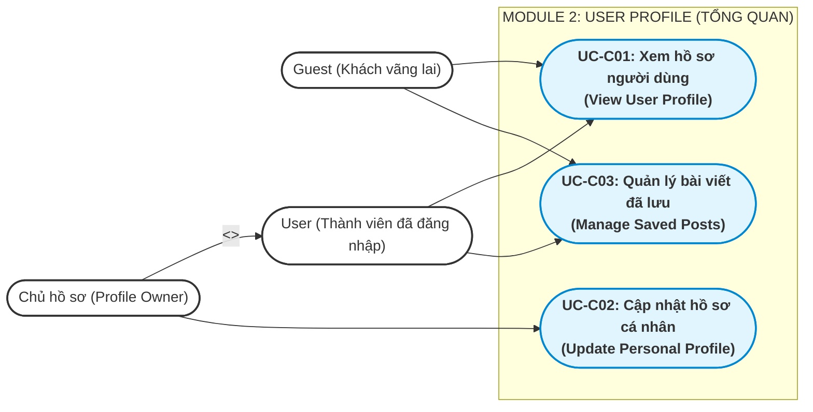
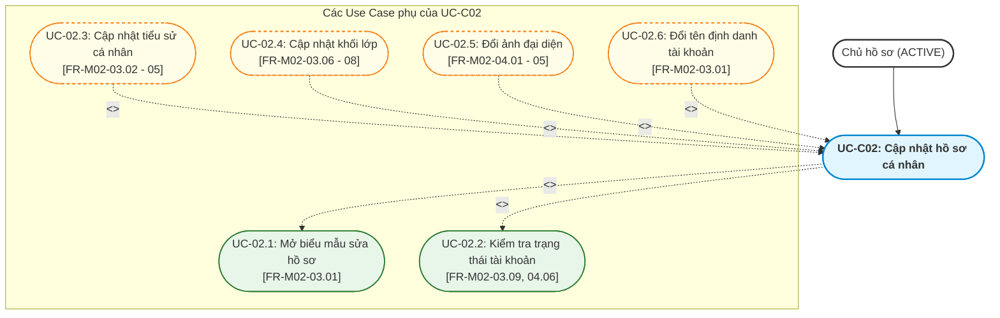
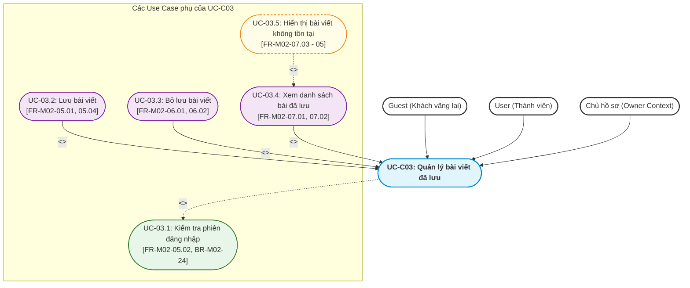

# Tài liệu Đặc tả Use Case — M02: User Profile (US-M02)

| Thuộc tính | Nội dung |
|---|---|
| **Mã tài liệu** | `US-M02` |
| **Dự án** | iShare — Nền tảng chia sẻ tri thức và hỏi đáp học sinh THPT |
| **Module** | M02 — User Profile (Hồ sơ người dùng) |
| **Tài liệu căn cứ (Nguồn)** | [`FR-M02.md`](file:///g:/documents/season9/iShare/docs/specs/fr/FR-M02.md) (Phiên bản 1.6 — Ngày 2026-10-24) |
| **Mốc register căn cứ** | DEC-271, QA-477, ISS-415, OPEN-012 |
| **Người thực hiện** | Antigravity Engine (Tổng hợp & Phân rã theo chuẩn BA iShare) |
| **Ngày lập** | 2026-10-27 |
| **Trạng thái** | Hoàn thành |

---

## 1. Bảng Tổng hợp các Chức năng con trong Module 2

Căn cứ theo mục 4.4 và mục 5 trong tài liệu [`FR-M02.md`](file:///g:/documents/season9/iShare/docs/specs/fr/FR-M02.md), Module 2 bao gồm 7 chức năng con với mô tả ngắn gọn phạm vi và nghiệp vụ như sau:

| STT | Mã chức năng | Tên chức năng con | Mô tả ngắn gọn phạm vi & nghiệp vụ |
|:---:|:---:|---|---|
| 1 | **FR-M02-01** | Xem trang hồ sơ | Cho phép mọi người dùng (kể cả Guest) xem hồ sơ tại `/u/{username}` hiển thị avatar cắt tròn, bio, Lớp/Khối, ngày tham gia, điểm, badge, danh hiệu "Ngôi sao tuần", số người theo dõi; phân quyền theo 2 ngữ cảnh: Chủ hồ sơ (thấy nút Sửa, 3 tab: Bài viết, Bookmark, Đã xóa; thấy bài nháp/ẩn danh) và Người xem (chỉ thấy tab Bài viết công khai, nút Nhắn tin nếu đã đăng nhập; xử lý tài khoản `BANNED` hiện nhãn, `DEACTIVATED`/`DELETED` báo không tồn tại). |
| 2 | **FR-M02-02** | Xem danh sách người theo dõi và đang theo dõi | Cho phép người dùng đã đăng nhập xem chi tiết danh sách người theo dõi và đang theo dõi (xếp mới nhất trước; loại trừ tài khoản `DEACTIVATED`/`BANNED`); yêu cầu Guest phải đăng nhập; không hỗ trợ tùy chọn ẩn danh sách. |
| 3 | **FR-M02-03** | Sửa thông tin hồ sơ | Cho phép chủ tài khoản `ACTIVE` chỉnh sửa bio (tối đa 155 ký tự, đếm ký tự sau khi cắt khoảng trắng, tính emoji/xuống dòng là 1 ký tự, hỗ trợ bio trống) và cập nhật hoặc bỏ chọn Lớp/Khối (chỉ nhận giá trị 10, 11, 12; không tự động tăng theo năm học); trang sửa hồ sơ là nơi đổi username và display_name. |
| 4 | **FR-M02-04** | Đổi avatar | Cho phép chủ tài khoản `ACTIVE` tải lên ảnh đại diện mới định dạng JPEG, PNG hoặc WebP với dung lượng $\le$ 5 MB (từ chối ảnh GIF động); hệ thống lưu ảnh gốc và tự động xóa avatar cũ sau khi cập nhật thành công. |
| 5 | **FR-M02-05** | Lưu bài viết (Bookmark) | Cho phép người dùng đã đăng nhập lưu bài viết vào danh sách Bookmark cá nhân để đọc lại (chỉ lưu 1 lần cho mỗi bài; bài bị Khóa toàn bộ vẫn cho phép lưu); yêu cầu Guest phải đăng nhập; không gửi thông báo về bài chỉ vì hành động lưu. |
| 6 | **FR-M02-06** | Bỏ lưu bài viết | Cho phép người dùng đã đăng nhập xóa một bài viết đang lưu khỏi danh sách Bookmark cá nhân (hỗ trợ thao tác ngay cả khi bài viết đang ở mức Khóa toàn bộ). |
| 7 | **FR-M02-07** | Xem danh sách bài đã lưu | Hiển thị danh sách bài viết đã lưu trong tab Bookmark riêng cho chủ hồ sơ (sắp xếp mới nhất trước); hiển thị dòng "Nội dung không tồn tại" khi bài đã lưu tạm thời không xem được (cho phép bỏ lưu dòng này); tự động xóa bookmark khi bài bị xóa hẳn hoặc tác giả bị `DELETED`. |

---

## 2. Phân rã thành các Use Case Chính & Quy trình Nghiệp vụ Hoàn chỉnh

### 2.1 Tiêu chí phân rã Use Case Chính
- **Đủ lớn & Độc lập:** Đại diện cho một mục tiêu nghiệp vụ trọn vẹn của người dùng (User Goal) hoặc của hệ thống.
- **Có tương tác giao diện trực tiếp:** Bắt đầu bằng một hành động chủ động của Actor trên giao diện (UI) và kết thúc khi đạt được kết quả mong đợi.
- **Bao hàm các chức năng con:** Chứa đựng các bước thực hiện mang tính nghiệp vụ bắt buộc hoặc tùy chọn mở rộng.
- **Quy tắc đặt tên (Chuẩn BA chuyên nghiệp):** Cấu trúc `[1 Động từ duy nhất] + [Cụm danh từ]`. Tuyệt đối không dùng nhiều động từ nối nhau bằng từ liên kết ("và", "&", "/", "hoặc"). Văn phong mang tính con người, tường minh và chuẩn nghiệp vụ.

Từ 7 chức năng con, Module 2 được phân rã thành **3 Use Case Chính** sau:
1. **UC-C01: Xem hồ sơ người dùng (View User Profile)**
2. **UC-C02: Cập nhật hồ sơ cá nhân (Update Personal Profile)**
3. **UC-C03: Quản lý bài viết đã lưu (Manage Saved Posts)**

---

### 2.2 Sơ đồ Use Case Tổng quan của Module 2 (Macro Use Case Diagram)

---

### 2.3 Mô tả Quy trình Nghiệp vụ Hoàn chỉnh của từng Use Case Chính

#### 1. UC-C01: Xem hồ sơ người dùng (View User Profile) — [Quy trình tuần tự kết hợp rẽ nhánh ngữ cảnh]
- **Actor chính:** `Guest` (Xem chỉ đọc), `User` (Xem hồ sơ người khác / xem danh sách theo dõi), `Chủ hồ sơ` (Xem đầy đủ nội dung quản trị cá nhân).
- **Mục tiêu:** Cung cấp không gian định danh công khai đại diện cho mỗi thành viên trên nền tảng, cho phép cộng đồng tìm hiểu thông tin học tập, thành tích, theo dõi hoạt động và kết nối trò chuyện.
- **Quy trình nghiệp vụ hoàn chỉnh:**
  1. *Khởi đầu:* Người dùng truy cập đường dẫn `/u/{username}` (không phân biệt chữ hoa/thường) hoặc nhấp vào avatar/tên tác giả từ bảng tin (M14) hoặc bình luận (M04).
  2. *Kiểm tra trạng thái tài khoản hồ sơ:*
     - Nếu username không tồn tại, hoặc tài khoản ở trạng thái `DEACTIVATED` / `DELETED`: Hệ thống hiển thị thông báo "Người dùng không tồn tại" (FR-M02-01.11, 01.21).
     - Nếu tài khoản ở trạng thái `BANNED`: Hệ thống vẫn hiển thị hồ sơ nhưng gắn kèm nhãn công khai "Tài khoản đã bị khóa" (FR-M02-01.12).
     - Nếu tài khoản ở trạng thái `ACTIVE`: Hệ thống tải thông tin định danh cơ bản: avatar cắt tròn (hoặc avatar mặc định nếu chưa đặt), display_name, username, bio, Lớp/Khối, ngày tham gia, tổng điểm thời gian thực, huy hiệu badge đã đạt, danh hiệu "Ngôi sao tuần" (nếu đạt ở tuần vừa chốt) và số lượng follower/following.
  3. *Chuyên biệt hóa hiển thị theo ngữ cảnh (Generalization Paths):*
     - **Dạng chuyên biệt 1 — Ngữ cảnh Người xem (Guest hoặc User xem người khác):** Chỉ hiển thị duy nhất tab Bài viết (chỉ gồm bài đã đăng, không ẩn, không ẩn danh; bài nhóm Private chỉ hiện nếu người xem cùng nhóm). Nếu là User đã đăng nhập xem người khác, hệ thống hiển thị thêm nút "Nhắn tin" để mở chat 1-1 (M16). Tuyệt đối không hiển thị nút Sửa hồ sơ và các tab riêng tư (Bookmark, Đã xóa).
     - **Dạng chuyên biệt 2 — Ngữ cảnh Chủ hồ sơ (User đang xem chính mình):** Hiển thị nút "Sửa hồ sơ" và 3 tab nội dung (Bài viết, Bookmark, Đã xóa). Mặc định mở tab Bài viết (thấy thêm bài nháp, chờ duyệt, bị từ chối, tự ẩn và bài ẩn danh có gắn nhãn). Cho phép truy cập tab Bookmark cá nhân và tab Đã xóa để khôi phục bài viết (M03).
  4. *Khám phá mạng lưới theo dõi:*
     - Khi người dùng nhấp vào con số Người theo dõi hoặc Đang theo dõi:
       + Nếu là `User`: Hệ thống mở danh sách chi tiết người dùng tương ứng (sắp xếp mới nhất trước, tự động loại trừ các tài khoản đang `DEACTIVATED` hoặc `BANNED`).
       + Nếu là `Guest`: Hệ thống chặn lại và điều hướng hiển thị thông báo yêu cầu đăng nhập (FR-M02-02.05).
  5. *Kết thúc:* Người xem nắm bắt được thông tin thành viên hoặc chủ hồ sơ truy cập được các tab quản lý nội dung của mình.

---

#### 2. UC-C02: Cập nhật hồ sơ cá nhân (Update Personal Profile) — [Quy trình phân nhánh tùy chọn]
- **Actor chính:** `Chủ hồ sơ` (Thành viên đang đăng nhập và có tài khoản ở trạng thái `ACTIVE`).
- **Mục tiêu:** Cho phép người dùng chủ động cập nhật hình ảnh đại diện, thông tin giới thiệu và cấp học để phản ánh chính xác danh tính học tập của bản thân.
- **Quy trình nghiệp vụ hoàn chỉnh:**
  1. *Khởi đầu:* Chủ hồ sơ truy cập trang cá nhân của mình tại `/u/{username}` và bấm nút "Sửa hồ sơ".
  2. *Kiểm tra điều kiện tiên quyết:* Hệ thống xác thực người yêu cầu là chính chủ tài khoản và tài khoản đang ở trạng thái `ACTIVE` (từ chối sửa nếu tài khoản không ACTIVE hoặc người thao tác không phải chủ sở hữu).
  3. *Tải biểu mẫu chỉnh sửa:* Hệ thống hiển thị giao diện chỉnh sửa gồm: Ảnh đại diện avatar, Bio giới thiệu, Lớp/Khối học, cùng liên kết đổi `username` và `display_name` (chuyển tiếp M01).
  4. *Thực hiện cập nhật (các nhánh tùy chọn):*
     - *Nhánh cập nhật Bio:* Chủ hồ sơ nhập đoạn giới thiệu. Hệ thống hiển thị bộ đếm ký tự trực tiếp. Khi lưu, hệ thống tự động cắt khoảng trắng đầu/cuối, tính mỗi emoji và mỗi lần xuống dòng là 1 ký tự. Kiểm tra độ dài $\le 155$ ký tự (cho phép để trống).
     - *Nhánh cập nhật Lớp/Khối:* Chủ hồ sơ chọn 1 trong 3 giá trị `10`, `11`, `12` hoặc bấm bỏ chọn để hồ sơ không có Lớp/Khối. Hệ thống lưu nguyên giá trị, không tự động tăng theo năm học.
     - *Nhánh đổi Avatar:* Chủ hồ sơ chọn tệp ảnh mới. Hệ thống kiểm tra định dạng (chỉ nhận JPEG, PNG, WebP; từ chối ảnh GIF động) và dung lượng ($\le 5$ MB). Khi tải lên thành công, hệ thống lưu ảnh gốc, cập nhật avatar cắt tròn và tự động xóa vĩnh viễn tệp ảnh avatar cũ.
  5. *Kết thúc:* Hệ thống lưu các thay đổi hợp lệ, đóng form chỉnh sửa và cập nhật hiển thị tức thì trên trang hồ sơ công khai của người dùng.

---

#### 3. UC-C03: Quản lý bài viết đã lưu (Manage Saved Posts) — [Quy trình phân nhánh song song]
- **Actor chính:** `User` (Thành viên đã đăng nhập), `Chủ hồ sơ` (Khi xem danh sách Bookmark cá nhân), `Guest` (Bị chặn yêu cầu đăng nhập).
- **Mục tiêu:** Cho phép học sinh lưu trữ các bài giảng, câu hỏi, tài liệu hữu ích để tra cứu, ôn tập lại bất kỳ lúc nào một cách riêng tư và tiện lợi.
- **Quy trình nghiệp vụ hoàn chỉnh:**
  - *Nhánh 1 — Lưu bài viết (Bookmark):*
    1. User khi đang xem bài viết trên Bảng tin (M14), Chi tiết bài viết (M03) hoặc trong Nhóm (M11) bấm nút "Lưu bài viết" (Bookmark).
    2. Nếu là `Guest`: Hệ thống hiển thị thông báo yêu cầu đăng nhập để sử dụng tính năng Bookmark (FR-M02-05.02).
    3. Nếu là `User`: Hệ thống kiểm tra bài viết đã có trong danh sách lưu hay chưa (mỗi bài chỉ lưu tối đa 1 lần). Kể cả bài viết đang ở mức Khóa toàn bộ (M03), hệ thống vẫn cho phép lưu bình thường.
    4. Hệ thống ghi nhận bookmark kèm mốc thời gian lưu, cập nhật trạng thái nút bấm sang "Đã lưu" mà không gửi thông báo phiền hà tới người dùng.
  - *Nhánh 2 — Bỏ lưu bài viết (Unbookmark):*
    1. User bấm nút "Bỏ lưu" trực tiếp trên bài viết đang lưu hoặc bấm nút bỏ lưu tại tab Bookmark trên trang cá nhân.
    2. Hệ thống xóa bản ghi bookmark tương ứng ra khỏi danh sách của người dùng (kể cả khi bài viết đang bị Khóa toàn bộ).
  - *Nhánh 3 — Xem danh sách bài đã lưu (Tra cứu cá nhân):*
    1. Chủ hồ sơ mở tab "Bookmark" trên trang cá nhân `/u/{username}` của mình.
    2. Hệ thống kiểm tra quyền riêng tư tuyệt đối: Chỉ duy nhất chủ hồ sơ mới được xem tab này (người khác truy cập chỉ thấy tab Bài viết, không thấy tab Bookmark).
    3. Hệ thống tải và sắp xếp danh sách bài đã lưu theo thời điểm lưu, mới nhất lên đầu.
    4. Xử lý bài không còn xem được: Nếu một bài viết đã lưu tạm thời bị ẩn, bị xóa tạm thời (đang trong 7 ngày chờ khôi phục) hoặc người dùng mất quyền xem, hệ thống hiển thị dòng thay thế **"Nội dung không tồn tại"** tại đúng vị trí cũ mà không nêu lý do. Người dùng có quyền bấm bỏ lưu trực tiếp dòng này. Khi bài viết được tác giả khôi phục, bài sẽ tự động hiển thị lại bình thường.
    5. Xử lý dọn dẹp nền: Khi bài viết bị xóa hẳn (quá 7 ngày) hoặc tài khoản tác giả chuyển sang `DELETED`, hệ thống tự động xóa bản ghi bookmark khỏi danh sách.

---

## 3. Xác định Use Case con Chi tiết và Mối quan hệ với Use Case Chính

Phần này phân tích chi tiết quan hệ giữa 3 Use Case Chính và các Use Case con theo đúng 3 loại quan hệ chuẩn UML:
- **`<<include>>` (Bao hàm Bắt buộc):** Bước nghiệp vụ tiên quyết, bắt buộc phải có để Use Case chính thành công. (Mũi tên nét đứt từ Chính sang Con).
- **`<<extend>>` (Mở rộng Tùy chọn / Rẽ nhánh):** Bước mở rộng, tính năng tùy chọn hoặc nhánh ngoại lệ. (Mũi tên nét đứt từ Con sang Chính).
- **`Generalization` (Kế thừa / Cha - Con):** Use Case con là một dạng chuyên biệt hóa cụ thể của Use Case cha tổng quát (*is-a-kind-of*). (Mũi tên nét liền từ Con sang Cha).

> **Lưu ý chuẩn BA:** Tên tất cả các Use Case con đều tuân thủ cấu trúc `[1 Động từ duy nhất] + [Cụm danh từ]`.

---

### 3.1 Phân rã UC-C01: Xem hồ sơ người dùng

```mermaid
flowchart TB
    Guest(["Guest (Khách vãng lai)"]) --> UC_C01(["UC-C01: Xem hồ sơ người dùng"])
    User(["User (Thành viên)"]) --> UC_C01
    Owner(["Chủ hồ sơ (Owner)"]) --> UC_C01

    subgraph Sub_UCC01 ["Các Use Case phụ của UC-C01"]
        direction TB
        %% Bắt buộc (Include)
        INC_INFO(["UC-01.1: Xem thông tin hồ sơ<br/>[FR-M02-01.01, 01.02]"])
        INC_PERM(["UC-01.2: Phân quyền hiển thị theo ngữ cảnh<br/>[FR-M02-01.05, 01.06]"])

        %% Chuyên biệt hóa (Generalization)
        GEN_PUB_VIEW(["UC-01.3: Xem hồ sơ công khai<br/>[FR-M02-01.07]"])
        GEN_OWN_VIEW(["UC-01.4: Xem hồ sơ cá nhân<br/>[FR-M02-01.08, 01.17]"])

        %% Tùy chọn / Mở rộng (Extend)
        EXT_FOLLOW_LIST(["UC-01.5: Xem danh sách theo dõi<br/>[FR-M02-02.01, 02.02]"])
        EXT_GUEST_LOGIN(["UC-01.6: Yêu cầu đăng nhập khi xem danh sách<br/>[FR-M02-02.05]"])
        EXT_CHAT_11(["UC-01.7: Gửi tin nhắn từ hồ sơ<br/>[FR-M02-01.26]"])
        EXT_BANNED_LABEL(["UC-01.8: Hiển thị nhãn khóa tài khoản<br/>[FR-M02-01.12]"])
        EXT_NOT_EXIST(["UC-01.9: Thông báo tài khoản không tồn tại<br/>[FR-M02-01.11, 01.21]"])
        EXT_STAR_WEEK(["UC-01.10: Hiển thị danh hiệu ngôi sao tuần<br/>[FR-M02-01.24]"])
    end

    %% Quan hệ Include
    UC_C01 -.->|"<<include>>"| INC_INFO
    UC_C01 -.->|"<<include>>"| INC_PERM

    %% Quan hệ Generalization
    GEN_PUB_VIEW -->|"<<generalization>>"| UC_C01
    GEN_OWN_VIEW -->|"<<generalization>>"| UC_C01

    %% Quan hệ Extend
    EXT_FOLLOW_LIST -.->|"<<extend>>"| UC_C01
    EXT_GUEST_LOGIN -.->|"<<extend>>"| EXT_FOLLOW_LIST
    EXT_CHAT_11 -.->|"<<extend>>"| UC_C01
    EXT_BANNED_LABEL -.->|"<<extend>>"| UC_C01
    EXT_NOT_EXIST -.->|"<<extend>>"| UC_C01
    EXT_STAR_WEEK -.->|"<<extend>>"| UC_C01

    classDef actorStyle fill:#ffffff,stroke:#333333,stroke-width:2px;
    classDef coreUC fill:#e1f5fe,stroke:#0288d1,stroke-width:2px,font-weight:bold;
    classDef incStyle fill:#e8f5e9,stroke:#2e7d32,stroke-width:1.5px;
    classDef extStyle fill:#fffde7,stroke:#f57f17,stroke-width:1.5px,stroke-dasharray: 4 4;
    classDef genStyle fill:#f3e5f5,stroke:#7b1fa2,stroke-width:1.5px;

    class Guest,User,Owner actorStyle;
    class UC_C01 coreUC;
    class INC_INFO,INC_PERM incStyle;
    class GEN_PUB_VIEW,GEN_OWN_VIEW genStyle;
    class EXT_FOLLOW_LIST,EXT_GUEST_LOGIN,EXT_CHAT_11,EXT_BANNED_LABEL,EXT_NOT_EXIST,EXT_STAR_WEEK extStyle;
```

#### Bảng chi tiết quan hệ, điều kiện & lý do nghiệp vụ (UC-C01):
| Mã Use Case con | Tên Use Case con | Căn cứ FR/BR | Quan hệ | Điều kiện kích hoạt & Lý do nghiệp vụ |
|---|---|:---:|:---:|---|
| **UC-01.1** | Xem thông tin hồ sơ | FR-M02-01.01 - 04 FR-M02-01.09, 10 BR-M02-02, 12, 13 | `<<include>>` | **Bắt buộc:** Luôn được thực hiện khi truy cập `/u/{username}` hợp lệ để tải và hiển thị: avatar cắt tròn, display_name, username, bio, Lớp/Khối, ngày tham gia, điểm số thời gian thực, badge đã đạt và số lượng theo dõi. |
| **UC-01.2** | Phân quyền hiển thị theo ngữ cảnh | FR-M02-01.05, 06 BR-M02-01, 03 | `<<include>>` | **Bắt buộc:** Hệ thống bắt buộc xác định vai trò của người xem đối với hồ sơ này để quyết định phân quyền các tab nội dung và các nút tương tác quản trị. |
| **UC-01.3** | Xem hồ sơ công khai | FR-M02-01.06, 07 BR-M02-01, 03, 28 | Generalization | **Kế thừa (Chuyên biệt hóa):** Là một dạng hình thức hiển thị cụ thể của Use Case cha khi tác nhân là Guest hoặc thành viên khác (Người xem). Kế thừa việc hiển thị thông tin định danh chung, nhưng chuyên biệt hóa phạm vi hiển thị: chỉ thấy tab Bài viết công khai (đã đăng, không ẩn, không ẩn danh; bài nhóm Private chỉ hiện nếu cùng nhóm), hiển thị nút Nhắn tin 1-1 (nếu đã đăng nhập); tuyệt đối không hiển thị nút Sửa hồ sơ và các tab riêng tư (Bookmark, Đã xóa). |
| **UC-01.4** | Xem hồ sơ cá nhân | FR-M02-01.05, 08, 17 BR-M02-01, 03, 28 | Generalization | **Kế thừa (Chuyên biệt hóa):** Là một dạng hình thức hiển thị cụ thể của Use Case cha khi tác nhân là chính chủ tài khoản (Chủ hồ sơ). Kế thừa việc hiển thị thông tin định danh chung, nhưng chuyên biệt hóa thẩm quyền quản trị: hiển thị nút "Sửa hồ sơ", quản lý đầy đủ 3 tab nội dung (tab Bài viết hiển thị cả bài nháp, chờ duyệt, bị từ chối, tự ẩn, bài ẩn danh có gắn nhãn; tab Bookmark cá nhân; tab Đã xóa để khôi phục bài viết theo M03). |
| **UC-01.5** | Xem danh sách theo dõi | FR-M02-02.01 - 03 FR-M02-02.09 BR-M02-14, 31 | `<<extend>>` | **Mở rộng tương tác:** Kích hoạt khi User đã đăng nhập nhấp vào con số follower/following để mở danh sách chi tiết (xếp mới nhất trước, tự loại trừ tài khoản bị ban/vô hiệu hóa). |
| **UC-01.6** | Yêu cầu đăng nhập khi xem danh sách | FR-M02-02.05 BR-M02-14 | `<<extend>>` *(trong Xem danh sách theo dõi)* | **Rẽ nhánh ngoại lệ khi mở danh sách theo dõi:** Kích hoạt tại điểm mở rộng của UC-01.5 khi Guest nhấp vào số follower/following; hệ thống chặn lại và hiển thị thông báo yêu cầu đăng nhập (FR-M02-02.05). |
| **UC-01.7** | Gửi tin nhắn từ hồ sơ | FR-M02-01.26, 27 | `<<extend>>` | **Mở rộng tương tác:** Kích hoạt khi User đã đăng nhập xem hồ sơ người khác; hiển thị nút "Nhắn tin" dẫn vào cuộc trò chuyện 1-1 qua module M16. |
| **UC-01.8** | Hiển thị nhãn khóa tài khoản | FR-M02-01.12 BR-M02-16 | `<<extend>>` | **Rẽ nhánh trạng thái:** Kích hoạt khi tài khoản của hồ sơ ở trạng thái `BANNED`. Hồ sơ vẫn xem được nhưng gắn nhãn cảnh báo công khai. |
| **UC-01.9** | Thông báo tài khoản không tồn tại | FR-M02-01.11, 21 BR-M02-15, 34 | `<<extend>>` | **Ngoại lệ:** Kích hoạt khi username không tồn tại hoặc tài khoản ở trạng thái `DEACTIVATED` / `DELETED`. Thay thế toàn bộ hồ sơ bằng thông báo "Người dùng không tồn tại". |
| **UC-01.10** | Hiển thị danh hiệu ngôi sao tuần | FR-M02-01.24, 25 BR-M02-37 | `<<extend>>` | **Rẽ nhánh thành tích:** Kích hoạt nếu chủ hồ sơ đạt danh hiệu ở tuần vừa chốt; hiển thị cạnh badge trong vòng 7 ngày của tuần tiếp theo. |

---

### 3.2 Phân rã UC-C02: Cập nhật hồ sơ cá nhân

#### Bảng chi tiết quan hệ, điều kiện & lý do nghiệp vụ (UC-C02):
| Mã Use Case con | Tên Use Case con | Căn cứ FR/BR | Quan hệ | Điều kiện kích hoạt & Lý do nghiệp vụ |
|---|---|:---:|:---:|---|
| **UC-02.1** | Mở biểu mẫu sửa hồ sơ | FR-M02-03.01 | `<<include>>` | **Bắt buộc:** Chủ hồ sơ nhấp nút "Sửa hồ sơ" trên trang cá nhân để mở form điều khiển tập trung gồm bio, khối lớp, avatar và định danh. |
| **UC-02.2** | Kiểm tra trạng thái tài khoản | FR-M02-03.09, 10 FR-M02-04.06, 07 BR-M02-18, 36 | `<<include>>` | **Bắt buộc:** Hệ thống xác thực người yêu cầu là chính chủ tài khoản và tài khoản phải ở trạng thái `ACTIVE`. Từ chối mọi hành vi sửa nếu không phải chính chủ hoặc tài khoản bị khóa/vô hiệu hóa. |
| **UC-02.3** | Cập nhật tiểu sử cá nhân | FR-M02-03.02 - 05 FR-M02-03.11 - 13 BR-M02-04, 33 | `<<extend>>` | **Nhánh tùy chọn:** Chủ hồ sơ nhập bio; hệ thống hiển thị số ký tự đã dùng, tự cắt khoảng trắng đầu/cuối, tính emoji/xuống dòng là 1 ký tự, chặn nếu $> 155$ ký tự (cho phép lưu bio trống). |
| **UC-02.4** | Cập nhật khối lớp | FR-M02-03.06 - 08 FR-M02-03.14 BR-M02-09, 10 | `<<extend>>` | **Nhánh tùy chọn:** Chủ hồ sơ chọn 1 trong 3 khối lớp (10, 11, 12) hoặc bấm bỏ chọn để về trạng thái không khai báo khối lớp. Không tự động tăng theo năm học. |
| **UC-02.5** | Đổi ảnh đại diện | FR-M02-04.01 - 05 BR-M02-06, 07, 08 | `<<extend>>` | **Nhánh tùy chọn:** Tải tệp ảnh JPEG/PNG/WebP dung lượng $\le 5$ MB (từ chối ảnh GIF); hệ thống lưu ảnh gốc, cắt tròn và tự động xóa vĩnh viễn tệp avatar cũ khỏi kho lưu trữ. |
| **UC-02.6** | Đổi tên định danh tài khoản | FR-M02-03.01 | `<<extend>>` | **Phương thức tích hợp:** Cung cấp liên kết trên form sửa hồ sơ để chuyển tiếp sang quy trình đổi tên người dùng và tên hiển thị do module M01 quản lý. |

---

### 3.3 Phân rã UC-C03: Quản lý bài viết đã lưu

#### Bảng chi tiết quan hệ, điều kiện & lý do nghiệp vụ (UC-C03):
| Mã Use Case con | Tên Use Case con | Căn cứ FR/BR | Quan hệ | Điều kiện kích hoạt & Lý do nghiệp vụ |
|---|---|:---:|:---:|---|
| **UC-03.1** | Kiểm tra phiên đăng nhập | FR-M02-05.02 BR-M02-24 | `<<include>>` | **Bắt buộc:** Yêu cầu người dùng phải có phiên đăng nhập hợp lệ để thực hiện các thao tác Bookmark. Nếu Guest bấm lưu/bỏ lưu, hệ thống chặn lại và yêu cầu đăng nhập. |
| **UC-03.2** | Lưu bài viết | FR-M02-05.01, 03, 04 BR-M02-21, 22, 25 | Generalization | **Kế thừa (Chuyên biệt hóa):** Là một dạng hình thức tương tác cụ thể của hành vi quản lý bài lưu: thêm bài viết vào danh sách bookmark cá nhân (mỗi bài lưu tối đa 1 lần; bài bị Khóa toàn bộ vẫn lưu được; không gửi thông báo). |
| **UC-03.3** | Bỏ lưu bài viết | FR-M02-06.01, 02 BR-M02-25 | Generalization | **Kế thừa (Chuyên biệt hóa):** Là dạng hình thức tương tác nghịch đảo: xóa bài viết ra khỏi danh sách bookmark cá nhân (thực hiện trên bài viết hoặc từ danh sách tab Bookmark; hỗ trợ cả bài bị Khóa toàn bộ). |
| **UC-03.4** | Xem danh sách bài đã lưu | FR-M02-07.01, 02, 07 BR-M02-23, 31 | Generalization | **Kế thừa (Chuyên biệt hóa):** Là dạng hình thức quản trị danh mục lưu trữ cá nhân: Chủ hồ sơ mở tab Bookmark trên trang cá nhân của mình; hệ thống sắp xếp theo thời điểm lưu mới nhất trước. Tuyệt đối từ chối hiển thị với người khác. |
| **UC-03.5** | Hiển thị bài viết không tồn tại | FR-M02-07.03 - 05 BR-M02-29 | `<<extend>>` *(trong Xem danh sách bài đã lưu)* | **Rẽ nhánh ngoại lệ của tab Bookmark:** Phát sinh tại điểm mở rộng bên trong UC-03.4 khi một bài đã lưu bị ẩn hoặc tác giả tạm xóa (trong 7 ngày chờ khôi phục); hệ thống hiển thị dòng thay thế "Nội dung không tồn tại" và cho phép chủ danh sách bỏ lưu dòng này. |

---

## 4. Bảng Tổng kết Ánh xạ Toàn bộ Chức năng & Sơ đồ Use Case Chi tiết

### 4.1 Bảng Ma trận Ánh xạ Toàn bộ 7 Chức năng Con vào Hệ thống Use Case

| Mã FR | Tên chức năng con trong `FR-M02.md` | Thuộc Use Case Chính | Thuộc Use Case Phụ cụ thể | Vai trò quan hệ trong UC Chính |
|:---:|---|:---:|---|:---:|
| **FR-M02-01** | Xem trang hồ sơ | **UC-C01** | UC-01.1: Xem thông tin hồ sơ UC-01.2: Phân quyền hiển thị theo ngữ cảnh UC-01.3: Xem hồ sơ công khai UC-01.4: Xem hồ sơ cá nhân UC-01.7: Gửi tin nhắn từ hồ sơ UC-01.8: Hiển thị nhãn khóa tài khoản UC-01.9: Thông báo tài khoản không tồn tại UC-01.10: Hiển thị danh hiệu ngôi sao tuần | `<<include>>` (Bắt buộc) `<<include>>` (Bắt buộc) Generalization (Kế thừa) Generalization (Kế thừa) `<<extend>>` (Mở rộng tương tác) `<<extend>>` (Rẽ nhánh trạng thái) `<<extend>>` (Ngoại lệ) `<<extend>>` (Rẽ nhánh thành tích) |
| **FR-M02-02** | Xem danh sách người theo dõi và đang theo dõi | **UC-C01** *(Tầng hiển thị)* | UC-01.5: Xem danh sách theo dõi UC-01.6: Yêu cầu đăng nhập khi xem danh sách Logic loại trừ tài khoản `DEACTIVATED`/`BANNED` khỏi danh sách đếm | `<<extend>>` (Mở rộng tương tác) `<<extend>>` (Rẽ nhánh điều kiện) Logic kiểm soát hiển thị |
| **FR-M02-03** | Sửa thông tin hồ sơ | **UC-C02** | UC-02.1: Mở biểu mẫu sửa hồ sơ UC-02.2: Kiểm tra trạng thái tài khoản UC-02.3: Cập nhật tiểu sử cá nhân UC-02.4: Cập nhật khối lớp UC-02.6: Đổi tên định danh tài khoản | `<<include>>` (Bắt buộc) `<<include>>` (Bắt buộc) `<<extend>>` (Nhánh tùy chọn) `<<extend>>` (Nhánh tùy chọn) `<<extend>>` (Tích hợp liên module) |
| **FR-M02-04** | Đổi avatar | **UC-C02** | UC-02.2: Kiểm tra trạng thái tài khoản UC-02.5: Đổi ảnh đại diện | `<<include>>` (Bắt buộc) `<<extend>>` (Nhánh tùy chọn) |
| **FR-M02-05** | Lưu bài viết (Bookmark) | **UC-C03** | UC-03.1: Kiểm tra phiên đăng nhập UC-03.2: Lưu bài viết | `<<include>>` (Bắt buộc) Generalization (Kế thừa) |
| **FR-M02-06** | Bỏ lưu bài viết | **UC-C03** | UC-03.1: Kiểm tra phiên đăng nhập UC-03.3: Bỏ lưu bài viết | `<<include>>` (Bắt buộc) Generalization (Kế thừa) |
| **FR-M02-07** | Xem danh sách bài đã lưu | **UC-C03** *(Tiến trình ngầm)* | UC-03.4: Xem danh sách bài đã lưu UC-03.5: Hiển thị bài viết không tồn tại Tự động xóa bookmark khi bài xóa hẳn hoặc tác giả DELETED (FR-M02-07.06) | Generalization (Kế thừa) `<<extend>>` (Ngoại lệ hiển thị) Daemon / Trigger dọn dẹp dữ liệu |

---

### 4.2 Sơ đồ Use Case Chi tiết Toàn bộ Module 2 (Comprehensive Detailed Use Case Diagram)

```mermaid
flowchart TB
    %% ACTORS
    Guest(["Guest (Khách vãng lai)"])
    User(["User (Thành viên đã đăng nhập)"])
    Owner(["Chủ hồ sơ (Profile Owner)"])

    %% ACTOR GENERALIZATION
    Owner -->|"<<generalization>>"| User

    %% ========================================================
    %% SUBGRAPH 1: XEM HỒ SƠ NGƯỜI DÙNG
    %% ========================================================
    subgraph UCC01 ["UC-C01: Xem hồ sơ người dùng"]
        direction TB
        UC_C01(["UC-C01: Xem hồ sơ người dùng"])

        INC_C01_INFO(["UC-01.1: Xem thông tin hồ sơ<br/>[FR-M02-01.01, 01.02]"])
        INC_C01_PERM(["UC-01.2: Phân quyền hiển thị theo ngữ cảnh<br/>[FR-M02-01.05, 01.06]"])

        GEN_C01_PUB(["UC-01.3: Xem hồ sơ công khai<br/>[FR-M02-01.07]"])
        GEN_C01_OWN(["UC-01.4: Xem hồ sơ cá nhân<br/>[FR-M02-01.08, 01.17]"])

        EXT_C01_FOL(["UC-01.5: Xem danh sách theo dõi<br/>[FR-M02-02.01, 02.02]"])
        EXT_C01_GST(["UC-01.6: Yêu cầu đăng nhập khi xem danh sách<br/>[FR-M02-02.05]"])
        EXT_C01_MSG(["UC-01.7: Gửi tin nhắn từ hồ sơ<br/>[FR-M02-01.26]"])
        EXT_C01_BAN(["UC-01.8: Hiển thị nhãn khóa tài khoản<br/>[FR-M02-01.12]"])
        EXT_C01_NON(["UC-01.9: Thông báo tài khoản không tồn tại<br/>[FR-M02-01.11, 01.21]"])
        EXT_C01_STR(["UC-01.10: Hiển thị danh hiệu ngôi sao tuần<br/>[FR-M02-01.24]"])

        UC_C01 -.->|"<<include>>"| INC_C01_INFO
        UC_C01 -.->|"<<include>>"| INC_C01_PERM

        GEN_C01_PUB -->|"<<generalization>>"| UC_C01
        GEN_C01_OWN -->|"<<generalization>>"| UC_C01

        EXT_C01_FOL -.->|"<<extend>>"| UC_C01
        EXT_C01_GST -.->|"<<extend>>"| EXT_C01_FOL
        EXT_C01_MSG -.->|"<<extend>>"| UC_C01
        EXT_C01_BAN -.->|"<<extend>>"| UC_C01
        EXT_C01_NON -.->|"<<extend>>"| UC_C01
        EXT_C01_STR -.->|"<<extend>>"| UC_C01
    end

    %% ========================================================
    %% SUBGRAPH 2: CẬP NHẬT HỒ SƠ CÁ NHÂN
    %% ========================================================
    subgraph UCC02 ["UC-C02: Cập nhật hồ sơ cá nhân"]
        direction TB
        UC_C02(["UC-C02: Cập nhật hồ sơ cá nhân"])

        INC_C02_OPEN(["UC-02.1: Mở biểu mẫu sửa hồ sơ<br/>[FR-M02-03.01]"])
        INC_C02_CHK(["UC-02.2: Kiểm tra trạng thái tài khoản<br/>[FR-M02-03.09, 04.06]"])

        EXT_C02_BIO(["UC-02.3: Cập nhật tiểu sử cá nhân<br/>[FR-M02-03.02 - 05]"])
        EXT_C02_GRD(["UC-02.4: Cập nhật khối lớp<br/>[FR-M02-03.06 - 08]"])
        EXT_C02_AVA(["UC-02.5: Đổi ảnh đại diện<br/>[FR-M02-04.01 - 05]"])
        EXT_C02_NAM(["UC-02.6: Đổi tên định danh tài khoản<br/>[FR-M02-03.01]"])

        UC_C02 -.->|"<<include>>"| INC_C02_OPEN
        UC_C02 -.->|"<<include>>"| INC_C02_CHK

        EXT_C02_BIO -.->|"<<extend>>"| UC_C02
        EXT_C02_GRD -.->|"<<extend>>"| UC_C02
        EXT_C02_AVA -.->|"<<extend>>"| UC_C02
        EXT_C02_NAM -.->|"<<extend>>"| UC_C02
    end

    %% ========================================================
    %% SUBGRAPH 3: QUẢN LÝ BÀI VIẾT ĐÃ LƯU
    %% ========================================================
    subgraph UCC03 ["UC-C03: Quản lý bài viết đã lưu"]
        direction TB
        UC_C03(["UC-C03: Quản lý bài viết đã lưu"])

        INC_C03_CHK(["UC-03.1: Kiểm tra phiên đăng nhập<br/>[FR-M02-05.02, BR-M02-24]"])

        GEN_C03_ADD(["UC-03.2: Lưu bài viết<br/>[FR-M02-05.01, 05.04]"])
        GEN_C03_DEL(["UC-03.3: Bỏ lưu bài viết<br/>[FR-M02-06.01, 06.02]"])
        GEN_C03_VIE(["UC-03.4: Xem danh sách bài đã lưu<br/>[FR-M02-07.01, 07.02]"])

        EXT_C03_UNA(["UC-03.5: Hiển thị bài viết không tồn tại<br/>[FR-M02-07.03 - 05]"])

        UC_C03 -.->|"<<include>>"| INC_C03_CHK

        GEN_C03_ADD -->|"<<generalization>>"| UC_C03
        GEN_C03_DEL -->|"<<generalization>>"| UC_C03
        GEN_C03_VIE -->|"<<generalization>>"| UC_C03

        EXT_C03_UNA -.->|"<<extend>>"| GEN_C03_VIE
    end

    %% ========================================================
    %% LIÊN KẾT ACTORS VÀO CÁC USE CASE CHÍNH
    %% ========================================================
    Guest --> UC_C01
    Guest --> UC_C03

    User --> UC_C01
    User --> UC_C03

    Owner --> UC_C02

    %% ========================================================
    %% CLASS DEFINITIONS & STYLING
    %% ========================================================
    classDef actorStyle fill:#ffffff,stroke:#333333,stroke-width:2px;
    classDef coreUC fill:#e1f5fe,stroke:#0288d1,stroke-width:2px,font-weight:bold;
    classDef incStyle fill:#e8f5e9,stroke:#2e7d32,stroke-width:1.5px;
    classDef extStyle fill:#fffde7,stroke:#f57f17,stroke-width:1.5px,stroke-dasharray: 4 4;
    classDef genStyle fill:#f3e5f5,stroke:#7b1fa2,stroke-width:1.5px;

    class Guest,User,Owner actorStyle;
    class UC_C01,UC_C02,UC_C03 coreUC;
    class INC_C01_INFO,INC_C01_PERM,INC_C02_OPEN,INC_C02_CHK,INC_C03_CHK incStyle;
    class GEN_C01_PUB,GEN_C01_OWN,GEN_C03_ADD,GEN_C03_DEL,GEN_C03_VIE genStyle;
    class EXT_C01_FOL,EXT_C01_GST,EXT_C01_MSG,EXT_C01_BAN,EXT_C01_NON,EXT_C01_STR,EXT_C02_BIO,EXT_C02_GRD,EXT_C02_AVA,EXT_C02_NAM,EXT_C03_UNA extStyle;
```

