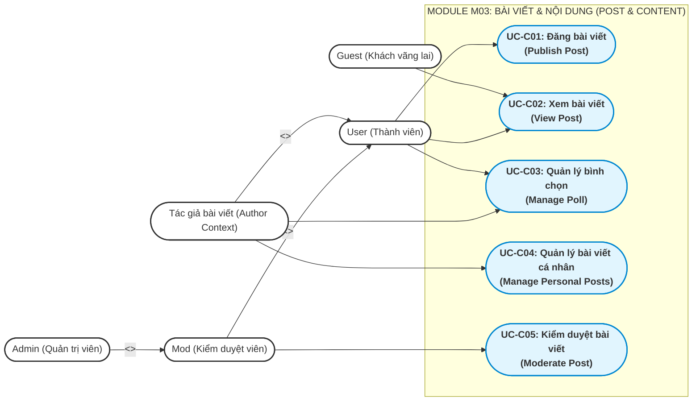
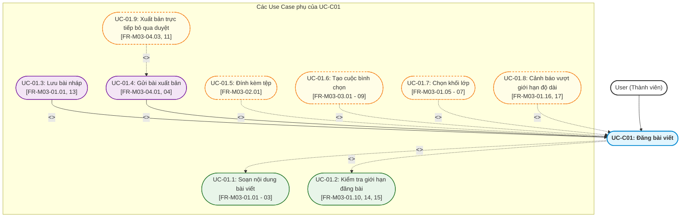
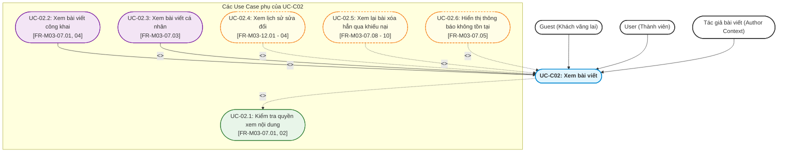
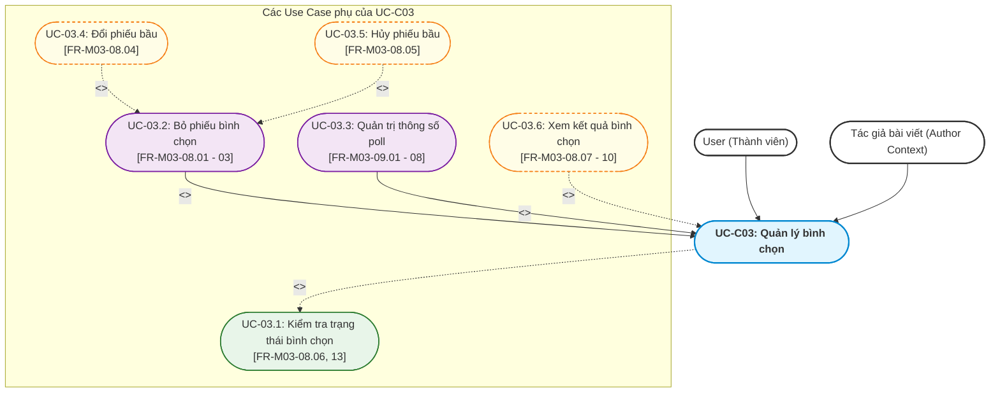
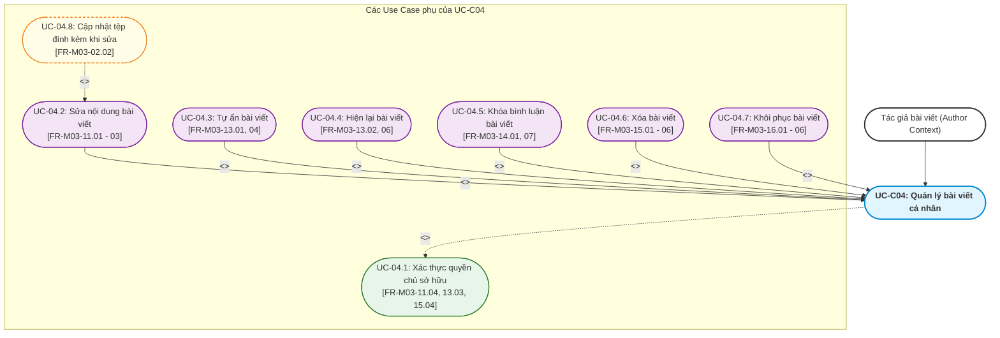
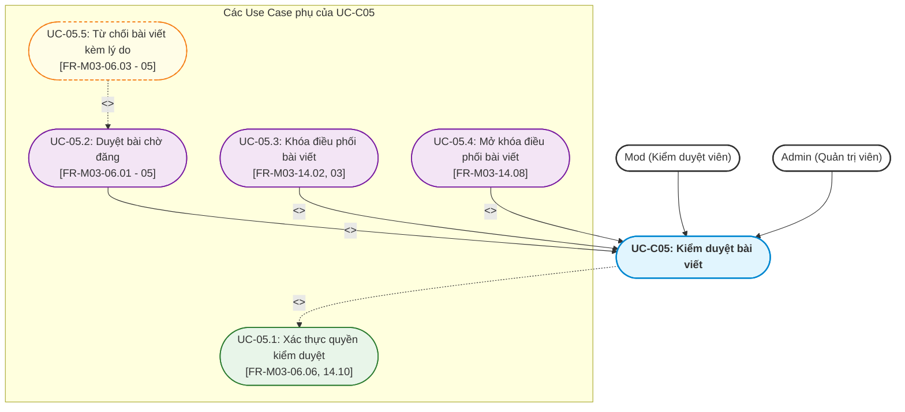

# Tài liệu Đặc tả Use Case — M03: Post & Content (US-M03)

| Thuộc tính | Nội dung |
|---|---|
| **Mã tài liệu** | `US-M03` |
| **Dự án** | iShare — Nền tảng chia sẻ tri thức và hỏi đáp học sinh THPT |
| **Module** | M03 — Post & Content (Bài viết & Nội dung) |
| **Tài liệu căn cứ (Nguồn)** | [`FR-M03.md`](file:///g:/documents/season9/iShare/docs/specs/fr/FR-M03.md) (Phiên bản 1.10 — Ngày 2026-10-24) |
| **Mốc register căn cứ** | DEC-271, QA-477, ISS-415, OPEN-012 |
| **Người thực hiện** | Antigravity Engine (Tổng hợp & Phân rã theo chuẩn BA iShare) |
| **Ngày lập** | 2026-10-27 |
| **Trạng thái** | Hoàn thành |

---

## 1. Bảng Tổng hợp các Chức năng con trong Module 3

Căn cứ theo mục 4.4 và mục 5 trong tài liệu [`FR-M03.md`](file:///g:/documents/season9/iShare/docs/specs/fr/FR-M03.md), Module 3 bao gồm 17 chức năng con với mô tả ngắn gọn phạm vi và nghiệp vụ như sau:

| STT | Mã chức năng | Tên chức năng con | Mô tả ngắn gọn phạm vi & nghiệp vụ |
|:---:|:---:|---|---|
| 1 | **FR-M03-01** | Soạn và lưu nháp bài viết | Cho phép người dùng đã đăng nhập (không ở mức cảnh cáo `MEDIUM`/`HEAVY`) soạn bài viết mới trong trình soạn giàu định dạng (hỗ trợ LaTeX, code block, H1–H3, bảng, Lớp/Khối 10–12 tùy chọn) và lưu bài chưa gửi ở trạng thái Nháp (tiêu đề tối đa 150 ký tự, nội dung tối đa 6.000 từ; từ chối lưu bài trống hoàn toàn). |
| 2 | **FR-M03-02** | Đính kèm tệp vào bài viết | Cho phép tác giả thêm hoặc bỏ tệp đính kèm ở phần dưới nội dung bài khi soạn hoặc sửa bài (tối đa 10 ảnh định dạng JPEG/PNG/WebP dung lượng $\le$ 5 MB mỗi ảnh và tối đa 3 tài liệu định dạng PDF/DOCX/XLSX/PPTX dung lượng $\le$ 20 MB mỗi tệp; tính giới hạn ảnh và tài liệu riêng biệt; tuyệt đối không chèn ảnh trong nội dung). |
| 3 | **FR-M03-03** | Tạo bình chọn trong bài viết | Cho phép tác giả thêm duy nhất 1 bình chọn (poll) đóng vào bài viết khi bài còn là bản nháp với từ 2 đến 10 lựa chọn, cấu hình chọn một hoặc chọn nhiều (mặc định chọn nhiều), tùy chọn ẩn/hiện kết quả trước khi bình chọn, và bắt buộc đặt hạn kết thúc trong tương lai; khóa cấu hình và lựa chọn sau khi gửi bài. |
| 4 | **FR-M03-04** | Gửi bài viết để đăng | Cho phép tác giả nộp bài nháp hoặc gửi lại bài bị từ chối sau khi sửa (bắt buộc có tiêu đề và nội dung hoặc poll; yêu cầu tài khoản không bị mức cảnh cáo `MEDIUM`/`HEAVY` (bị từ chối nếu vi phạm theo FR-M03-04.10)); hệ thống chuyển bài sang Chờ duyệt và kích hoạt quét nội dung khi AI bật (đăng ngay nếu AI tắt hoặc tác giả là Admin). |
| 5 | **FR-M03-05** | Quét nội dung bài viết | *(Tiến trình ngầm / Dịch vụ nền)* Hệ thống tự động kích hoạt AI chấm điểm bài viết khi được gửi hoặc khi bài đã đăng được sửa: điểm $< 0.5 \to$ Đã đăng; điểm $0.5 \le \text{điểm} < 0.9$ (hoặc quét lỗi sau 1 lần thử lại) $\to$ giữ Chờ duyệt và đưa vào hàng chờ Mod; điểm $\ge 0.9 \to$ AI tự động từ chối (với bài gửi) hoặc gắn cờ Bị gắn cờ và ẩn bài (với bài sửa). |
| 6 | **FR-M03-06** | Duyệt bài viết chờ đăng | Cho phép Mod và Admin kiểm duyệt các bài viết nằm trong hàng chờ duyệt (do điểm quét từ 0.5 đến $< 0.9$ hoặc quét lỗi): quyết định chấp nhận để chuyển sang trạng thái Đã đăng, hoặc từ chối chuyển sang Bị từ chối kèm lý do bắt buộc để tác giả sửa và gửi lại. |
| 7 | **FR-M03-07** | Xem bài viết | Cho phép mọi người dùng (kể cả Guest) xem bài viết đang hiển thị công khai (trạng thái Đã đăng và kiểm duyệt Bình thường) kèm tiêu đề, nội dung, tác giả, Lớp/Khối, tệp đính kèm và poll; cho phép tác giả xem bài của mình ở mọi trạng thái; chặn mở bài xóa hẳn hoặc bài người khác chưa công khai. |
| 8 | **FR-M03-08** | Bình chọn trong poll | Cho phép người dùng đã đăng nhập (kể cả chính tác giả bài viết) tham gia bỏ phiếu trong poll đang mở (chọn 1 hoặc nhiều theo cấu hình), hỗ trợ đổi phiếu hoặc bỏ chọn khi poll còn mở; tự động tính toán và hiển thị tỷ lệ phần trăm theo lượt chọn; chặn thao tác khi bài bị Khóa toàn bộ hoặc poll đã đóng. |
| 9 | **FR-M03-09** | Đổi hạn, kết thúc và thêm lựa chọn cho poll | Cho phép tác giả của bài viết quản trị poll đang mở: thay đổi hạn kết thúc sang mốc thời gian mới trong tương lai, kết thúc ngay lập tức để đóng poll, hoặc thêm lựa chọn mới vào poll của bài đã gửi (tối đa không quá 10 lựa chọn; không sửa hoặc xóa lựa chọn cũ). |
| 10 | **FR-M03-10** | Kết thúc poll khi hết hạn | *(Tiến trình ngầm / Batch Job)* Tác vụ tự động của hệ thống khi chạm đến mốc hạn kết thúc của poll: tự động chuyển trạng thái poll sang Đã đóng, ngừng tiếp nhận mọi phiếu bầu mới/đổi phiếu/bỏ phiếu, hiển thị công khai kết quả theo phần trăm cho mọi người xem và phát sinh sự kiện thông báo kết thúc (cho M07). |
| 11 | **FR-M03-11** | Sửa bài viết đã gửi | Cho phép tác giả cập nhật tiêu đề, nội dung, Lớp/Khối và tệp đính kèm của bài viết ở trạng thái Bị từ chối, Đã đăng hoặc Tự ẩn (kể cả khi bài bị khóa bình luận hoặc khóa toàn bộ; từ chối khi đang Chờ duyệt, Đã xóa hoặc Bị Mod ẩn); hệ thống tự động lưu phiên bản cũ vào lịch sử sửa và kích hoạt quét lại nếu bài đang Đã đăng. |
| 12 | **FR-M03-12** | Xem lịch sử sửa bài viết | Cho phép mọi người xem được bài viết (kể cả Guest) bấm "Xem lịch sử" trên các bài có nhãn "(đã chỉnh sửa)" để duyệt danh sách các phiên bản nội dung trước đó kèm thông tin người sửa và thời điểm sửa. |
| 13 | **FR-M03-13** | Tự ẩn và hiện lại bài viết | Cho phép tác giả chủ động ẩn bài viết Đã đăng của mình (chuyển sang trạng thái Tự ẩn, không hiển thị công khai) và cho phép hiện lại về trạng thái Đã đăng bất kỳ lúc nào; nếu bài có chỉnh sửa trong thời gian tự ẩn thì hệ thống sẽ kích hoạt quét lại khi hiện lại. |
| 14 | **FR-M03-14** | Khóa và mở khóa bài viết | Cho phép tác giả bài viết khóa hoặc mở khóa bình luận cho bài của mình; cho phép Mod/Admin khóa bình luận hoặc Khóa toàn bộ bài viết (chặn bình luận, upvote và poll; vẫn cho bookmark/báo cáo) và ghi nhận người khóa; tác giả không thể tự mở khóa hoặc hạ mức khóa do Mod/Admin thiết lập. |
| 15 | **FR-M03-15** | Xóa bài viết | Cho phép tác giả thực hiện xóa mềm bài viết của mình ở bất kỳ trạng thái nào (trừ bài đã xóa); hệ thống ghi nhận thời điểm xóa, trạng thái trước đó, ẩn bài khỏi feed công khai, đưa vào tab "Đã xóa" trên hồ sơ tác giả và rút bài khỏi hàng chờ duyệt của Mod nếu đang Chờ duyệt. |
| 16 | **FR-M03-16** | Khôi phục bài viết đã xóa | Cho phép tác giả khôi phục bài viết trong tab "Đã xóa" trong thời hạn khôi phục 7 ngày ($7 \times 24$ giờ) kể từ lúc xóa mềm; hệ thống đưa bài về trạng thái trước khi xóa (riêng bài vốn ở Chờ duyệt thì chuyển về Nháp; từ chối nếu bài có trạng thái kiểm duyệt Bị Mod ẩn). |
| 17 | **FR-M03-17** | Chuyển bài hết hạn khôi phục sang Đã xóa hẳn | *(Tiến trình ngầm / Cron Job)* Tác vụ tự động của hệ thống khi bài viết ở trạng thái Đã xóa vượt quá 7 ngày: hệ thống gắn cờ Đã xóa hẳn (chỉ gắn cờ, giữ nguyên toàn bộ dữ liệu nội dung, tệp, poll, lịch sử sửa để phục vụ kiểm duyệt/khiếu nại), không cho phép khôi phục và ẩn hoàn toàn khỏi giao diện người dùng. |

---

## 2. Phân rã thành các Use Case Chính & Quy trình Nghiệp vụ Hoàn chỉnh

### 2.1 Tiêu chí phân rã Use Case Chính
- **Đủ lớn & Độc lập:** Đại diện cho một mục tiêu nghiệp vụ trọn vẹn của người dùng (User Goal) hoặc của hệ thống.
- **Có tương tác giao diện trực tiếp:** Bắt đầu bằng một hành động chủ động của Actor trên giao diện (UI) và kết thúc khi đạt được kết quả mong đợi.
- **Bao hàm các chức năng con:** Chứa đựng các bước thực hiện mang tính nghiệp vụ bắt buộc hoặc tùy chọn mở rộng.
- **Quy tắc đặt tên (Chuẩn BA chuyên nghiệp):** Cấu trúc `[1 Động từ duy nhất] + [Cụm danh từ]`. Tuyệt đối không dùng nhiều động từ nối nhau bằng từ liên kết ("và", "&", "/", "hoặc"). Văn phong mang tính con người, tường minh và chuẩn nghiệp vụ.

Từ 17 chức năng con, Module 3 được phân rã thành **5 Use Case Chính** sau:
1. **UC-C01: Đăng bài viết (Publish Post)**
2. **UC-C02: Xem bài viết (View Post)**
3. **UC-C03: Quản lý bình chọn (Manage Poll)**
4. **UC-C04: Quản lý bài viết cá nhân (Manage Personal Posts)**
5. **UC-C05: Kiểm duyệt bài viết (Moderate Post)**

---

### 2.2 Sơ đồ Use Case Tổng quan của Module 3 (Macro Use Case Diagram)

---

### 2.3 Mô tả Quy trình Nghiệp vụ Hoàn chỉnh của từng Use Case Chính

#### 1. UC-C01: Đăng bài viết (Publish Post)
- **Actor chính:** `User` (với tư cách là người soạn bài), `Admin`.
- **Mục tiêu:** Soạn thảo nội dung và xuất bản thành công một bài viết mới (hoặc lưu nháp an toàn để tiếp tục chỉnh sửa sau).
- **Quy trình nghiệp vụ hoàn chỉnh (Kiểu B: Phân nhánh song song giữa Lưu nháp & Gửi đăng):**
  - *Nhánh 1 — Lưu bài nháp (Save Draft):* Người dùng mở trình soạn bài mới $\to$ Nhập tiêu đề, nội dung, tùy chọn đính kèm tệp/poll/khối lớp $\to$ Bấm "Lưu nháp" $\to$ Hệ thống kiểm tra điều kiện tài khoản (không bị mức cảnh cáo `MEDIUM`/`HEAVY`) và tính hợp lệ (bài không trống hoàn toàn; tiêu đề $\le 150$ ký tự, nội dung $\le 6.000$ từ) $\to$ Lưu thành công ở trạng thái `Nháp`.
  - *Nhánh 2 — Gửi bài xuất bản (Submit Post):* Tác giả hoàn thiện bài (từ bài mới, bài nháp hoặc bài bị từ chối) $\to$ Bấm "Gửi bài" $\to$ Hệ thống kiểm tra điều kiện bắt buộc (phải có tiêu đề, và phải có nội dung hoặc poll; không vượt giới hạn độ dài) $\to$ Xử lý chuyển trạng thái:
    + Nếu tác giả là Admin hoặc hệ thống tắt AI/Moderation: Chuyển thẳng sang `Đã đăng` ngay lập tức.
    + Nếu tác giả là User/Mod và AI đang bật: Chuyển sang trạng thái `Chờ duyệt` và gửi nội dung sang tiến trình quét tự động của AI.

#### 2. UC-C02: Xem bài viết (View Post)
- **Actor chính:** `Guest`, `User`, `Mod`, `Admin`, `Tác giả bài viết`.
- **Mục tiêu:** Tiếp cận, hiển thị và đọc nội dung bài viết, tệp đính kèm, poll và lịch sử chỉnh sửa theo đúng quyền hạn và trạng thái bài viết.
- **Quy trình nghiệp vụ hoàn chỉnh (Kiểu B: Phân nhánh theo ngữ cảnh truy cập):**
  - *Nhánh 1 — Xem bài viết công khai (Public Post View):* Guest hoặc User truy cập đường dẫn bài viết `/p/{post_id}` $\to$ Hệ thống kiểm tra bài ở trạng thái đăng `Đã đăng` và trạng thái kiểm duyệt `Bình thường` $\to$ Hiển thị toàn văn bài viết với định dạng giàu (render công thức LaTeX, code block), ảnh/tài liệu đính kèm và giao diện poll.
  - *Nhánh 2 — Xem bài viết cá nhân chưa công khai (Author Private View):* Tác giả mở bài của chính mình ở trạng thái `Nháp`, `Chờ duyệt`, `Bị từ chối`, `Tự ẩn`, hoặc trong tab "Đã xóa" $\to$ Hệ thống xác thực danh tính chính chủ và hiển thị đầy đủ nội dung bài (kèm thông tin lý do từ chối nếu có).
  - *Nhánh 3 — Xem lịch sử chỉnh sửa (Revision History View):* Người xem mở bài viết có nhãn "(đã chỉnh sửa)" $\to$ Bấm "Xem lịch sử" $\to$ Hệ thống hiển thị danh sách các phiên bản nội dung trước đây kèm thông tin người sửa và thời điểm sửa.

#### 3. UC-C03: Quản lý bình chọn (Manage Poll)
- **Actor chính:** `User` (Người tham gia bỏ phiếu), `Tác giả bài viết` (Người quản trị poll).
- **Mục tiêu:** Ghi nhận và phản ánh ý kiến đánh giá của cộng đồng qua cuộc thăm dò đóng, đồng thời cung cấp công cụ điều phối poll cho tác giả.
- **Quy trình nghiệp vụ hoàn chỉnh (Kiểu B: Phân nhánh tương tác & quản trị):**
  - *Nhánh 1 — Bỏ phiếu bình chọn (Cast Vote):* User mở bài viết có poll đang mở $\to$ Chọn 1 hoặc nhiều lựa chọn theo cấu hình poll $\to$ Hệ thống kiểm tra bài không bị `Khóa toàn bộ` và poll chưa đóng $\to$ Ghi nhận phiếu, tính toán tỷ lệ % theo tổng lượt chọn và cập nhật giao diện.
  - *Nhánh 2 — Đổi phiếu hoặc bỏ chọn (Change / Revoke Vote):* User đã bình chọn chọn lại phương án khác hoặc bấm bỏ chọn khi poll còn mở $\to$ Hệ thống cập nhật phiếu mới hoặc xóa phiếu cũ tương ứng.
  - *Nhánh 3 — Quản trị poll đang mở (Manage Active Poll):* Tác giả bài viết truy cập bảng điều khiển poll $\to$ Lựa chọn đổi hạn kết thúc sang mốc mới trong tương lai, kết thúc ngay lập tức (chuyển sang `Đã đóng`), hoặc bổ sung thêm lựa chọn mới (tổng không quá 10) $\to$ Hệ thống cập nhật thông số poll.

#### 4. UC-C04: Quản lý bài viết cá nhân (Manage Personal Posts)
- **Actor chính:** `Tác giả bài viết` (Contextual Role của User/Mod/Admin đối với bài viết của chính mình).
- **Mục tiêu:** Cho phép tác giả toàn quyền điều chỉnh nội dung, trạng thái hiển thị và vòng đời bài viết của mình.
- **Quy trình nghiệp vụ hoàn chỉnh (Kiểu B: Đa nhánh quản trị vòng đời):**
  - *Nhánh 1 — Sửa nội dung bài viết đã gửi:* Tác giả chọn sửa bài ở trạng thái `Bị từ chối`, `Đã đăng` hoặc `Tự ẩn` $\to$ Cập nhật tiêu đề, nội dung, tệp đính kèm, khối lớp $\to$ Bấm lưu $\to$ Hệ thống tự động ghi lại phiên bản trước đó vào lịch sử sửa và kích hoạt quét lại nếu bài đang ở trạng thái `Đã đăng`.
  - *Nhánh 2 — Tự ẩn và hiện lại bài viết:* Tác giả chọn ẩn bài viết `Đã đăng` của mình $\to$ Hệ thống chuyển sang `Tự ẩn` và rút bài khỏi nơi công cộng; Khi tác giả bấm "Hiện lại" $\to$ Hệ thống đưa về `Đã đăng` (kích hoạt quét lại nếu có bản sửa được lưu trong lúc ẩn).
  - *Nhánh 3 — Khóa hoặc mở khóa bình luận của tác giả:* Tác giả chọn khóa bình luận bài mình $\to$ Hệ thống đặt mức `Khóa bình luận` và ghi người khóa là tác giả; Tác giả có thể chủ động mở khóa lại về `Không khóa`.
  - *Nhánh 4 — Xóa mềm và khôi phục bài viết:* Tác giả bấm xóa bài $\to$ Hệ thống chuyển trạng thái sang `Đã xóa`, ghi mốc thời gian xóa và đưa vào tab "Đã xóa"; Trong thời hạn 7 ngày ($7 \times 24$ giờ), tác giả mở tab "Đã xóa" và bấm "Khôi phục" $\to$ Hệ thống hoàn trả bài về trạng thái trước khi xóa (riêng bài vốn ở Chờ duyệt thì về Nháp).

#### 5. UC-C05: Kiểm duyệt bài viết (Moderate Post)
- **Actor chính:** `Mod`, `Admin`.
- **Mục tiêu:** Thẩm định nội dung các bài viết nghi vấn và điều phối tương tác khi xảy ra tranh cãi để duy trì trật tự cộng đồng.
- **Quy trình nghiệp vụ hoàn chỉnh (Kiểu B: Phân nhánh duyệt bài & điều phối khóa):**
  - *Nhánh 1 — Duyệt bài chờ đăng:* Mod/Admin mở hàng chờ duyệt bài viết (các bài có điểm quét từ 0.5 đến $< 0.9$ hoặc quét lỗi) $\to$ Đọc nội dung $\to$ Chọn "Chấp nhận" (chuyển sang `Đã đăng`) hoặc "Từ chối" (bắt buộc nhập lý do từ chối $\to$ chuyển sang `Bị từ chối` và hiển thị lý do cho tác giả).
  - *Nhánh 2 — Khóa điều phối bài viết:* Mod/Admin nhận diện bài viết vi phạm hoặc tranh chấp gay gắt $\to$ Chọn đặt mức `Khóa bình luận` hoặc `Khóa toàn bộ` (chặn bình luận mới, upvote và poll) kèm ghi nhận người khóa là Mod $\to$ Hệ thống khóa bài (tác giả không thể tự mở khóa hoặc hạ mức khóa này).
  - *Nhánh 3 — Mở khóa hoặc hạ mức khóa:* Mod/Admin mở bài viết đang bị Mod khóa $\to$ Chọn mở khóa về `Không khóa` hoặc hạ từ Khóa toàn bộ xuống Khóa bình luận $\to$ Hệ thống cập nhật mức khóa mới.

---

## 3. Xác định Use Case con Chi tiết và Mối quan hệ với Use Case Chính

### 3.1 Phân rã UC-C01: Đăng bài viết

#### Bảng chi tiết quan hệ, điều kiện & lý do nghiệp vụ (UC-C01):
| Mã Use Case con | Tên Use Case con | Căn cứ FR/BR | Quan hệ | Điều kiện kích hoạt & Lý do nghiệp vụ |
|---|---|:---:|:---:|---|
| **UC-01.1** | Soạn nội dung bài viết | FR-M03-01.01 - 03 BR-M03-03, 05 | `<<include>>` | **Bắt buộc:** Khởi tạo không gian soạn thảo giàu định dạng (tiêu đề, khối nội dung, công thức mã thô LaTeX, code block, bảng biểu, trích dẫn). |
| **UC-01.2** | Kiểm tra giới hạn đăng bài | FR-M03-01.10, 14, 15 BR-M03-38, 42 | `<<include>>` | **Bắt buộc:** Kiểm tra tính hợp lệ của bài: tiêu đề $\le 150$ ký tự, nội dung $\le 6.000$ từ và tài khoản không thuộc mức cảnh cáo `MEDIUM`/`HEAVY`. |
| **UC-01.3** | Lưu bài nháp | FR-M03-01.01, 13 BR-M03-41 | Generalization | **Kế thừa (Chuyên biệt hóa):** Tác giả chọn lưu bài chưa gửi ở trạng thái `Nháp`. Điều kiện: Bài không được trống hoàn toàn (phải có ít nhất 1 trong 4 phần: tiêu đề, nội dung, poll hoặc tệp đính kèm). |
| **UC-01.4** | Gửi bài xuất bản | FR-M03-04.01, 04, 08, 09 BR-M03-40 | Generalization | **Kế thừa (Chuyên biệt hóa):** Tác giả nộp bài để đăng. Điều kiện: Bắt buộc có tiêu đề, và phải có nội dung hoặc poll; chuyển sang `Chờ duyệt` để quét AI nếu công tắc AI bật. |
| **UC-01.5** | Đính kèm tệp | FR-M03-02.01, 04 - 10 BR-M03-04, 07, 08 | `<<extend>>` | **Nhánh tùy chọn:** Tác giả thêm tối đa 10 ảnh (JPEG/PNG/WebP $\le 5$ MB) và tối đa 3 tài liệu (PDF/DOCX/XLSX/PPTX $\le 20$ MB) ở phần đính kèm dưới bài. |
| **UC-01.6** | Tạo cuộc bình chọn | FR-M03-03.01 - 09 BR-M03-09 - 12 | `<<extend>>` | **Nhánh tùy chọn:** Tác giả thêm tối đa 1 poll đóng (2–10 lựa chọn, hạn kết thúc trong tương lai, cấu hình chọn một/nhiều) khi bài còn là bản nháp. |
| **UC-01.7** | Chọn khối lớp | FR-M03-01.05 - 07 BR-M03-06 | `<<extend>>` | **Nhánh tùy chọn:** Tác giả chọn gắn thẻ Lớp/Khối (10, 11 hoặc 12) hoặc để trống; độc lập với thông tin khối lớp trên hồ sơ cá nhân. |
| **UC-01.8** | Cảnh báo vượt giới hạn độ dài | FR-M03-01.16, 17 BR-M03-43 | `<<extend>>` | **Ngoại lệ giao diện:** Kích hoạt ngay trên màn hình soạn thảo khi tiêu đề vượt 150 ký tự hoặc nội dung vượt 6.000 từ; giữ nguyên nội dung đang soạn để tác giả chỉnh sửa. |
| **UC-01.9** | Xuất bản trực tiếp bỏ qua duyệt | FR-M03-04.03, 11 BR-M03-22, 51 | `<<extend>>` *(trong Gửi bài)* | **Rẽ nhánh đặc quyền / ngoại lệ:** Kích hoạt khi tác giả là Admin hoặc khi công tắc AI tổng / Moderation đang tắt; bài viết chuyển thẳng sang trạng thái `Đã đăng` mà không cần quét AI hay qua Mod. |

---

### 3.2 Phân rã UC-C02: Xem bài viết

#### Bảng chi tiết quan hệ, điều kiện & lý do nghiệp vụ (UC-C02):
| Mã Use Case con | Tên Use Case con | Căn cứ FR/BR | Quan hệ | Điều kiện kích hoạt & Lý do nghiệp vụ |
|---|---|:---:|:---:|---|
| **UC-02.1** | Kiểm tra quyền xem nội dung | FR-M03-07.01, 02 BR-M03-18 | `<<include>>` | **Bắt buộc:** Hệ thống xác thực danh tính người xem, trạng thái đăng và trạng thái kiểm duyệt của bài viết để điều phối quyền hiển thị. |
| **UC-02.2** | Xem bài viết công khai | FR-M03-07.01, 04 BR-M03-18, 39 | Generalization | **Kế thừa (Chuyên biệt hóa):** Cho phép mọi người (kể cả Guest) xem các bài ở trạng thái `Đã đăng` và kiểm duyệt `Bình thường` kèm toàn bộ tiêu đề, nội dung, tác giả, khối lớp, tệp đính kèm và poll. |
| **UC-02.3** | Xem bài viết cá nhân | FR-M03-07.03 BR-M03-49 | Generalization | **Kế thừa (Chuyên biệt hóa):** Cho phép chính tác giả xem bài của mình ở mọi trạng thái (`Nháp`, `Chờ duyệt`, `Bị từ chối`, `Tự ẩn`, hoặc trong tab `Đã xóa`). |
| **UC-02.4** | Xem lịch sử sửa đổi | FR-M03-12.01 - 04 BR-M03-27 | `<<extend>>` | **Mở rộng tương tác:** Xuất hiện nhãn "(đã chỉnh sửa)" và nút "Xem lịch sử" khi bài có ít nhất 1 lần sửa; cho phép người xem duyệt danh sách các phiên bản nội dung trước đây kèm người sửa và thời điểm sửa. |
| **UC-02.5** | Xem lại bài xóa hẳn qua khiếu nại | FR-M03-07.08 - 10 BR-M03-37 | `<<extend>>` | **Mở rộng ngữ cảnh đặc thù:** Kích hoạt khi tác giả mở xem bài từ thông báo kết quả xử lý báo cáo hoặc đơn khiếu nại; hiển thị bài ở chế độ chỉ đọc kể cả khi bài đã gắn cờ `Đã xóa hẳn`. |
| **UC-02.6** | Hiển thị thông báo không tồn tại | FR-M03-07.05 BR-M03-37 | `<<extend>>` | **Ngoại lệ điều hướng:** Kích hoạt khi người dùng mở đường dẫn trực tiếp của một bài viết đã chuyển sang trạng thái `Đã xóa hẳn`. |

---

### 3.3 Phân rã UC-C03: Quản lý bình chọn

#### Bảng chi tiết quan hệ, điều kiện & lý do nghiệp vụ (UC-C03):
| Mã Use Case con | Tên Use Case con | Căn cứ FR/BR | Quan hệ | Điều kiện kích hoạt & Lý do nghiệp vụ |
|---|---|:---:|:---:|---|
| **UC-03.1** | Kiểm tra trạng thái bình chọn | FR-M03-08.06, 13 BR-M03-13, 31 | `<<include>>` | **Bắt buộc:** Kiểm tra poll còn mở (chưa hết hạn / chưa bị kết thúc) và bài viết không ở mức `Khóa toàn bộ`. Từ chối mọi thao tác bỏ phiếu/đổi phiếu nếu vi phạm. |
| **UC-03.2** | Bỏ phiếu bình chọn | FR-M03-08.01 - 03, 11 BR-M03-10, 11, 45 | Generalization | **Kế thừa (Chuyên biệt hóa):** User (kể cả tác giả) ghi phiếu bình chọn: chọn đúng 1 lựa chọn (nếu chọn một) hoặc 1 đến tất cả (nếu chọn nhiều). |
| **UC-03.3** | Quản trị thông số poll | FR-M03-09.01 - 08 BR-M03-14, 44 | Generalization | **Kế thừa (Chuyên biệt hóa):** Tác giả đổi hạn kết thúc sang mốc tương lai, bấm kết thúc ngay (đóng poll), hoặc thêm lựa chọn mới vào bài đã gửi (tối đa 10 lựa chọn). |
| **UC-03.4** | Đổi phiếu bầu | FR-M03-08.04 BR-M03-16 | `<<extend>>` *(trong Bỏ phiếu)* | **Rẽ nhánh tương tác:** Kích hoạt khi người dùng đã bỏ phiếu thực hiện chọn lại phương án khác trong lúc poll còn mở; hệ thống thay thế phiếu cũ bằng phiếu mới. |
| **UC-03.5** | Hủy phiếu bầu | FR-M03-08.05 BR-M03-16 | `<<extend>>` *(trong Bỏ phiếu)* | **Rẽ nhánh tương tác:** Kích hoạt khi người dùng bấm bỏ chọn hoàn toàn phiếu của mình trong lúc poll còn mở; hệ thống xóa sạch phiếu của người dùng. |
| **UC-03.6** | Xem kết quả bình chọn | FR-M03-08.07 - 10, 12 BR-M03-15 | `<<extend>>` | **Mở rộng hiển thị:** Hiển thị tỷ lệ phần trăm theo lượt chọn (làm tròn số nguyên) khi người dùng đã vote, hoặc khi bật hiện trước khi vote, hoặc mặc định cho mọi người xem khi poll đã đóng. |

---

### 3.4 Phân rã UC-C04: Quản lý bài viết cá nhân

#### Bảng chi tiết quan hệ, điều kiện & lý do nghiệp vụ (UC-C04):
| Mã Use Case con | Tên Use Case con | Căn cứ FR/BR | Quan hệ | Điều kiện kích hoạt & Lý do nghiệp vụ |
|---|---|:---:|:---:|---|
| **UC-04.1** | Xác thực quyền chủ sở hữu | FR-M03-11.04, 13.03, 14.11, 15.04, 16.05 | `<<include>>` | **Bắt buộc:** Kiểm tra người dùng thực hiện các thao tác quản trị vòng đời phải đúng là tác giả sở hữu bài viết; từ chối mọi truy cập trái phép. |
| **UC-04.2** | Sửa nội dung bài viết | FR-M03-11.01 - 03 BR-M03-27, 47 | Generalization | **Kế thừa (Chuyên biệt hóa):** Cho phép sửa tiêu đề, nội dung, khối lớp trên bài ở trạng thái `Bị từ chối`, `Đã đăng` hoặc `Tự ẩn` (kể cả khi bài bị khóa); tự động lưu phiên bản cũ vào lịch sử sửa và kích hoạt quét lại nếu bài đang hiển thị. |
| **UC-04.3** | Tự ẩn bài viết | FR-M03-13.01, 04 BR-M03-29 | Generalization | **Kế thừa (Chuyên biệt hóa):** Tác giả chủ động đưa bài viết `Đã đăng` sang trạng thái `Tự ẩn` để ngừng hiển thị công khai. |
| **UC-04.4** | Hiện lại bài viết | FR-M03-13.02, 06 BR-M03-26, 29 | Generalization | **Kế thừa (Chuyên biệt hóa):** Tác giả đưa bài `Tự ẩn` về `Đã đăng`; kích hoạt quét lại nếu bài có bản sửa được lưu trong lúc ẩn. |
| **UC-04.5** | Khóa bình luận bài viết | FR-M03-14.01, 07 BR-M03-30, 32 | Generalization | **Kế thừa (Chuyên biệt hóa):** Tác giả thiết lập mức `Khóa bình luận` (chặn bình luận mới, ghi người khóa là tác giả) hoặc mở khóa về `Không khóa` (chỉ áp dụng khi người khóa là tác giả). |
| **UC-04.6** | Xóa bài viết | FR-M03-15.01 - 06 BR-M03-34 | Generalization | **Kế thừa (Chuyên biệt hóa):** Tác giả xóa mềm bài viết ở mọi trạng thái trừ Đã xóa; hệ thống ghi mốc thời gian xóa, trạng thái trước đó, chuyển vào tab "Đã xóa" và rút khỏi hàng chờ Mod. |
| **UC-04.7** | Khôi phục bài viết | FR-M03-16.01 - 06 BR-M03-35, 36 | Generalization | **Kế thừa (Chuyên biệt hóa):** Tác giả khôi phục bài viết trong tab "Đã xóa" trong thời hạn 7 ngày; đưa về trạng thái trước đó (riêng bài Chờ duyệt thì về Nháp; từ chối nếu có trạng thái kiểm duyệt Bị Mod ẩn). |
| **UC-04.8** | Cập nhật tệp đính kèm khi sửa | FR-M03-02.02 BR-M03-07, 08 | `<<extend>>` *(trong Sửa bài)* | **Nhánh tùy chọn:** Cho phép thêm hoặc xóa bớt tệp ảnh/tài liệu đính kèm trong quá trình sửa bài viết đã gửi. |

---

### 3.5 Phân rã UC-C05: Kiểm duyệt bài viết

#### Bảng chi tiết quan hệ, điều kiện & lý do nghiệp vụ (UC-C05):
| Mã Use Case con | Tên Use Case con | Căn cứ FR/BR | Quan hệ | Điều kiện kích hoạt & Lý do nghiệp vụ |
|---|---|:---:|:---:|---|
| **UC-05.1** | Xác thực quyền kiểm duyệt | FR-M03-06.06, 14.10, 14.11 | `<<include>>` | **Bắt buộc:** Hệ thống xác thực người yêu cầu phải có vai trò Mod hoặc Admin; từ chối mọi hành động kiểm duyệt của người dùng thông thường. |
| **UC-05.2** | Duyệt bài chờ đăng | FR-M03-06.01, 02 BR-M03-23 | Generalization | **Kế thừa (Chuyên biệt hóa):** Mod/Admin duyệt bài viết trong hàng chờ (bài có điểm AI từ 0.5 đến $< 0.9$ hoặc quét lỗi); chấp nhận để chuyển sang `Đã đăng`. |
| **UC-05.3** | Khóa điều phối bài viết | FR-M03-14.02, 03 BR-M03-31, 32 | Generalization | **Kế thừa (Chuyên biệt hóa):** Mod/Admin đặt mức `Khóa bình luận` hoặc `Khóa toàn bộ` (chặn bình luận mới, upvote và poll) kèm ghi nhận người khóa là Mod. |
| **UC-05.4** | Mở khóa điều phối bài viết | FR-M03-14.08 BR-M03-32 | Generalization | **Kế thừa (Chuyên biệt hóa):** Mod/Admin mở khóa bài viết do Mod khóa hoặc hạ từ Khóa toàn bộ xuống Khóa bình luận. |
| **UC-05.5** | Từ chối bài viết kèm lý do | FR-M03-06.03 - 05 BR-M03-23 | `<<extend>>` *(trong Duyệt bài)* | **Rẽ nhánh ngoại lệ khi duyệt:** Kích hoạt khi Mod/Admin từ chối bài chờ duyệt; bắt buộc nhập lý do từ chối để chuyển bài sang `Bị từ chối` và hiển thị lý do cho tác giả. |

---

## 4. Bảng Tổng kết Ánh xạ Toàn bộ Chức năng & Sơ đồ Use Case Chi tiết

### 4.1 Bảng Ma trận Ánh xạ Toàn bộ 17 Chức năng Con vào Hệ thống Use Case

| Mã FR | Tên chức năng con trong `FR-M03.md` | Thuộc Use Case Chính | Thuộc Use Case Phụ cụ thể | Vai trò quan hệ trong UC Chính |
|:---:|---|:---:|---|:---:|
| **FR-M03-01** | Soạn và lưu nháp bài viết | **UC-C01** | UC-01.1: Soạn nội dung bài viết UC-01.2: Kiểm tra giới hạn đăng bài UC-01.3: Lưu bài nháp UC-01.7: Chọn khối lớp UC-01.8: Cảnh báo vượt giới hạn độ dài | `<<include>>` (Bắt buộc) `<<include>>` (Bắt buộc) Generalization (Kế thừa) `<<extend>>` (Tùy chọn) `<<extend>>` (Ngoại lệ giao diện) |
| **FR-M03-02** | Đính kèm tệp vào bài viết | **UC-C01** **UC-C04** | UC-01.5: Đính kèm tệp UC-04.8: Cập nhật tệp đính kèm khi sửa | `<<extend>>` (Tùy chọn khi tạo bài) `<<extend>>` (Tùy chọn khi sửa bài) |
| **FR-M03-03** | Tạo bình chọn trong bài viết | **UC-C01** | UC-01.6: Tạo cuộc bình chọn | `<<extend>>` (Tùy chọn khi soạn bài) |
| **FR-M03-04** | Gửi bài viết để đăng | **UC-C01** | UC-01.4: Gửi bài xuất bản UC-01.9: Xuất bản trực tiếp bỏ qua duyệt | Generalization (Kế thừa) `<<extend>>` (Rẽ nhánh Admin / Tắt AI) |
| **FR-M03-05** | Quét nội dung bài viết | *(Tiến trình ngầm)* | Dịch vụ AI tự động chấm điểm bài viết khi gửi hoặc sửa; phân loại điểm ($<0.5$, $0.5 - <0.9$, $\ge 0.9$) và gắn cờ kiểm duyệt | Dịch vụ nền tảng hạ tầng kỹ thuật |
| **FR-M03-06** | Duyệt bài viết chờ đăng | **UC-C05** | UC-05.2: Duyệt bài chờ đăng UC-05.5: Từ chối bài viết kèm lý do | Generalization (Kế thừa) `<<extend>>` (Rẽ nhánh khi từ chối) |
| **FR-M03-07** | Xem bài viết | **UC-C02** | UC-02.1: Kiểm tra quyền xem nội dung UC-02.2: Xem bài viết công khai UC-02.3: Xem bài viết cá nhân UC-02.5: Xem lại bài xóa hẳn qua khiếu nại UC-02.6: Hiển thị thông báo không tồn tại | `<<include>>` (Bắt buộc) Generalization (Kế thừa) Generalization (Kế thừa) `<<extend>>` (Mở rộng ngữ cảnh) `<<extend>>` (Ngoại lệ điều hướng) |
| **FR-M03-08** | Bình chọn trong poll | **UC-C03** | UC-03.1: Kiểm tra trạng thái bình chọn UC-03.2: Bỏ phiếu bình chọn UC-03.4: Đổi phiếu bầu UC-03.5: Hủy phiếu bầu UC-03.6: Xem kết quả bình chọn | `<<include>>` (Bắt buộc) Generalization (Kế thừa) `<<extend>>` (Rẽ nhánh tương tác) `<<extend>>` (Rẽ nhánh tương tác) `<<extend>>` (Mở rộng hiển thị) |
| **FR-M03-09** | Đổi hạn, kết thúc và thêm lựa chọn cho poll | **UC-C03** | UC-03.3: Quản trị thông số poll | Generalization (Kế thừa) |
| **FR-M03-10** | Kết thúc poll khi hết hạn | *(Tiến trình ngầm)* | Scheduler / Cron Job tự động chuyển poll sang `Đã đóng` khi đến hạn và phát sinh sự kiện kết thúc cho M07 | Daemon chạy tự động |
| **FR-M03-11** | Sửa bài viết đã gửi | **UC-C04** | UC-04.2: Sửa nội dung bài viết | Generalization (Kế thừa) |
| **FR-M03-12** | Xem lịch sử sửa bài viết | **UC-C02** | UC-02.4: Xem lịch sử sửa đổi | `<<extend>>` (Mở rộng tương tác) |
| **FR-M03-13** | Tự ẩn và hiện lại bài viết | **UC-C04** | UC-04.3: Tự ẩn bài viết UC-04.4: Hiện lại bài viết | Generalization (Kế thừa) Generalization (Kế thừa) |
| **FR-M03-14** | Khóa và mở khóa bài viết | **UC-C04** **UC-C05** | UC-04.5: Khóa bình luận bài viết UC-05.3: Khóa điều phối bài viết UC-05.4: Mở khóa điều phối bài viết | Generalization (Kế thừa của Tác giả) Generalization (Kế thừa của Mod/Admin) Generalization (Kế thừa của Mod/Admin) |
| **FR-M03-15** | Xóa bài viết | **UC-C04** | UC-04.6: Xóa bài viết | Generalization (Kế thừa) |
| **FR-M03-16** | Khôi phục bài viết đã xóa | **UC-C04** | UC-04.7: Khôi phục bài viết | Generalization (Kế thừa) |
| **FR-M03-17** | Chuyển bài hết hạn khôi phục sang Đã xóa hẳn | *(Tiến trình ngầm)* | Cron Job tự động gắn cờ `Đã xóa hẳn` sau 7 ngày xóa mềm, bảo toàn toàn bộ dữ liệu phục vụ kiểm duyệt | Daemon chạy tự động |

---

### 4.2 Sơ đồ Use Case Chi tiết Toàn bộ Module 3 (Comprehensive Detailed Use Case Diagram)

```mermaid
flowchart TB
    %% ========================================================
    %% ACTORS & GENERALIZATION
    %% ========================================================
    Guest(["Guest (Khách vãng lai)"])
    User(["User (Thành viên)"])
    Author(["Tác giả bài viết (Author Context)"])
    Mod(["Mod (Kiểm duyệt viên)"])
    Admin(["Admin (Quản trị viên)"])

    Author -->|"<<generalization>>"| User
    Mod -->|"<<generalization>>"| User
    Admin -->|"<<generalization>>"| Mod

    %% ========================================================
    %% SUBGRAPH 1: ĐĂNG BÀI VIẾT
    %% ========================================================
    subgraph UCC01 ["UC-C01: Đăng bài viết"]
        direction TB
        UC_C01(["UC-C01: Đăng bài viết"])

        INC_C01_COM(["UC-01.1: Soạn nội dung bài viết<br/>[FR-M03-01.01 - 03]"])
        INC_C01_CHK(["UC-01.2: Kiểm tra giới hạn đăng bài<br/>[FR-M03-01.10, 14, 15]"])

        GEN_C01_DFT(["UC-01.3: Lưu bài nháp<br/>[FR-M03-01.01, 13]"])
        GEN_C01_SUB(["UC-01.4: Gửi bài xuất bản<br/>[FR-M03-04.01, 04]"])

        EXT_C01_ATT(["UC-01.5: Đính kèm tệp<br/>[FR-M03-02.01]"])
        EXT_C01_POL(["UC-01.6: Tạo cuộc bình chọn<br/>[FR-M03-03.01 - 09]"])
        EXT_C01_GRD(["UC-01.7: Chọn khối lớp<br/>[FR-M03-01.05 - 07]"])
        EXT_C01_WRN(["UC-01.8: Cảnh báo vượt giới hạn độ dài<br/>[FR-M03-01.16, 17]"])
        EXT_C01_ADM(["UC-01.9: Xuất bản trực tiếp bỏ qua duyệt<br/>[FR-M03-04.03, 11]"])

        UC_C01 -.->|"<<include>>"| INC_C01_COM
        UC_C01 -.->|"<<include>>"| INC_C01_CHK

        GEN_C01_DFT -->|"<<generalization>>"| UC_C01
        GEN_C01_SUB -->|"<<generalization>>"| UC_C01

        EXT_C01_ATT -.->|"<<extend>>"| UC_C01
        EXT_C01_POL -.->|"<<extend>>"| UC_C01
        EXT_C01_GRD -.->|"<<extend>>"| UC_C01
        EXT_C01_WRN -.->|"<<extend>>"| UC_C01
        EXT_C01_ADM -.->|"<<extend>>"| GEN_C01_SUB
    end

    %% ========================================================
    %% SUBGRAPH 2: XEM BÀI VIẾT
    %% ========================================================
    subgraph UCC02 ["UC-C02: Xem bài viết"]
        direction TB
        UC_C02(["UC-C02: Xem bài viết"])

        INC_C02_PRM(["UC-02.1: Kiểm tra quyền xem nội dung<br/>[FR-M03-07.01, 02]"])

        GEN_C02_PUB(["UC-02.2: Xem bài viết công khai<br/>[FR-M03-07.01, 04]"])
        GEN_C02_OWN(["UC-02.3: Xem bài viết cá nhân<br/>[FR-M03-07.03]"])

        EXT_C02_HIS(["UC-02.4: Xem lịch sử sửa đổi<br/>[FR-M03-12.01 - 04]"])
        EXT_C02_DEL(["UC-02.5: Xem lại bài xóa hẳn qua khiếu nại<br/>[FR-M03-07.08 - 10]"])
        EXT_C02_404(["UC-02.6: Hiển thị thông báo không tồn tại<br/>[FR-M03-07.05]"])

        UC_C02 -.->|"<<include>>"| INC_C02_PRM

        GEN_C02_PUB -->|"<<generalization>>"| UC_C02
        GEN_C02_OWN -->|"<<generalization>>"| UC_C02

        EXT_C02_HIS -.->|"<<extend>>"| UC_C02
        EXT_C02_DEL -.->|"<<extend>>"| UC_C02
        EXT_C02_404 -.->|"<<extend>>"| UC_C02
    end

    %% ========================================================
    %% SUBGRAPH 3: QUẢN LÝ BÌNH CHỌN
    %% ========================================================
    subgraph UCC03 ["UC-C03: Quản lý bình chọn"]
        direction TB
        UC_C03(["UC-C03: Quản lý bình chọn"])

        INC_C03_CHK(["UC-03.1: Kiểm tra trạng thái bình chọn<br/>[FR-M03-08.06, 13]"])

        GEN_C03_VOT(["UC-03.2: Bỏ phiếu bình chọn<br/>[FR-M03-08.01 - 03]"])
        GEN_C03_CFG(["UC-03.3: Quản trị thông số poll<br/>[FR-M03-09.01 - 08]"])

        EXT_C03_CHG(["UC-03.4: Đổi phiếu bầu<br/>[FR-M03-08.04]"])
        EXT_C03_REV(["UC-03.5: Hủy phiếu bầu<br/>[FR-M03-08.05]"])
        EXT_C03_RES(["UC-03.6: Xem kết quả bình chọn<br/>[FR-M03-08.07 - 10]"])

        UC_C03 -.->|"<<include>>"| INC_C03_CHK

        GEN_C03_VOT -->|"<<generalization>>"| UC_C03
        GEN_C03_CFG -->|"<<generalization>>"| UC_C03

        EXT_C03_CHG -.->|"<<extend>>"| GEN_C03_VOT
        EXT_C03_REV -.->|"<<extend>>"| GEN_C03_VOT
        EXT_C03_RES -.->|"<<extend>>"| UC_C03
    end

    %% ========================================================
    %% SUBGRAPH 4: QUẢN LÝ BÀI VIẾT CÁ NHÂN
    %% ========================================================
    subgraph UCC04 ["UC-C04: Quản lý bài viết cá nhân"]
        direction TB
        UC_C04(["UC-C04: Quản lý bài viết cá nhân"])

        INC_C04_OWN(["UC-04.1: Xác thực quyền chủ sở hữu<br/>[FR-M03-11.04, 13.03, 15.04]"])

        GEN_C04_EDT(["UC-04.2: Sửa nội dung bài viết<br/>[FR-M03-11.01 - 03]"])
        GEN_C04_HID(["UC-04.3: Tự ẩn bài viết<br/>[FR-M03-13.01, 04]"])
        GEN_C04_UNH(["UC-04.4: Hiện lại bài viết<br/>[FR-M03-13.02, 06]"])
        GEN_C04_LCK(["UC-04.5: Khóa bình luận bài viết<br/>[FR-M03-14.01, 07]"])
        GEN_C04_DEL(["UC-04.6: Xóa bài viết<br/>[FR-M03-15.01 - 06]"])
        GEN_C04_RES(["UC-04.7: Khôi phục bài viết<br/>[FR-M03-16.01 - 06]"])

        EXT_C04_ATT(["UC-04.8: Cập nhật tệp đính kèm khi sửa<br/>[FR-M03-02.02]"])

        UC_C04 -.->|"<<include>>"| INC_C04_OWN

        GEN_C04_EDT -->|"<<generalization>>"| UC_C04
        GEN_C04_HID -->|"<<generalization>>"| UC_C04
        GEN_C04_UNH -->|"<<generalization>>"| UC_C04
        GEN_C04_LCK -->|"<<generalization>>"| UC_C04
        GEN_C04_DEL -->|"<<generalization>>"| UC_C04
        GEN_C04_RES -->|"<<generalization>>"| UC_C04

        EXT_C04_ATT -.->|"<<extend>>"| GEN_C04_EDT
    end

    %% ========================================================
    %% SUBGRAPH 5: KIỂM DUYỆT BÀI VIẾT
    %% ========================================================
    subgraph UCC05 ["UC-C05: Kiểm duyệt bài viết"]
        direction TB
        UC_C05(["UC-C05: Kiểm duyệt bài viết"])

        INC_C05_MOD(["UC-05.1: Xác thực quyền kiểm duyệt<br/>[FR-M03-06.06, 14.10]"])

        GEN_C05_APP(["UC-05.2: Duyệt bài chờ đăng<br/>[FR-M03-06.01 - 05]"])
        GEN_C05_LCK(["UC-05.3: Khóa điều phối bài viết<br/>[FR-M03-14.02, 03]"])
        GEN_C05_UNL(["UC-05.4: Mở khóa điều phối bài viết<br/>[FR-M03-14.08]"])

        EXT_C05_REJ(["UC-05.5: Từ chối bài viết kèm lý do<br/>[FR-M03-06.03 - 05]"])

        UC_C05 -.->|"<<include>>"| INC_C05_MOD

        GEN_C05_APP -->|"<<generalization>>"| UC_C05
        GEN_C05_LCK -->|"<<generalization>>"| UC_C05
        GEN_C05_UNL -->|"<<generalization>>"| UC_C05

        EXT_C05_REJ -.->|"<<extend>>"| GEN_C05_APP
    end

    %% ========================================================
    %% LIÊN KẾT ACTOR ĐẾN CÁC USE CASE CHÍNH
    %% ========================================================
    Guest --> UC_C02

    User --> UC_C01
    User --> UC_C02
    User --> UC_C03

    Author --> UC_C03
    Author --> UC_C04

    Mod --> UC_C05

    %% ========================================================
    %% CLASS DEFINITIONS & STYLING
    %% ========================================================
    classDef actorStyle fill:#ffffff,stroke:#333333,stroke-width:2px;
    classDef coreUC fill:#e1f5fe,stroke:#0288d1,stroke-width:2px,font-weight:bold;
    classDef incStyle fill:#e8f5e9,stroke:#2e7d32,stroke-width:1.5px;
    classDef extStyle fill:#fffde7,stroke:#f57f17,stroke-width:1.5px,stroke-dasharray: 4 4;
    classDef genStyle fill:#f3e5f5,stroke:#7b1fa2,stroke-width:1.5px;

    class Guest,User,Author,Mod,Admin actorStyle;
    class UC_C01,UC_C02,UC_C03,UC_C04,UC_C05 coreUC;

    class INC_C01_COM,INC_C01_CHK,INC_C02_PRM,INC_C03_CHK,INC_C04_OWN,INC_C05_MOD incStyle;
    class GEN_C01_DFT,GEN_C01_SUB,GEN_C02_PUB,GEN_C02_OWN,GEN_C03_VOT,GEN_C03_CFG,GEN_C04_EDT,GEN_C04_HID,GEN_C04_UNH,GEN_C04_LCK,GEN_C04_DEL,GEN_C04_RES,GEN_C05_APP,GEN_C05_LCK,GEN_C05_UNL genStyle;
    class EXT_C01_ATT,EXT_C01_POL,EXT_C01_GRD,EXT_C01_WRN,EXT_C01_ADM,EXT_C02_HIS,EXT_C02_DEL,EXT_C02_404,EXT_C03_CHG,EXT_C03_REV,EXT_C03_RES,EXT_C04_ATT,EXT_C05_REJ extStyle;
```

